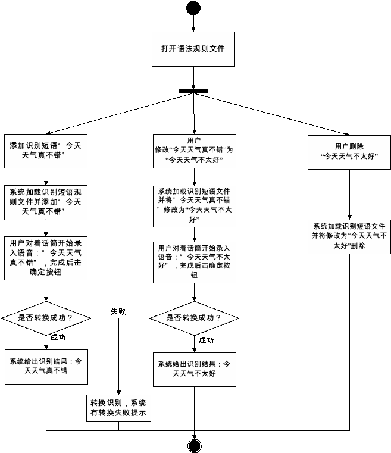
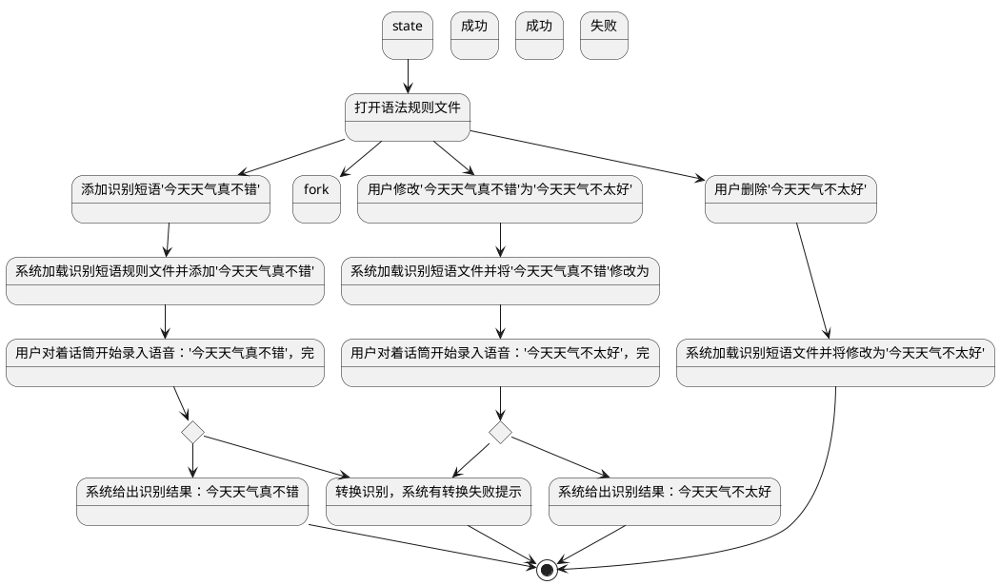
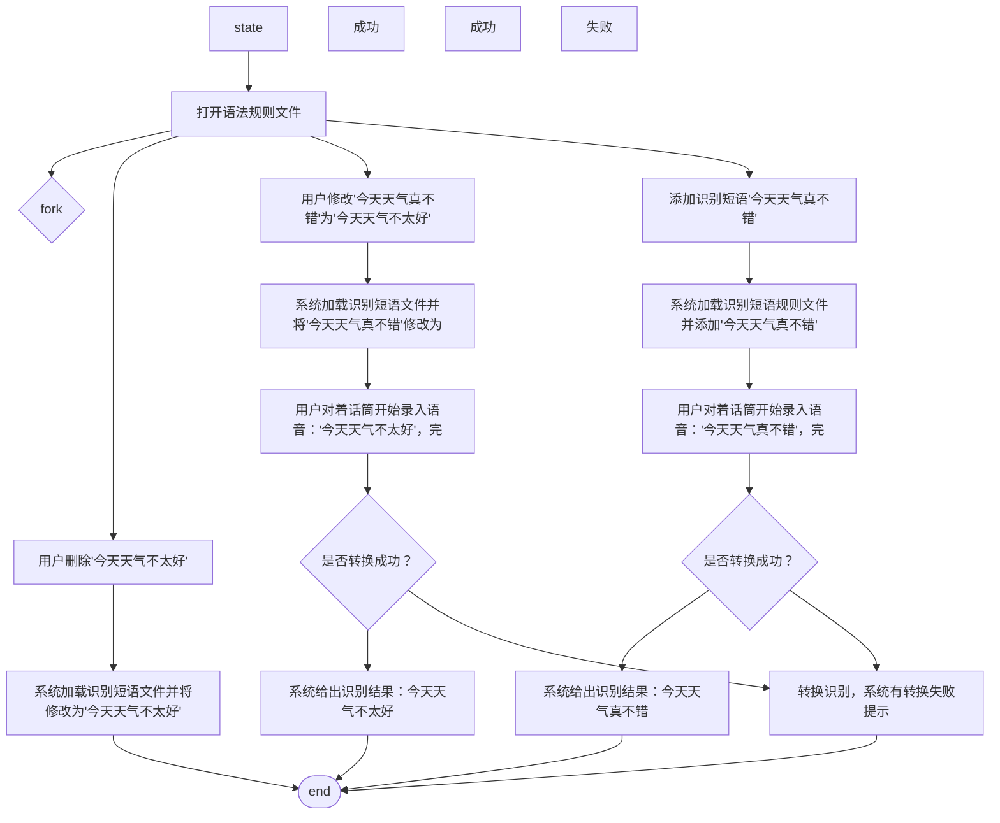
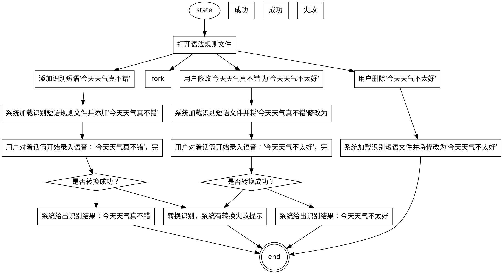

# 1_112 数据对档案

| 字段 | 值 |
|---|---|
| doc | 11语音综合处理软件需求规格说明-终稿 |
| section | 3.2 |
| image_caption | 图16 识别短语管理用例图 |
| table_caption | 表12 识别短语定制能力标识 |

## 原始图片

*图16 识别短语管理用例图*

## 结构图

*⚠ 结构经census重对齐: 旧锚点(oleObject19.bin:page1.xml)与图片不符, 已切换到与image.png内容一致的锚点(oleObject16.bin:page1.xml, align_score=0.824)*

*来源: born-digital导出(flowchart, 17节点/20边)*
*类型经几何启发式精化(Master类型识别失败的图, 投影层推断, canonical锚点不变)*

*状态图以PlantUML渲染(UML母语): [*]=起止 | 圆角框=状态 | 箭头标签=迁移事件*

Mermaid兼容投影(通用md渲染器可显示)

DOT源码(完整语义, graphviz可渲染)

### 锚点节点结构

| # | 文本 | 类型 |
|---|---|---|
| 1 | 添加识别短语“今天天气真不错” | process |
| 2 |   | state |
| 3 | 打开语法规则文件 | process |
| 4 | 系统加载识别短语规则文件并添加“今天天气真不错” | process |
| 5 | 用户对着话筒开始录入语音：“今天天气真不错”，完 | process |
| 6 |   | fork |
| 7 | 系统给出识别结果：今天天气真不错 | process |
| 8 | 是否转换成功？ | decision |
| 9 | 成功 | other |
| 10 | 用户修改“今天天气真不错”为“今天天气不太好” | process |
| 11 | 系统加载识别短语文件并将“今天天气真不错”修改为 | process |
| 12 | 用户对着话筒开始录入语音：“今天天气不太好”，完 | process |
| 13 | 系统给出识别结果：今天天气不太好 | process |
| 14 | 是否转换成功？ | decision |
| 15 | 成功 | other |
| … | 共20个节点 | |

## 表格内容

| 序号 | Use case名称 | 项目唯一标识符 | 需求描述 | 需求重用 | 方式名称 | 运行状态 | 对应的任务书功能/性能 |
|---|---|---|---|---|---|---|---|
| 1 | 识别短语管理 | PZXQ-GN-YYZHCL-YYSB- | 提供识别短语的管理功能，支持用户按照需求 | 新研 | 桌面 | 集成阶段、运行阶段 | 4.1.3a) |
| 2 | 识别短语生成 | PZXQ-GN-YYZHCL-YYSB- | 依据语法规则构建用于语言解码的BNF文件 | 新研 | 桌面 | 集成阶段、运行阶段 | 4.1.3b) |

## 正文

识别短语定制的主要功能包括：识别短语管理、识别短语生成，功能用例如图14所示。
