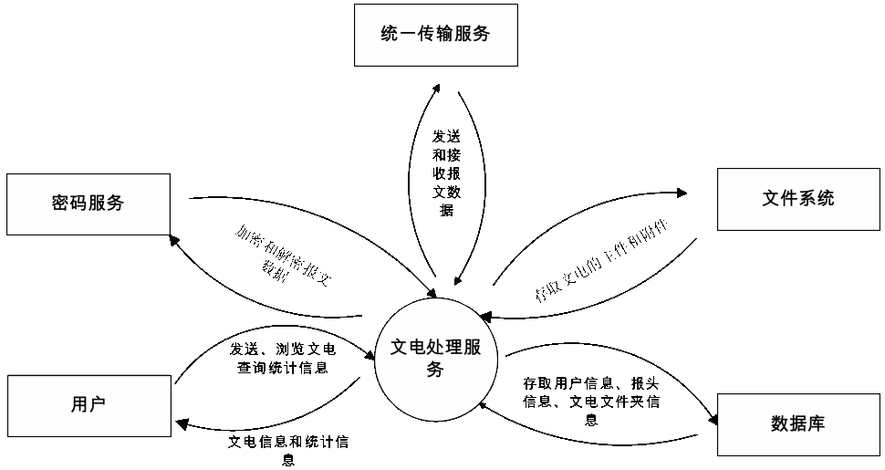
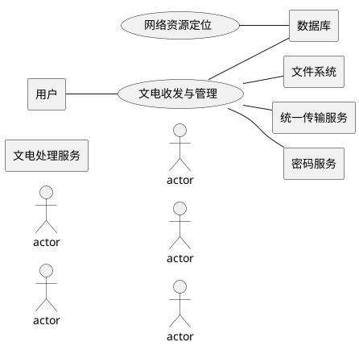
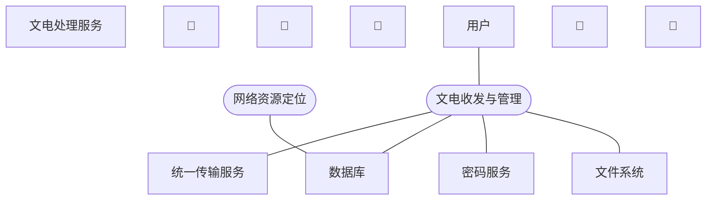
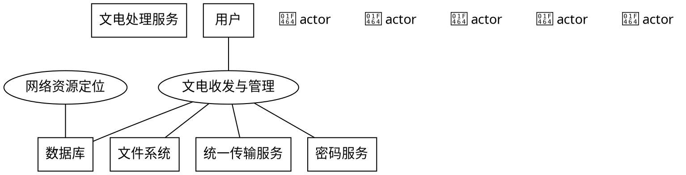

# 1_116 数据对档案

| 字段 | 值 |
|---|---|
| doc | 12文电处理需求规格说明-终端 |
| section | 3.2.2 |
| image_caption | 图 6  文电收发与管理功能用例图 |
| table_caption | 表 7  文电收发与管理功能所有能力标识 |

## 原始图片

*图 6  文电收发与管理功能用例图*

## 结构图

*⚠ 结构经census重对齐: 旧锚点(oleObject4.bin:page1.xml)与图片不符, 已切换到与image.png内容一致的锚点(oleObject3.bin:page1.xml, align_score=0.75)*

*来源: born-digital导出(usecase, 8节点/6边)*
*类型经几何启发式精化(Master类型识别失败的图, 投影层推断, canonical锚点不变)*

*用例图以PlantUML渲染(UML母语): 小人=参与者 | 椭圆=用例 | 矩形框=系统边界 | 实线=关联 | 虚线=include/extend*

Mermaid兼容投影(通用md渲染器可显示)

DOT源码(完整语义, graphviz可渲染)

### 锚点节点结构

| # | 文本 | 类型 |
|---|---|---|
| 1 | 文电处理服务 | process |
| 2 | 网络资源定位 | usecase |
| 3 | 文电收发与管理 | usecase |
| 4 |   | actor |
| 5 | 文件系统 | process |
| 6 |   | actor |
| 7 | 统一传输服务 | process |
| 8 |   | actor |
| 9 | 用户 | process |
| 10 |   | actor |
| 11 | 数据库 | process |
| 12 |   | actor |
| 13 | 密码服务 | process |

## 表格内容

| 序号 | Use case名称 | 项目唯一标识符 | 需求描述 | 需求重用 | 方式 | 运行状态 | 对应的任务书功能/性能 |
|---|---|---|---|---|---|---|---|
|   | 用户登录和退出 | PZXQ-GN-SFGL-DLTC | 支持用户使用用户名/口令认证进行登录，以 | 新研 | 桌面版、平板版 | 运行阶段 |   |
|   | 文电发送 | PZXQ-GN-SFGL-WDFS | 合法用户发送文电，一次发送可以包含多个接 | 新研 | 桌面版、平板版 | 运行阶段 |   |
|   | 文电接收 | PZXQ-GN-SFGL-WDJS | 保存接收的文电，并发送投递成功的通知和来 | 新研 | 桌面版、平板版 | 运行阶段 |   |
|   | 用户管理 | PZXQ-GN-SFGL-YHGL | 增加、删除、修改文电用户的名录信息和文电 | 新研 | 桌面版 | 运行阶段 |   |
|   | 信息查询和管理 | PZXQ-GN-SFGL-CXGL | 按用户名、发送时间范围、接收时间范围和标 | 新研 | 桌面版、平板版 | 运行阶段 |   |
|   | 通讯录查询和管理 | PZXQ-GN-SFGL-TXL | 提供通讯录对联系人进行查询和管理。 | 新研 | 桌面版、平板版 | 运行阶段 |   |
|   | 轻量化部署 | PZXQ-GN-SFGL-QLGBS | 在不超过两台服务器上完成整套系统的轻量级 | 新研 | 桌面版 | 运行阶段 |   |

## 正文

文电处理软件提供文电收发与管理功能，支持插件式应用和B/S客户端应用，包括用户登录和退出、文电发送、文电接收、用户管理、信息统计、信息查询和管理功能，其功能用例如图 6所示。
