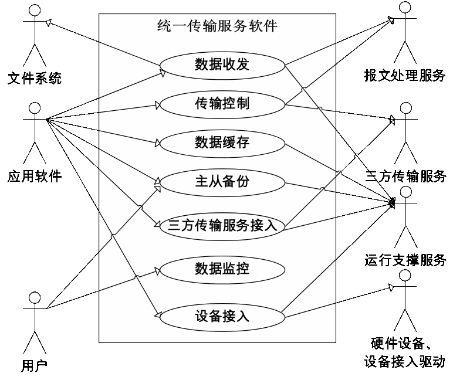
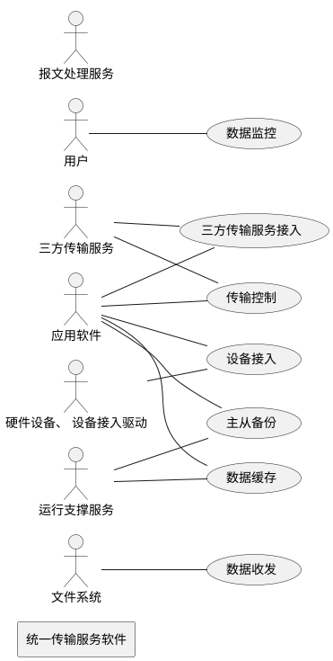
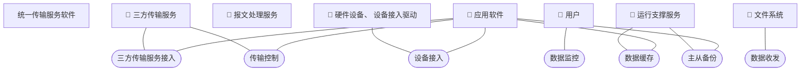

# 1_117 数据对档案

| 字段 | 值 |
|---|---|
| doc | 13统一传输服务软件需求规格说明-终端 |
| section | 3.2 |
| image_caption | 图2 统一传输服务软件用例图 |

## 原始图片

*图2 统一传输服务软件用例图*

## 结构图

*⚠ 结构经census重对齐: 旧锚点(oleObject7.bin:page1.xml)与图片不符, 已切换到与image.png内容一致的锚点(oleObject2.bin:page1.xml, align_score=1.0)*

*来源: born-digital导出(usecase, 15节点/12边)*
*类型经几何启发式精化(Master类型识别失败的图, 投影层推断, canonical锚点不变)*

*用例图以PlantUML渲染(UML母语): 小人=参与者 | 椭圆=用例 | 矩形框=系统边界 | 实线=关联 | 虚线=include/extend*

Mermaid兼容投影(通用md渲染器可显示)

DOT源码(完整语义, graphviz可渲染)

### 锚点节点结构

| # | 文本 | 类型 |
|---|---|---|
| 1 | 统一传输服务软件 | process |
| 2 | 数据收发 | usecase |
| 3 | 传输控制 | usecase |
| 4 | 设备接入 | usecase |
| 5 | 三方传输服务接入 | usecase |
| 6 | 数据缓存 | usecase |
| 7 | 主从备份 | usecase |
| 8 | 数据监控 | usecase |
| 9 | 三方传输服务 | actor |
| 10 | 报文处理服务 | actor |
| 11 | 硬件设备、
设备接入驱动 | actor |
| 12 | 用户 | actor |
| 13 | 应用软件 | actor |
| 14 | 运行支撑服务 | actor |
| 15 | 文件系统 | actor |

## 表格内容

| 序号 | Use case名称 | 项目唯一标识符 | 需求描述 | 需求重用 | 方式名称 | 运行状态 | 对应的任务书功能/性能 |
|---|---|---|---|---|---|---|---|
| 1 | 数据收发 | PZXQ-GN-SJSF | 提供话音业务数据的收发功能； 提供流媒体 | 沿用 | 桌面版、平板版、手持版 | 运行状态 | 4.1.1/4.2 a) |
| 2 | 传输控制 | PZXQ-GN-CSKZ | 提供根据应用需求选择传输策略（可靠性、优 | 沿用 | 桌面版、平板版、手持版 | 运行状态 | 4.1.2 |
| 3 | 数据缓存 | PZXQ-GN-SJHC | 提供非结构化数据的本地临时缓存功能，支持 | 改进 | 桌面版、平板版、手持版 | 运行状态 | 4.1.3/4.2b) |
| 4 | 主从备份 | PZXQ-GN-ZCBF | 提供主从服务器上传输服务之间互为备份的功 | 新研 | 桌面版、平板版、手持版 | 运行状态 | 4.1.4 |
| 5 | 三方传输服务接入 | PZXQ-GN-SFCSFWJR | 提供三方传输服务接入的功能，提供通用传输 | 改进 | 桌面版、平板版、手持版 | 运行状态 | 4.1.5 |
| 6 | 设备接入 | PZXQ-GN-SBJR | 提供网络设备物理接入的功能，支持以UDP | 沿用 | 桌面版、平板版、手持版 | 运行状态 | 4.1.6 |
| 7 | 数据监控 | PZXQ-GN-SJJK | 提供对局域网内传输服务状态信息的采集功能 | 沿用 | 桌面版、平板版 | 运行状态 | 4.1.7 |
