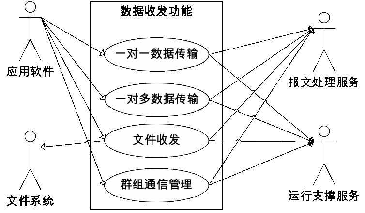
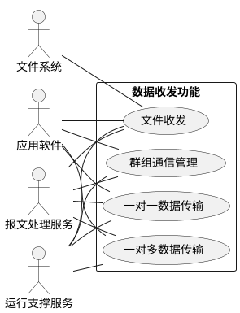
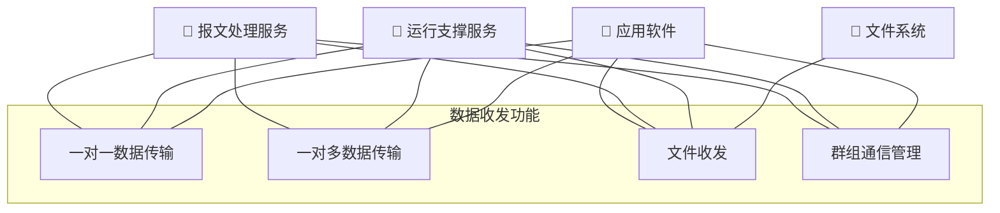
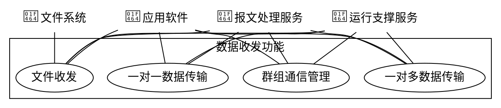

# 1_118 数据对档案

| 字段 | 值 |
|---|---|
| doc | 13统一传输服务软件需求规格说明-终端 |
| section | 3.2.1 |
| image_caption | 图3 数据收发功能用例图 |
| table_caption | 表3 数据收发功能所有能力标识 |

## 原始图片

*图3 数据收发功能用例图*

## 结构图

*来源: born-digital导出(usecase, 9节点/13边)*
*类型经几何启发式精化(Master类型识别失败的图, 投影层推断, canonical锚点不变)*

*用例图以PlantUML渲染(UML母语): 小人=参与者 | 椭圆=用例 | 矩形框=系统边界 | 实线=关联 | 虚线=include/extend*

Mermaid兼容投影(通用md渲染器可显示)

DOT源码(完整语义, graphviz可渲染)

*锚点Connect重建存在1个悬空连线端点, 已几何恢复1条边(连线自由端吸附最近语义节点, 每条带距离证据, via=dangling_snap; canonical锚点不变)*

### 锚点节点结构

| # | 文本 | 类型 |
|---|---|---|
| 1 | 应用软件 | actor |
| 2 | 数据收发功能 | boundary |
| 3 | 一对一数据传输 | process |
| 4 | 一对多数据传输 | process |
| 5 | 文件收发 | process |
| 6 | 群组通信管理 | process |
| 7 | 文件系统 | actor |
| 8 | 报文处理服务 | actor |
| 9 | 运行支撑服务 | actor |

## 表格内容

| 序号 | Use case名称 | 项目唯一标识符 | 需求描述 | 需求重用 | 方式名称 | 运行状态 | 对应的任务书功能/性能 |
|---|---|---|---|---|---|---|---|
|   | 一对一数据传输 | PZXQ-GN-SJSF-YDYSJCS | 提供一对一的数据传输功能，支持应用软件按 | 沿用 | 桌面版、平板版、手持版 | 运行阶段 |   |
|   | 一对多数据传输 | PZXQ-GN-SJSF-YDDSJCS | 提供一对多的数据传输功能，支持应用软件按 | 沿用 | 桌面版、平板版、手持版 | 运行阶段 |   |
|   | 文件收发 | PZXQ-GN-SJSF-WJSF | 提供不同格式的文件收发功能，支持文件发送 | 沿用 | 桌面版、平板版、手持版 | 运行阶段 |   |
|   | 群组通信管理 | PZXQ-GN-SJSF-QZTXGL | 提供群组通信管理功能，支持应用软件创建群 | 沿用 | 桌面版、平板版、手持版 | 运行阶段 |   |

## 正文

数据收发功能所有能力标识表，见表3。
