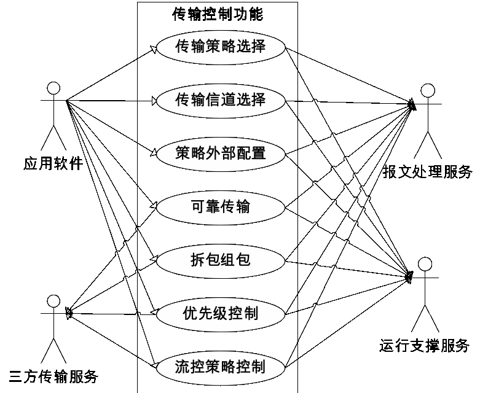
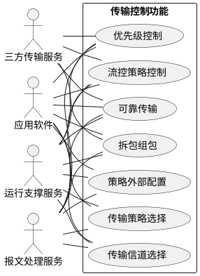
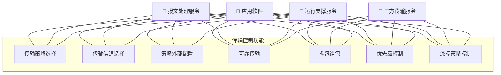
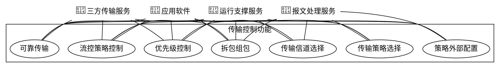

# 1_119 数据对档案

| 字段 | 值 |
|---|---|
| doc | 13统一传输服务软件需求规格说明-终端 |
| section | 3.2.2 |
| image_caption | 图4 传输控制功能用例图 |
| table_caption | 表8 传输控制功能所有能力标识 |

## 原始图片

*图4 传输控制功能用例图*

## 结构图

*来源: born-digital导出(usecase, 12节点/25边)*
*类型经几何启发式精化(Master类型识别失败的图, 投影层推断, canonical锚点不变)*

*用例图以PlantUML渲染(UML母语): 小人=参与者 | 椭圆=用例 | 矩形框=系统边界 | 实线=关联 | 虚线=include/extend*

Mermaid兼容投影(通用md渲染器可显示)

DOT源码(完整语义, graphviz可渲染)

### 锚点节点结构

| # | 文本 | 类型 |
|---|---|---|
| 1 | 传输控制功能 | boundary |
| 2 | 传输策略选择 | process |
| 3 | 传输信道选择 | process |
| 4 | 策略外部配置 | process |
| 5 | 可靠传输 | process |
| 6 | 拆包组包 | process |
| 7 | 优先级控制 | process |
| 8 | 流控策略控制 | process |
| 9 | 应用软件 | actor |
| 10 | 三方传输服务 | actor |
| 11 | 运行支撑服务 | actor |
| 12 | 报文处理服务 | actor |

## 表格内容

| 序号 | Use case名称 | 项目唯一标识符 | 需求描述 | 需求重用 | 方式名称 | 运行状态 | 对应的任务书功能/性能 |
|---|---|---|---|---|---|---|---|
|   | 传输信道选择 | PZXQ-GN-CSKZ-CSXDXZ | 提供根据应用需求、网络状态选择三方传输服 | 沿用 | 桌面版、平板版、手持版 | 运行阶段 | 4.1.2 a) |

## 正文

传输控制功能所有能力标识表，见表8。
