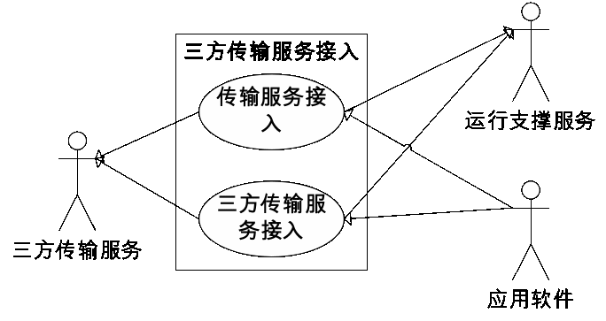

# 1_122 数据对档案

| 字段 | 值 |
|---|---|
| doc | 13统一传输服务软件需求规格说明-终端 |
| section | 3.2.5 |
| image_caption | 图7 三方传输服务接入功能用例图 |
| table_caption | 表16 三方传输服务接入功能所有能力标识 |

## 原始图片

*图7 三方传输服务接入功能用例图*

## 结构图

*该对无Visio锚点(非Visio图, 无born-digital导出)*

## 表格内容

| 序号 | Use case名称 | 项目唯一标识符 | 需求描述 | 需求重用 | 方式名称 | 运行状态 | 对应的任务书功能/性能 |
|---|---|---|---|---|---|---|---|
|   | 传输服务接入 | PZXQ-GN-SFCSFWJR-XYC | 提供传输服务接入的功能，支持等传输服务的 | 改进 | 桌面版、平板版、手持版 | 运行阶段 | 4.1.5 a) |
|   | 三方传输服务接入 | PZXQ-GN-SFCSFWJR-SFC | 提供三方传输服务接入的功能，提供通用传输 | 改进 | 桌面版、平板版、手持版 | 运行阶段 | 4.1.5 b) |

## 正文

三方传输服务接入功能主要提供与传输接入和与三方传输接入的功能，其功能用例如图7所示。
