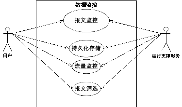
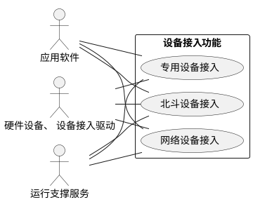
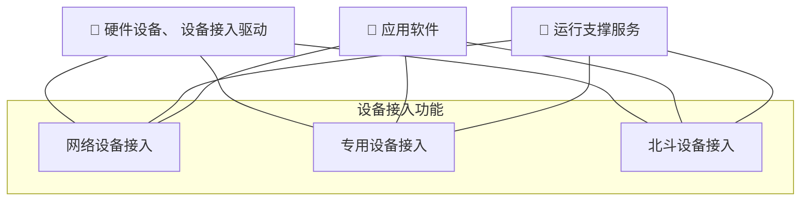
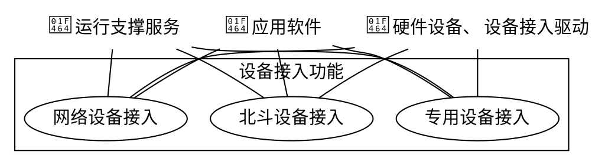

# 1_123 数据对档案

| 字段 | 值 |
|---|---|
| doc | 13统一传输服务软件需求规格说明-终端 |
| section | 3.2.6 |
| image_caption | 图8 设备接入功能用例图 |
| table_caption | 表19 设备接入功能所有能力标识 |

## 原始图片

*图8 设备接入功能用例图*

## 结构图

*来源: born-digital导出(usecase, 7节点/9边)*
*类型经几何启发式精化(Master类型识别失败的图, 投影层推断, canonical锚点不变)*

*用例图以PlantUML渲染(UML母语): 小人=参与者 | 椭圆=用例 | 矩形框=系统边界 | 实线=关联 | 虚线=include/extend*

Mermaid兼容投影(通用md渲染器可显示)

DOT源码(完整语义, graphviz可渲染)

### 锚点节点结构

| # | 文本 | 类型 |
|---|---|---|
| 1 | 设备接入功能 | boundary |
| 2 | 网络设备接入 | process |
| 3 | 专用设备接入 | process |
| 4 | 北斗设备接入 | process |
| 5 | 硬件设备、
设备接入驱动 | actor |
| 6 | 运行支撑服务 | actor |
| 7 | 应用软件 | actor |

## 表格内容

| 序号 | Use case名称 | 项目唯一标识符 | 需求描述 | 需求重用 | 方式名称 | 运行状态 | 对应的任务书功能/性能 |
|---|---|---|---|---|---|---|---|
|   | 网络设备接入 | PZXQ-GN-SBJR-WLSBJR | 提供网络设备物理接入的功能，支持以UDP | 沿用 | 桌面版、平板版、手持版 | 运行阶段 | 4.1.6 a) |
|   | 专用设备接入 | PZXQ-GN-SBJR-ZYSBJR | 提供专用设备驱动软件接入的功能，支持专用 | 沿用 | 桌面版、平板版、手持版 | 运行阶段 | 4.1.6 b) /4.2 c) |
|   | 北斗设备接入 | PZXQ-GN-SBJR-BDSBJR | 提供北斗设备接入服务软件接入的功能； | 沿用 | 桌面版、平板版、手持版 | 运行阶段 | 4.1.6 c) /4.2 c) |

## 正文

设备接入功能所有能力标识表，见表19。
