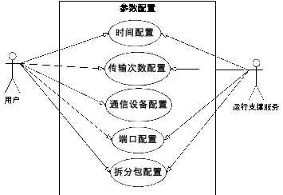
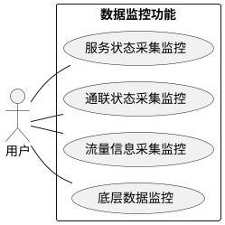
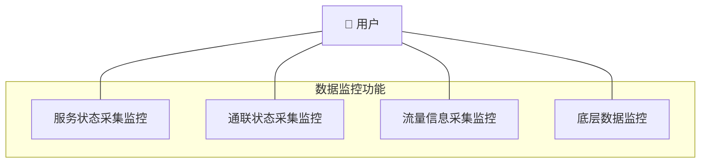
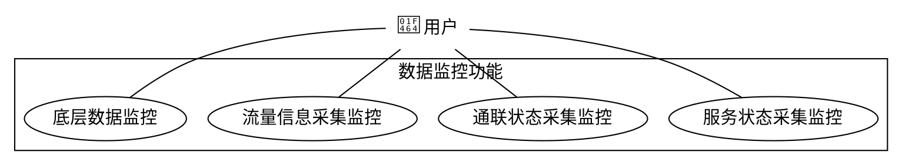

# 1_124 数据对档案

| 字段 | 值 |
|---|---|
| doc | 13统一传输服务软件需求规格说明-终端 |
| section | 3.2.7 |
| image_caption | 图9 数据监控功能用例图 |
| table_caption | 表23 数据监控功能所有能力标识 |

## 原始图片

*图9 数据监控功能用例图*

## 结构图

*来源: born-digital导出(usecase, 6节点/4边)*
*类型经几何启发式精化(Master类型识别失败的图, 投影层推断, canonical锚点不变)*

*用例图以PlantUML渲染(UML母语): 小人=参与者 | 椭圆=用例 | 矩形框=系统边界 | 实线=关联 | 虚线=include/extend*

Mermaid兼容投影(通用md渲染器可显示)

DOT源码(完整语义, graphviz可渲染)

### 锚点节点结构

| # | 文本 | 类型 |
|---|---|---|
| 1 | 用户 | actor |
| 2 | 数据监控功能 | boundary |
| 3 | 服务状态采集监控 | process |
| 4 | 通联状态采集监控 | process |
| 5 | 流量信息采集监控 | process |
| 6 | 底层数据监控 | process |

## 表格内容

| 序号 | Use case名称 | 项目唯一标识符 | 需求描述 | 需求重用 | 方式名称 | 运行阶段 | 对应的任务书功能/性能 |
|---|---|---|---|---|---|---|---|
|   | 服务状态采集监控 | PZXQ-GN-SJJK-FWZTCJJ | 提供对局域网内传输服务状态信息的采集功能 | 沿用 | 桌面版、平板版 | 运行阶段 | 4.1.7 a) |
|   | 流量信息采集监控 | PZXQ-GN-SJJK-LLXXCJJ | 提供对局域网内数据流量信息的采集和统计显 | 沿用 | 桌面版、平板版 | 运行阶段 | 4.1.7 b) |
|   | 通联状态采集监控 | PZXQ-GN-SJJK-TLZTCJJ | 提供对局域网内传输服务间通联状态的采集和 | 沿用 | 桌面版、平板版 | 运行阶段 | 4.1.7 c) |
|   | 底层数据监控 | PZXQ-GN-SJJK-DCSJJK | 提供对三方传输服务数据交互状态的监控功能 | 沿用 | 桌面版、平板版 | 运行阶段 | 4.1.7 d) |

## 正文

数据监控功能所有能力标识表，见表23。
