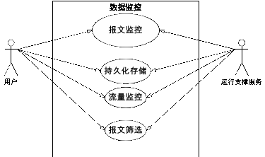

# 1_127 数据对档案

| 字段 | 值 |
|---|---|
| doc | 14传输服务软件需求规格说明-终稿 |
| section | 3.2.2 |
| image_caption | 图6 数据监控用例图 |
| table_caption | 表10 计划组织管理所有能力标识 |

## 原始图片

*图6 数据监控用例图*

## 结构图

*该对无Visio锚点(非Visio图, 无born-digital导出)*

## 表格内容

| 序号 | Use case名称 | 项目唯一标识符 | 需求描述 | 需求重用 | 方式 | 运行状态 | 对应的任务书功能/性能 |
|---|---|---|---|---|---|---|---|
| 1 | 报文监控 | PZXQ-GN-SJJK-BWJK | 能够对收端和发端的数据监控，可以解析传输 | 沿用 | 桌面版、平板版、手持版 | 运行阶段 | 4.1.5 a) /4.2 a)b) |
| 2 | 持久化存储 | PZXQ-GN-SJJK-CJHCC | 能够将监控信息存储到本地日志文件，用于历 | 沿用 | 桌面版、平板版、手持版 | 运行阶段 | 4.1.5 b) /4.2 a)b) |
| 3 | 流量监控 | PZXQ-GN-SJJK-LLJK | 能够监控实时流量，可以观察到各时间点流量 | 沿用 | 桌面版、平板版、手持版 | 运行阶段 | 4.1.5 c) /4.2 a)b) |
| 4 | 报文筛选 | PZXQ-GN-SJJK-BWSX | 能够根据报文协议中的关键字段筛选相关报文 | 沿用 | 桌面版、平板版、手持版 | 运行阶段 | 4.1.5 d) /4.2 a)b) |

## 正文

数据监控功能包括报文监控、持久化存储、流量监控、报文筛选，其功能用例如图6所示。
