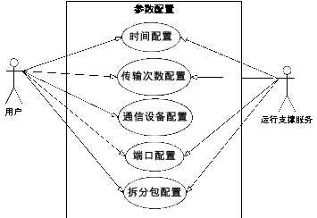
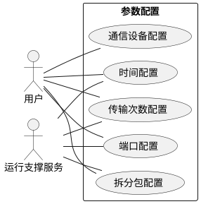
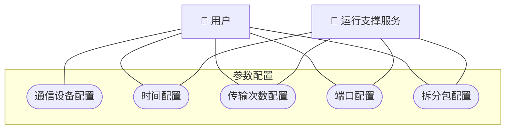

# 1_128 数据对档案

| 字段 | 值 |
|---|---|
| doc | 14传输服务软件需求规格说明-终稿 |
| section | 3.2.3 |
| image_caption | 图7 参数配置用例图 |
| table_caption | 表15 参数配置所有能力标识 |

## 原始图片

*图7 参数配置用例图*

## 结构图

*来源: born-digital导出(usecase, 8节点/9边)*
*类型经几何启发式精化(Master类型识别失败的图, 投影层推断, canonical锚点不变)*

*用例图以PlantUML渲染(UML母语): 小人=参与者 | 椭圆=用例 | 矩形框=系统边界 | 实线=关联 | 虚线=include/extend*

Mermaid兼容投影(通用md渲染器可显示)

DOT源码(完整语义, graphviz可渲染)

### 锚点节点结构

| # | 文本 | 类型 |
|---|---|---|
| 1 | 用户 | actor |
| 2 | 通信设备配置 | usecase |
| 3 | 时间配置 | usecase |
| 4 | 传输次数配置 | usecase |
| 5 | 参数配置 | boundary |
| 6 | 端口配置 | usecase |
| 7 | 拆分包配置 | usecase |
| 8 | 运行支撑服务 | actor |

## 表格内容

| 序号 | Use case名称 | 项目唯一标识符 | 需求描述 | 需求重用 | 方式 | 运行状态 | 对应的任务书功能/性能 |
|---|---|---|---|---|---|---|---|
|   | 时间配置 | PZXQ-GN-CSPZ-SJPZ | 能够在传输服务运行条件下动态配置数据超时 | 沿用 | 桌面版、平板版、手持版 | 运行阶段 | 4.1.6 a) /4.2 a)b) |
|   | 传输次数配置 | PZXQ-GN-CSPZ-CSCSPZ | 能够在传输服务运行条件下动态配置最大传输 | 沿用 | 桌面版、平板版、手持版 | 运行阶段 | 4.1.6 b) /4.2 a)b) |
|   | 通信设备配置 | PZXQ-GN-CSPZ-TXSBPZ | 能够在传输服务运行条件下动态配置目的通信 | 沿用 | 桌面版、平板版、手持版 | 运行阶段 | 4.1.6 c) /4.2 a)b) |
|   | 端口配置 | PZXQ-GN-CSPZ-DKPZ | 能够在传输服务运行条件下动态配置与通信设 | 沿用 | 桌面版、平板版、手持版 | 运行阶段 | 4.1.6 d) /4.2 a)b) |
|   | 拆分包配置 | PZXQ-GN-CSPZ-CFBPZ | 能够在传输服务运行条件下动态配置数据拆分 | 沿用 | 桌面版、平板版、手持版 | 运行阶段 | 4.1.6 e) /4.2 a)b) |

## 正文

参数配置功能包括时间配置、传输次数配置、通信设备配置、端口配置、拆分包配置，其功能用例如图7所示。
