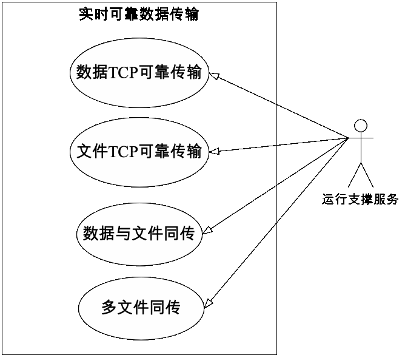
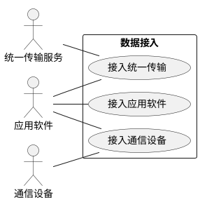
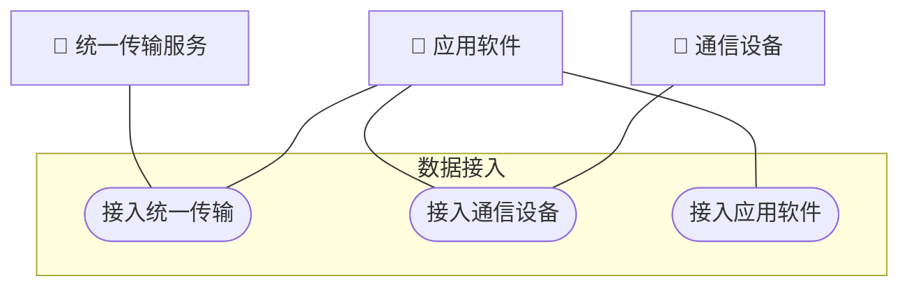
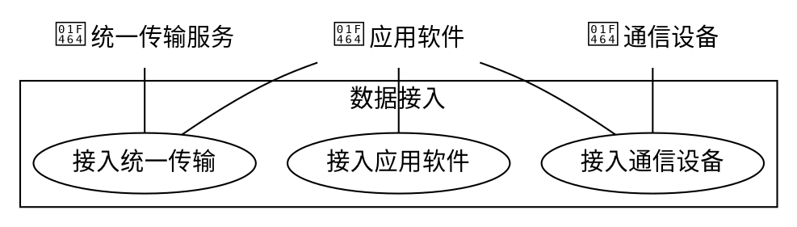

# 1_129 数据对档案

| 字段 | 值 |
|---|---|
| doc | 14传输服务软件需求规格说明-终稿 |
| section | 3.2.6 |
| image_caption | 图8 数据接入用例图 |
| table_caption | 表23 数据接入所有能力标识 |

## 原始图片

*图8 数据接入用例图*

## 结构图

*⚠ 结构经census重对齐: 旧锚点(oleObject2.bin:page1.xml)与图片不符, 已切换到与image.png内容一致的锚点(oleObject8.bin:page1.xml, align_score=0.857)*

*来源: born-digital导出(usecase, 7节点/5边)*
*类型经几何启发式精化(Master类型识别失败的图, 投影层推断, canonical锚点不变)*

*用例图以PlantUML渲染(UML母语): 小人=参与者 | 椭圆=用例 | 矩形框=系统边界 | 实线=关联 | 虚线=include/extend*

Mermaid兼容投影(通用md渲染器可显示)

DOT源码(完整语义, graphviz可渲染)

### 锚点节点结构

| # | 文本 | 类型 |
|---|---|---|
| 1 | 应用软件 | actor |
| 2 | 接入统一传输 | usecase |
| 3 | 接入通信设备 | usecase |
| 4 | 数据接入 | boundary |
| 5 | 统一传输服务 | actor |
| 6 | 通信设备 | actor |
| 7 | 接入应用软件 | usecase |

## 表格内容

| 序号 | Use case名称 | 项目唯一标识符 | 需求描述 | 需求重用 | 状态/方式名称 | 运行状态 | 对应的任务书功能/性能 |
|---|---|---|---|---|---|---|---|
|   | 接入通信设备 | PZXQ-GN-SJJR-JRTYSB | 能够将业务软件数据报文根据通信设备协议， | 沿用 | 桌面版、平板版、手持版 | 运行阶段 | 4.1.1 a) /4.2 a)b) |
|   | 接入统一传输服务 | PZXQ-GN-SJJR-JRTYCS | 能够接收统一传输服务发送的数据并解析用户 | 沿用 | 桌面版、平板版、手持版 | 运行阶段 | 4.1.1 b) /4.2 a)b) |
|   | 接入应用软件 | PZXQ-GN-SJJR-JRYYRJ | 能够接收应用软件发送的数据，并解析协议中 | 沿用 | 桌面版、平板版、手持版 | 运行阶段 | 4.1.1 c) /4.2 a)b) |

## 正文

数据接入功能包括接入统一传输服务、接入通信设备，其功能用例如图8所示。
