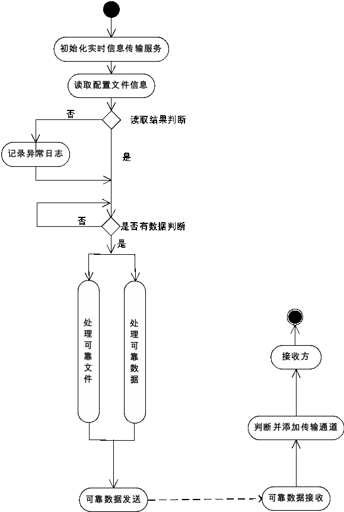
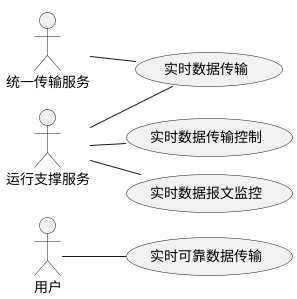
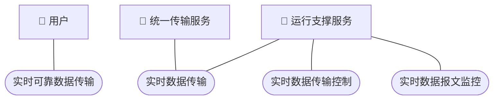

# 1_130 数据对档案

| 字段 | 值 |
|---|---|
| doc | 15实时信息传输服务软件需求规格说明-终稿 |
| section | 3.2 |
| image_caption | 图2实时信息传输服务软件用例图 |
| table_caption | 表2实时信息传输服务软件所有能力标识 |

## 原始图片

*图2实时信息传输服务软件用例图*

## 结构图

*⚠ 结构经census重对齐: 旧锚点(oleObject1.bin:page1.xml)与图片不符, 已切换到与image.png内容一致的锚点(oleObject2.bin:page1.xml, align_score=1.0)*

*来源: born-digital导出(usecase, 7节点/5边)*
*类型经几何启发式精化(Master类型识别失败的图, 投影层推断, canonical锚点不变)*

*用例图以PlantUML渲染(UML母语): 小人=参与者 | 椭圆=用例 | 矩形框=系统边界 | 实线=关联 | 虚线=include/extend*

Mermaid兼容投影(通用md渲染器可显示)

DOT源码(完整语义, graphviz可渲染)

### 锚点节点结构

| # | 文本 | 类型 |
|---|---|---|
| 1 | 用户 | actor |
| 2 | 实时数据传输 | usecase |
| 3 | 实时数据传输控制 | usecase |
| 4 | 实时数据报文监控 | usecase |
| 5 | 统一传输服务 | actor |
| 6 | 运行支撑服务 | actor |
| 7 | 实时可靠数据传输 | usecase |

## 表格内容

| 序号 | Use case名称 | 项目唯一标识符 | 需求描述 | 需求重用 | 方式名称 | 运行状态 | 对应的任务书功能/性能 |
|---|---|---|---|---|---|---|---|
| 1 | 实时数据传输 | PZXQ-GN-SSSJCS | 具备实时数据传输的能力。 | 沿用 | 桌面版、平板版 | 运行阶段 | 4.1.1 |
| 2 | 实时数据传输控制 | PZXQ-GN-SSSJCSKZ | 具备实时数据传输控制的能力。 | 沿用 | 桌面版、平板版 | 运行阶段 | 4.1.2 |
| 3 | 实时可靠数据传输 | PZXQ-GN-SSKKSJCS | 具备实时可靠数据和文件的传输能力 | 沿用 | 桌面版、平板版 | 运行阶段 | 4.1.3 |
| 4 | 实时数据报文监控 | PZXQ-GN-SSSJBWJK | 具备监控收发端数据传输协议信息和正文信息 | 沿用 | 桌面版、平板版 | 运行阶段 | 4.1.4 |

## 正文

实时信息传输服务软件按照其功能需求，包含实时数据传输、实时数据传输控制、实时可靠数据传输、实时数据报文监控功能。
