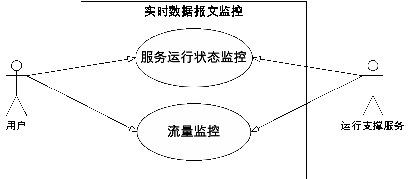
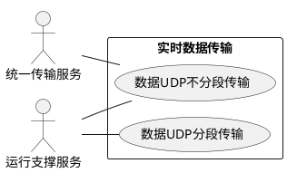
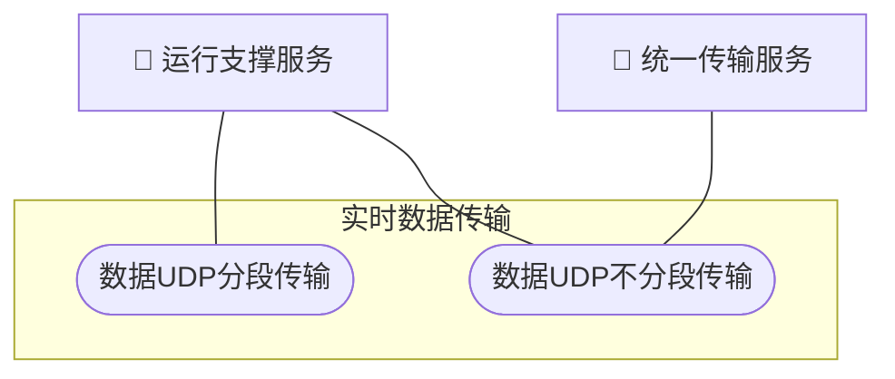
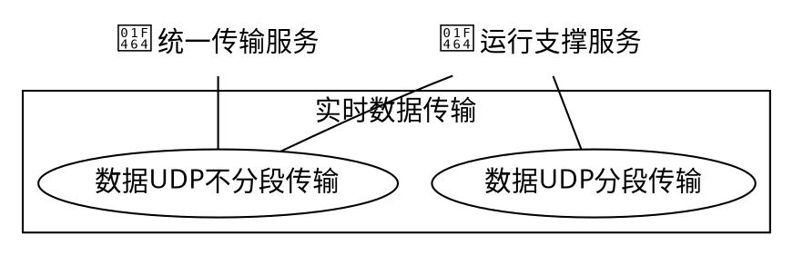

# 1_131 数据对档案

| 字段 | 值 |
|---|---|
| doc | 15实时信息传输服务软件需求规格说明-终稿 |
| section | 3.2.1 |
| image_caption | 图4实时数据传输用例图 |
| table_caption | 表3实时数据传输所有能力标识 |

## 原始图片

*图4实时数据传输用例图*

## 结构图

*来源: born-digital导出(usecase, 5节点/3边)*
*类型经几何启发式精化(Master类型识别失败的图, 投影层推断, canonical锚点不变)*

*用例图以PlantUML渲染(UML母语): 小人=参与者 | 椭圆=用例 | 矩形框=系统边界 | 实线=关联 | 虚线=include/extend*

Mermaid兼容投影(通用md渲染器可显示)

DOT源码(完整语义, graphviz可渲染)

### 锚点节点结构

| # | 文本 | 类型 |
|---|---|---|
| 1 | 统一传输服务 | actor |
| 2 | 运行支撑服务 | actor |
| 3 | 数据UDP分段传输 | usecase |
| 4 | 实时数据传输 | boundary |
| 5 | 数据UDP不分段传输 | usecase |

## 表格内容

| 序号 | Use case名称 | 项目唯一标识符 | 需求描述 | 需求重用 | 方式名称 | 运行状态 | 对应的任务书功能/性能 |
|---|---|---|---|---|---|---|---|
|   | 数据UDP不分段传输 | PZXQ-GN-SSSJCS-SJUDP | 能够支撑实时信息数据的不分段UDP传输 | 沿用 | 桌面版、平板版 | 运行阶段 | 4.1.1 a) |
|   | 数据UDP分段传输 | PZXQ-GN-SSSJCS-SJUDP | 能够支撑实时信息数据的分段UDP传输； | 沿用 | 桌面版、平板版 | 运行阶段 | 4.1.1 b) |

## 正文

实时数据传输包括数据UDP不分段传输、数据UDP分段传输，其功能用例如图4所示。
