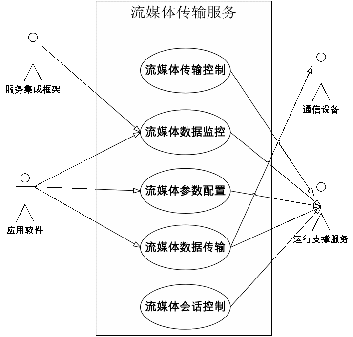
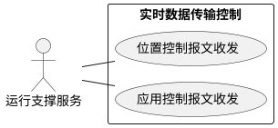
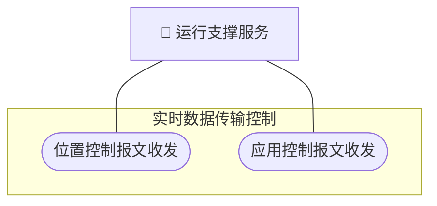
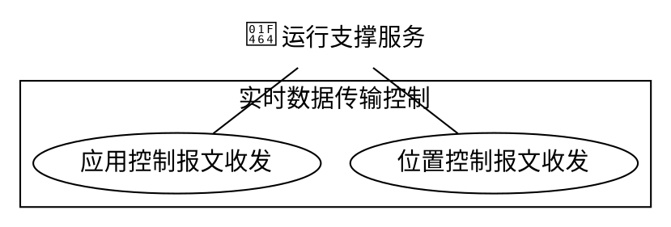

# 1_132 数据对档案

| 字段 | 值 |
|---|---|
| doc | 15实时信息传输服务软件需求规格说明-终稿 |
| section | 3.2.2 |
| image_caption | 图6实时数据传输控制用例图 |
| table_caption | 表6实时控制报文传输功能所有能力标识 |

## 原始图片

*图6实时数据传输控制用例图*

## 结构图

*来源: born-digital导出(usecase, 4节点/2边)*
*类型经几何启发式精化(Master类型识别失败的图, 投影层推断, canonical锚点不变)*

*用例图以PlantUML渲染(UML母语): 小人=参与者 | 椭圆=用例 | 矩形框=系统边界 | 实线=关联 | 虚线=include/extend*

Mermaid兼容投影(通用md渲染器可显示)

DOT源码(完整语义, graphviz可渲染)

### 锚点节点结构

| # | 文本 | 类型 |
|---|---|---|
| 1 | 运行支撑服务 | actor |
| 2 | 位置控制报文收发 | usecase |
| 3 | 实时数据传输控制 | boundary |
| 4 | 应用控制报文收发 | usecase |

## 表格内容

| 序号 | Use case名称 | 项目唯一标识符 | 需求描述 | 需求重用 | 方式名称 | 运行状态 | 对应的任务书功能/性能 |
|---|---|---|---|---|---|---|---|
|   | 位置控制报文收发 | PZXQ-GN-SSSJCSKZ-WZK | 能够支撑实时位置控制报文的收发功能； | 沿用 | 桌面版、平板版 | 运行阶段 | 4.1.2 a) |
|   | 应用控制报文收发 | PZXQ-GN-SSSJCSKZ-YYK | 能够支撑实时应用控制报文的收发 | 沿用 | 桌面版、平板版 | 运行阶段 | 4.1.2 b) |

## 正文

实时数据传输控制包含位置控制报文收发、应用控制报文收发，其功能用例如图6所示。
