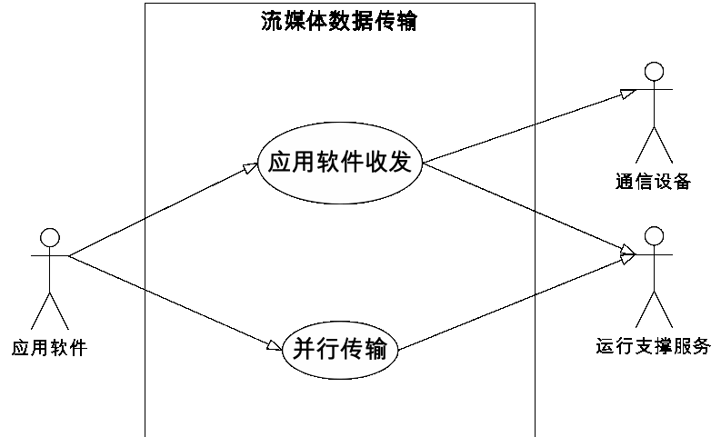
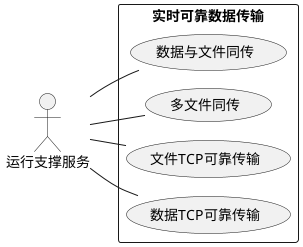
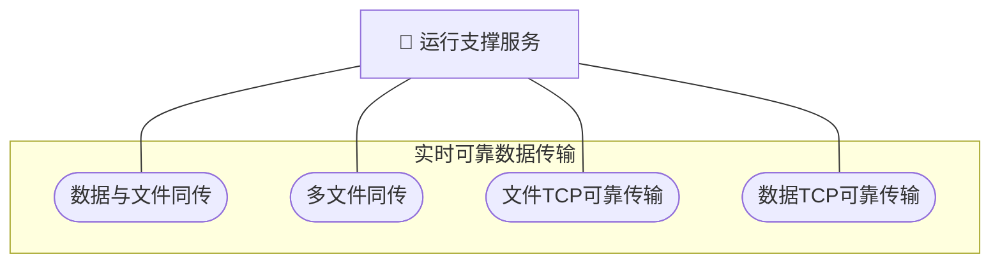
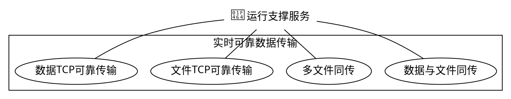

# 1_133 数据对档案

| 字段 | 值 |
|---|---|
| doc | 15实时信息传输服务软件需求规格说明-终稿 |
| section | 3.2.3 |
| image_caption | 图7实时可靠数据传输用例图 |
| table_caption | 表9实时可靠数据传输所有能力标识 |

## 原始图片

*图7实时可靠数据传输用例图*

## 结构图

*来源: born-digital导出(usecase, 6节点/4边)*
*类型经几何启发式精化(Master类型识别失败的图, 投影层推断, canonical锚点不变)*

*用例图以PlantUML渲染(UML母语): 小人=参与者 | 椭圆=用例 | 矩形框=系统边界 | 实线=关联 | 虚线=include/extend*

Mermaid兼容投影(通用md渲染器可显示)

DOT源码(完整语义, graphviz可渲染)

### 锚点节点结构

| # | 文本 | 类型 |
|---|---|---|
| 1 | 运行支撑服务 | actor |
| 2 | 数据与文件同传 | usecase |
| 3 | 实时可靠数据传输 | boundary |
| 4 | 多文件同传 | usecase |
| 5 | 文件TCP可靠传输 | usecase |
| 6 | 数据TCP可靠传输 | usecase |

## 表格内容

| 序号 | Use case名称 | 项目唯一标识符 | 需求描述 | 需求重用 | 方式名称 | 运行状态 | 对应的任务书功能/性能 |
|---|---|---|---|---|---|---|---|
| 1 | 数据TCP可靠传输 | PZXQ-GN-SSKKSJCS-SJT | 能够支撑实时数据的TCP可靠传输功能 | 沿用 | 桌面版、平板版 | 运行阶段 | 4.1.3 a) |
| 2 | 文件TCP可靠传输 | PZXQ-GN-SSKKSJCS-WJT | 能够支撑实时信息文件TCP可靠传输功能 | 沿用 | 桌面版、平板版 | 运行阶段 | 4.1.3 b) |
| 3 | 数据与文件同传 | PZXQ-GN-SSKKSJCS-SJY | 能够支撑实时信息数据和文件的同传功能； | 沿用 | 桌面版、平板版 | 运行阶段 | 4.1.3 c) |
| 4 | 多文件同传 | PZXQ-GN-SSKKSJCS-DWJ | 能够支撑实时信息多个文件的同传功能； | 沿用 | 桌面版、平板版 | 运行阶段 | 4.1.3 d) |

## 正文

实时可靠数据传输包括数据TCP可靠传输、文件TCP可靠传输、数据与文件同传、多文件同传，其功能用例如图7所示。
