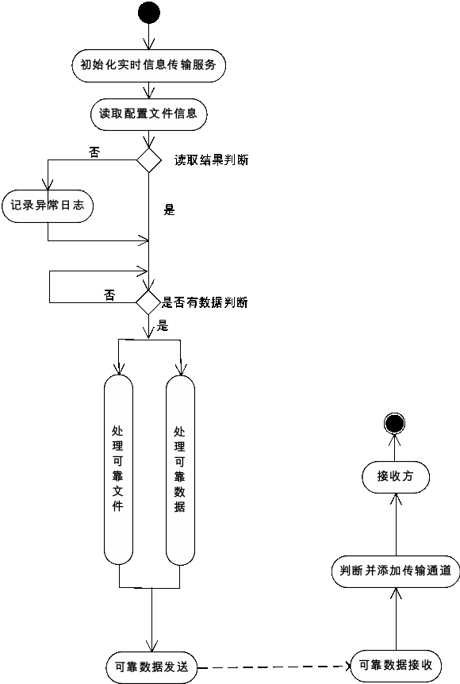
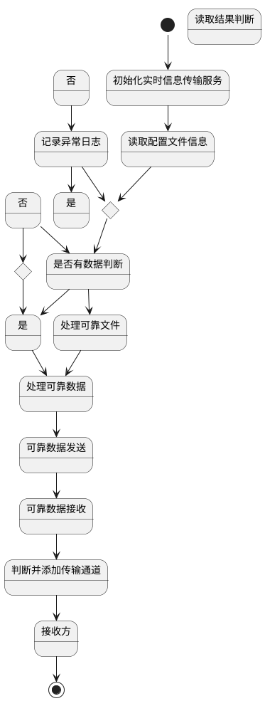
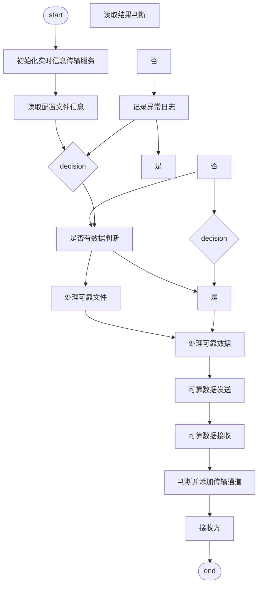
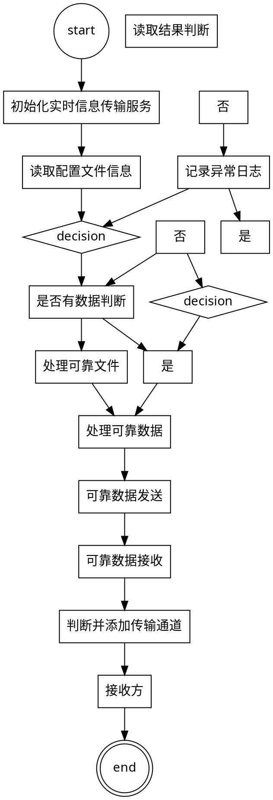

# 1_134 数据对档案

| 字段 | 值 |
|---|---|
| doc | 15实时信息传输服务软件需求规格说明-终稿 |
| section | 3.2.3 |
| image_caption | 图8实时可靠数据传输流程用例图 |
| table_caption | 表9实时可靠数据传输所有能力标识 |

## 原始图片

*图8实时可靠数据传输流程用例图*

## 结构图

*来源: born-digital导出(flowchart, 15节点/19边)*
*类型经几何启发式精化(Master类型识别失败的图, 投影层推断, canonical锚点不变)*

*状态图以PlantUML渲染(UML母语): [*]=起止 | 圆角框=状态 | 箭头标签=迁移事件*

Mermaid兼容投影(通用md渲染器可显示)

DOT源码(完整语义, graphviz可渲染)

*锚点Connect重建存在10个悬空连线端点, 已几何恢复8条边(连线自由端吸附最近语义节点, 每条带距离证据, via=dangling_snap; canonical锚点不变)*

### 锚点节点结构

| # | 文本 | 类型 |
|---|---|---|
| 1 |   | start |
| 2 | 初始化实时信息传输服务 | process |
| 3 | 记录异常日志 | process |
| 4 | 读取配置文件信息 | process |
| 5 |   | decision |
| 6 | 读取结果判断 | other |
| 7 | 否 | other |
| 8 | 是 | other |
| 9 |   | decision |
| 10 | 是否有数据判断 | other |
| 11 | 否 | other |
| 12 | 是 | other |
| 13 | 可靠数据发送 | process |
| 14 | 可靠数据接收 | process |
| 15 | 判断并添加传输通道 | process |
| … | 共19个节点 | |

## 表格内容

| 序号 | Use case名称 | 项目唯一标识符 | 需求描述 | 需求重用 | 方式名称 | 运行状态 | 对应的任务书功能/性能 |
|---|---|---|---|---|---|---|---|
| 1 | 数据TCP可靠传输 | PZXQ-GN-SSKKSJCS-SJT | 能够支撑实时数据的TCP可靠传输功能 | 沿用 | 桌面版、平板版 | 运行阶段 | 4.1.3 a) |
| 2 | 文件TCP可靠传输 | PZXQ-GN-SSKKSJCS-WJT | 能够支撑实时信息文件TCP可靠传输功能 | 沿用 | 桌面版、平板版 | 运行阶段 | 4.1.3 b) |
| 3 | 数据与文件同传 | PZXQ-GN-SSKKSJCS-SJY | 能够支撑实时信息数据和文件的同传功能； | 沿用 | 桌面版、平板版 | 运行阶段 | 4.1.3 c) |
| 4 | 多文件同传 | PZXQ-GN-SSKKSJCS-DWJ | 能够支撑实时信息多个文件的同传功能； | 沿用 | 桌面版、平板版 | 运行阶段 | 4.1.3 d) |

## 正文

实时可靠数据传输包括数据TCP可靠传输、文件TCP可靠传输、数据与文件同传、多文件同传，其功能用例如图7所示。
