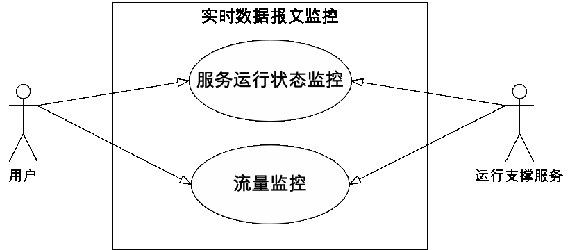
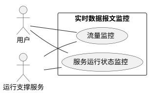
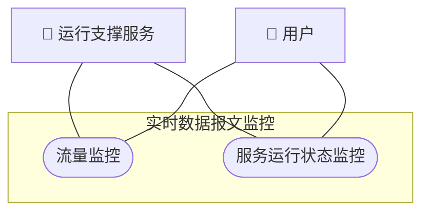
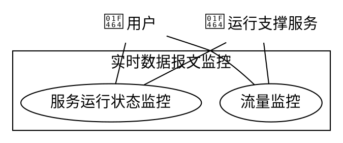

# 1_135 数据对档案

| 字段 | 值 |
|---|---|
| doc | 15实时信息传输服务软件需求规格说明-终稿 |
| section | 3.2.4 |
| image_caption | 图9实时数据报文监控用例图 |
| table_caption | 表14实时数据报文监控所有能力标识 |

## 原始图片

*图9实时数据报文监控用例图*

## 结构图

*来源: born-digital导出(usecase, 5节点/4边)*
*类型经几何启发式精化(Master类型识别失败的图, 投影层推断, canonical锚点不变)*

*用例图以PlantUML渲染(UML母语): 小人=参与者 | 椭圆=用例 | 矩形框=系统边界 | 实线=关联 | 虚线=include/extend*

Mermaid兼容投影(通用md渲染器可显示)

DOT源码(完整语义, graphviz可渲染)

### 锚点节点结构

| # | 文本 | 类型 |
|---|---|---|
| 1 | 用户 | actor |
| 2 | 运行支撑服务 | actor |
| 3 | 流量监控 | usecase |
| 4 | 服务运行状态监控 | usecase |
| 5 | 实时数据报文监控 | boundary |

## 表格内容

| 序号 | Use case名称 | 项目唯一标识符 | 需求描述 | 需求重用 | 方式名称 | 运行状态 | 对应的任务书功能/性能 |
|---|---|---|---|---|---|---|---|
|   | 服务运行状态监控 | PZXQ-GN-SSSJBWJK-FWY | 能够对实时信息传输服务运行状态进行监控 | 沿用 | 桌面版、平板版 | 运行阶段 | 4.1.4 a) |
|   | 流量监控 | PZXQ-GN-SSSJBWJK-LLJ | 能够实时监控应用数据的流向信息 | 沿用 | 桌面版、平板版 | 运行阶段 | 4.1.4 a) |

## 正文

实时数据报文监控功能包括服务运行状态监控、流量监控等功能，其功能用例如图9所示。
