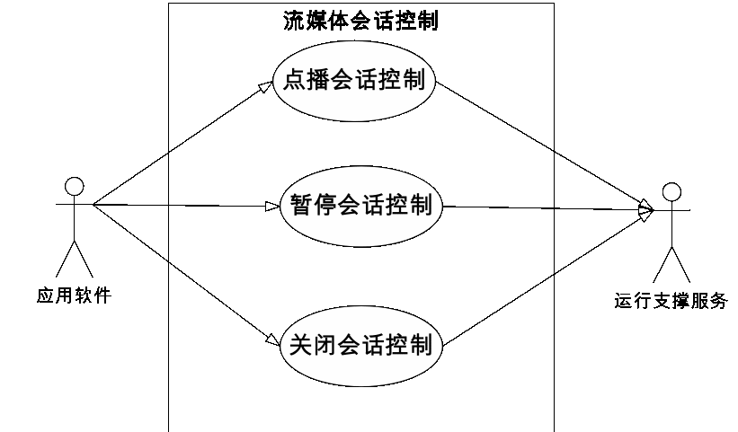
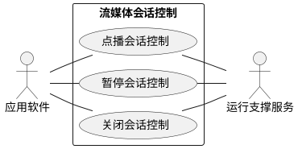
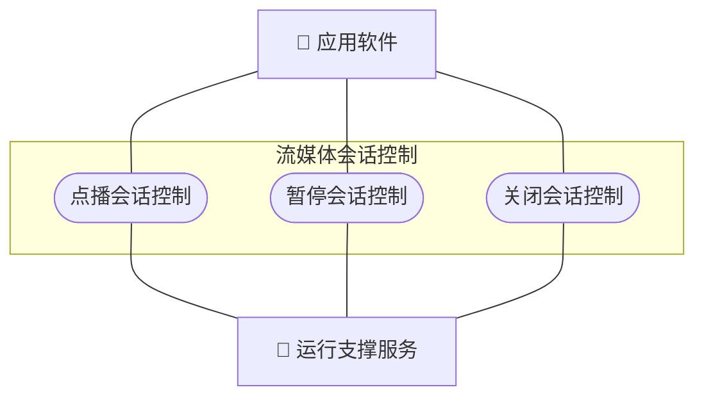
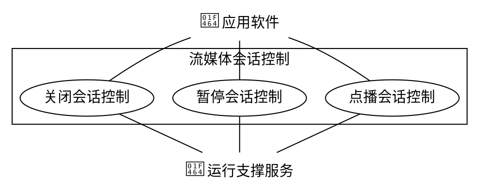

# 1_138 数据对档案

| 字段 | 值 |
|---|---|
| doc | 16流媒体传输服务软件需求规格说明-终稿 |
| section | 3.2.2 |
| image_caption | 图4 流媒体数据传输用例图 |
| table_caption | 表6 流媒体数据传输所有能力标识 |

## 原始图片

*图4 流媒体数据传输用例图*

## 结构图

*来源: born-digital导出(usecase, 6节点/6边)*
*类型经几何启发式精化(Master类型识别失败的图, 投影层推断, canonical锚点不变)*

*用例图以PlantUML渲染(UML母语): 小人=参与者 | 椭圆=用例 | 矩形框=系统边界 | 实线=关联 | 虚线=include/extend*

Mermaid兼容投影(通用md渲染器可显示)

DOT源码(完整语义, graphviz可渲染)

### 锚点节点结构

| # | 文本 | 类型 |
|---|---|---|
| 1 | 点播会话控制 | usecase |
| 2 | 暂停会话控制 | usecase |
| 3 | 流媒体会话控制 | boundary |
| 4 | 关闭会话控制 | usecase |
| 5 | 运行支撑服务 | actor |
| 6 | 应用软件 | actor |

## 表格内容

| 序号 | Use case名称 | 项目唯一标识符 | 需求描述 | 需求重用 | 状态/方式名称 | 运行状态 | 对应的任务书功能/性能 |
|---|---|---|---|---|---|---|---|
|   | 点播会话控制 | PZXQ-GN-LMTHHKZ-DBHH | 提供流媒体会话控制，支持点播会话控制信令 | 沿用 | 桌面版、平板版 | 运行阶段 | 4.1.2 |
|   | 暂停会话控制 | PZXQ-GN-LMTHHKZ-ZTHH | 提供流媒体会话控制，支持暂停会话控制信令 | 沿用 | 桌面版、平板版 | 运行阶段 | 4.1.2 |
|   | 关闭会话控制 | PZXQ-GN-LMTHHKZ-GBHH | 提供流媒体会话控制，支持关闭会话控制信令 | 沿用 | 桌面版、平板版 | 运行阶段 | 4.1.2 |

## 正文

流媒体会话控制功能包括点播会话控制、暂停会话控制、关闭会话控制，其功能用例如图4所示。
