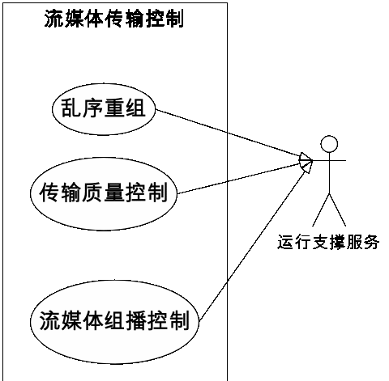
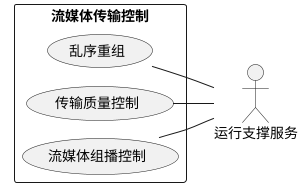
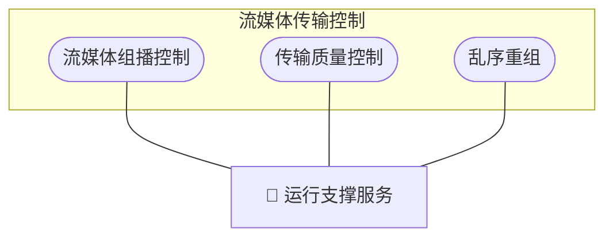
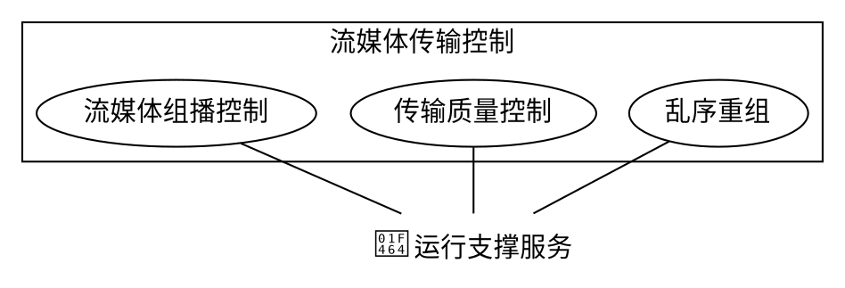

# 1_140 数据对档案

| 字段 | 值 |
|---|---|
| doc | 16流媒体传输服务软件需求规格说明-终稿 |
| section | 3.2.4 |
| image_caption | 图6 流媒体传输控制用例图 |
| table_caption | 表13 流媒体传输控制所有能力标识 |

## 原始图片

*图6 流媒体传输控制用例图*

## 结构图

*来源: born-digital导出(usecase, 5节点/3边)*
*类型经几何启发式精化(Master类型识别失败的图, 投影层推断, canonical锚点不变)*

*用例图以PlantUML渲染(UML母语): 小人=参与者 | 椭圆=用例 | 矩形框=系统边界 | 实线=关联 | 虚线=include/extend*

Mermaid兼容投影(通用md渲染器可显示)

DOT源码(完整语义, graphviz可渲染)

### 锚点节点结构

| # | 文本 | 类型 |
|---|---|---|
| 1 | 运行支撑服务 | actor |
| 2 | 乱序重组 | usecase |
| 3 | 流媒体传输控制 | boundary |
| 4 | 传输质量控制 | usecase |
| 5 | 流媒体组播控制 | usecase |

## 表格内容

| 序号 | Use case名称 | 项目唯一标识符 | 需求描述 | 需求重用 | 方式 | 运行状态 | 对应的任务书功能/性能 |
|---|---|---|---|---|---|---|---|
| 1 | 乱序重组 | PZXQ-GN-LMTCSKZ-LXCZ | 提供数据接收时的乱序重组功能，将流媒体数 | 沿用 | 桌面版、平板版 | 运行阶段 | 4.1.4 a) |
| 2 | 传输质量控制 | PZXQ-GN-LMTCSKZ-CSZL | 能够周期性的发送传输质量控制包 | 沿用 | 桌面版、平板版 | 运行阶段 | 4.1.4 b) |
| 3 | 流媒体组播控制 | PZXQ-GN-LMTCSKZ-LMTZ | 提供流媒体数据流的单播、组播能力 | 沿用 | 桌面版、平板版 | 运行阶段 | 4.1.1 c) |

## 正文

流媒体传输控制功能包括乱序重组、传输质量控制以及流媒体组播控制，其功能用例如图6所示。
