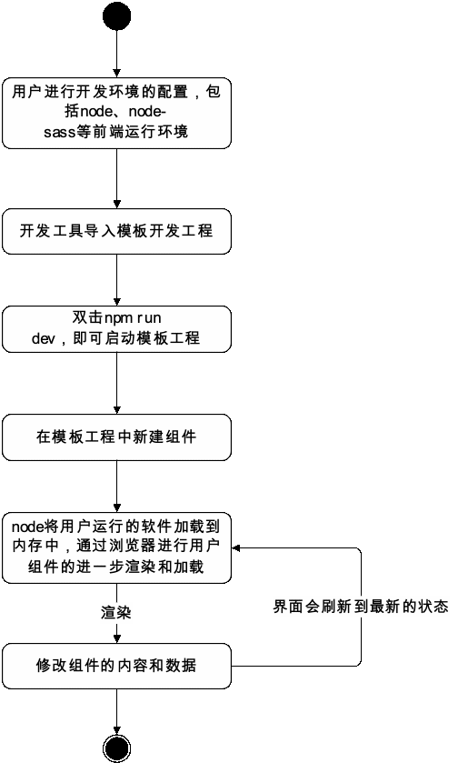
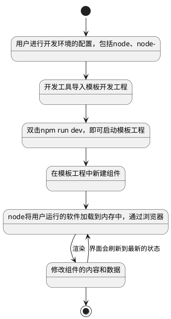
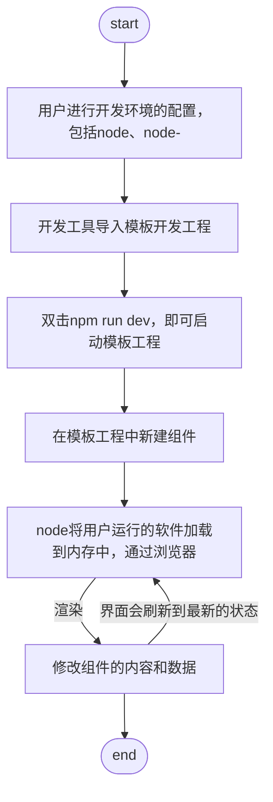

# 2_001 数据对档案

| 字段 | 值 |
|---|---|
| doc | 02界面集成框架软件需求规格说明-终稿 |
| section | 1.8.1.1 |
| image_caption | 图 7开发工程流程图 |
| table_caption | 表4 开发工程生成用例描述 |

## 原始图片


*图 7开发工程流程图*

## 结构图

*来源: born-digital导出(flowchart, 6节点/8边)*
*类型经几何启发式精化(Master类型识别失败的图, 投影层推断, canonical锚点不变)*

*状态图以PlantUML渲染(UML母语): [*]=起止 | 圆角框=状态 | 箭头标签=迁移事件*



<details><summary>Mermaid兼容投影(通用md渲染器可显示)</summary>



</details>

<details><summary>DOT源码(完整语义, graphviz可渲染)</summary>

```dot
digraph G {
  rankdir=TB;
  node [fontname="Microsoft YaHei"];
  N543 [shape=box, label="用户进行开发环境的配置，包括node、node-"];
  N567 [shape=box, label="开发工具导入模板开发工程"];
  N590 [shape=box, label="双击npm run dev，即可启动模板工程"];
  N613 [shape=box, label="在模板工程中新建组件"];
  N636 [shape=box, label="node将用户运行的软件加载到内存中，通过浏览器"];
  N659 [shape=box, label="修改组件的内容和数据"];
  N3237 [shape=circle, label="start"];
  N3238 [shape=doublecircle, label="end"];
  N543 -> N567;
  N659 -> N3238;
  N659 -> N636, label="界面会刷新到最新的状态";
  N636 -> N659, label="渲染";
  N3237 -> N543;
  N567 -> N590;
  N590 -> N613;
  N613 -> N636;
}
```

</details>

### 锚点节点结构

| # | 文本 | 类型 |
|---|---|---|
| 1 | 用户进行开发环境的配置，包括node、node- | process |
| 2 | 开发工具导入模板开发工程 | process |
| 3 | 双击npm run dev，即可启动模板工程 | process |
| 4 | 在模板工程中新建组件 | process |
| 5 | node将用户运行的软件加载到内存中，通过浏览器 | process |
| 6 | 修改组件的内容和数据 | process |
| 7 |   | start |
| 8 |   | end |

## 表格内容

| Use Case 名称：开发工程生成 | Actors：开发人员 |   |
|---|---|---|
| Use Case 名称：开发工程生成 | Actors：开发人员 |   |
| 概述：本用例是开发工程生成的扩展用例，描 |   |   |
| 前置条件：数据库连接正常。 |   |   |
| 主事件流 |   |   |
| Actor的动作 | 系统的动作 | 动作约束 （性能、可靠性、容错等） |
| 1.开发人员打开软件开发ide工具（包括 |   | 1．开发所用的运行环境内存需要大于等于4 |
| 2．在工程中找到package.json |   |
|   | 3. node将用户运行的软件加载到内存 |
| 4．在模板工程中新建组件 |   |
| 5．修改组件的内容和数据 |   |
|   | 6．用户修改界面后，浏览器里的组件会同步 |
|   | 7.用例结束 |
| 异常流E1：组件无法被正常加载，用例结束 |   |   |
| 后置条件：无。 |   |   |

## 正文

开发工程生成是提供用户进行基于界面框架二次开发的模板工程，提供界面组件开发模板生成功能，支持应用软件基于模板开发界面组件。
