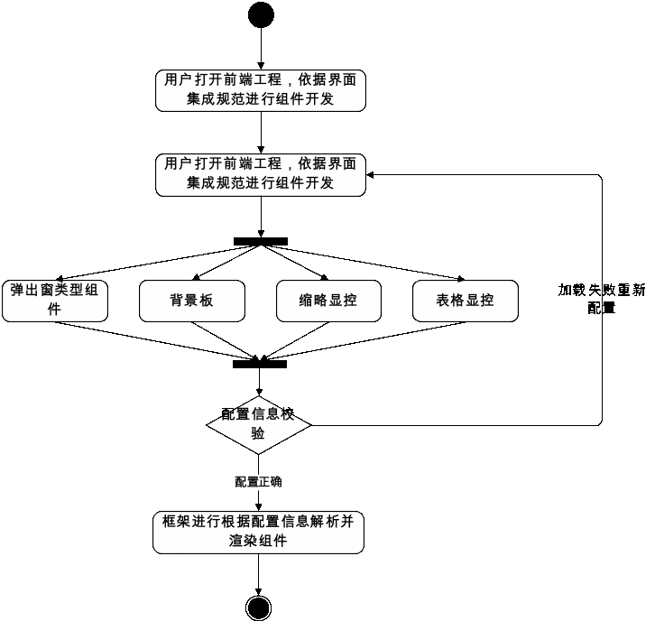
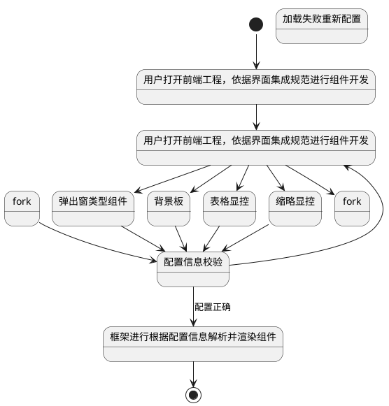
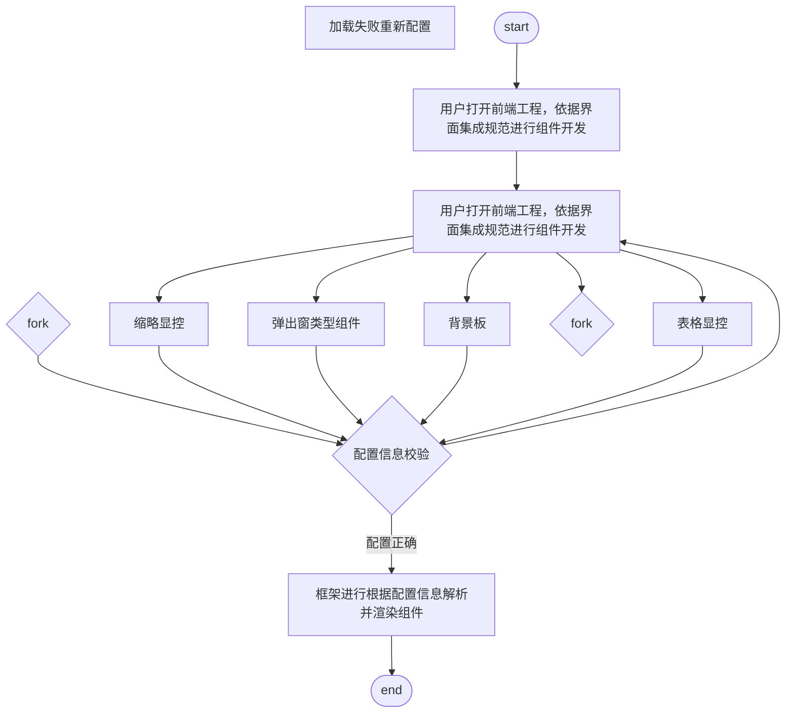

# 2_002 数据对档案

| 字段 | 值 |
|---|---|
| doc | 02界面集成框架软件需求规格说明-终稿 |
| section | 1.8.1.2 |
| image_caption | 图 8组件配置流程图 |
| table_caption | 表5 组件配置管理用例描述 |

## 原始图片


*图 8组件配置流程图*

## 结构图

*来源: born-digital导出(flowchart, 9节点/15边)*
*类型经几何启发式精化(Master类型识别失败的图, 投影层推断, canonical锚点不变)*

*状态图以PlantUML渲染(UML母语): [*]=起止 | 圆角框=状态 | 箭头标签=迁移事件*



<details><summary>Mermaid兼容投影(通用md渲染器可显示)</summary>



</details>

<details><summary>DOT源码(完整语义, graphviz可渲染)</summary>

```dot
digraph G {
  rankdir=TB;
  node [fontname="Microsoft YaHei"];
  N718 [shape=box, label="用户打开前端工程，依据界面集成规范进行组件开发"];
  N741 [shape=box, label="用户打开前端工程，依据界面集成规范进行组件开发"];
  N764 [shape=box, label="弹出窗类型组件"];
  N787 [shape=box, label="背景板"];
  N810 [shape=box, label="表格显控"];
  N833 [shape=box, label="缩略显控"];
  N873 [shape=box, label="框架进行根据配置信息解析并渲染组件"];
  N896 [shape=box, label="配置信息校验"];
  N914 [shape=box, label="加载失败重新配置"];
  N3241 [shape=circle, label="start"];
  N3242 [shape=doublecircle, label="end"];
  N4108 [shape=box, label="fork"];
  N4118 [shape=box, label="fork"];
  N4118 -> N896;
  N833 -> N896;
  N764 -> N896;
  N787 -> N896;
  N810 -> N896;
  N741 -> N787;
  N741 -> N810;
  N741 -> N833;
  N741 -> N764;
  N896 -> N873, label="配置正确";
  N873 -> N3242;
  N3241 -> N718;
  N718 -> N741;
  N741 -> N4108;
  N896 -> N741;
}
```

</details>

### 锚点节点结构

| # | 文本 | 类型 |
|---|---|---|
| 1 | 用户打开前端工程，依据界面集成规范进行组件开发 | process |
| 2 | 用户打开前端工程，依据界面集成规范进行组件开发 | process |
| 3 | 弹出窗类型组件 | process |
| 4 | 背景板 | process |
| 5 | 表格显控 | process |
| 6 | 缩略显控 | process |
| 7 | 框架进行根据配置信息解析并渲染组件 | process |
| 8 | 配置信息校验 | gateway |
| 9 | 加载失败重新配置 | other |
| 10 |   | start |
| 11 |   | end |
| 12 |   | fork |
| 13 |   | fork |

## 表格内容

| Use Case 名称：组件的配置填写 | Actors：开发人员 |   |
|---|---|---|
| Use Case 名称：组件的配置填写 | Actors：开发人员 |   |
| 概述：本用例是组件的配置填写扩展用例，描 |   |   |
| 前置条件：无。 |   |   |
| 主事件流 |   |   |
| Actor的动作 | 系统的动作 | 动作约束 （性能、可靠性、容错等） |
| 1．开发人员打开前端工程 |   | 1.面向用户提供编辑输入的软件在对输入输 |
| 2．开发人员进行组件的开发工作 |   |
| 3．开发组件完毕之后，在工程的main. |   |
| 4．打开esplug.json文件，按照 |   |
| 5．开发人员在开发工程下执行npm ru |   |
|   | 6．系统将用户开发好的组件加载到内存中， |
| 7．启动前端工程，并且在浏览器中打开前端 |   |
|   | 8.界面集成框架按照用户填写的esplu |
|   | 9．系统将用户配置的组件，按照配置信息显 |
| 异常流E1：组件无法被正常加载，用例结束 |   |   |
| 后置条件：无。 |   |   |

## 正文

组件配置填写提供界面组件配置功能，能够对组件配置文件进行编辑，支持应用按照预定义类型（弹出窗、背景板、表格显控、缩略显控等）设置界面组件展示形态。
