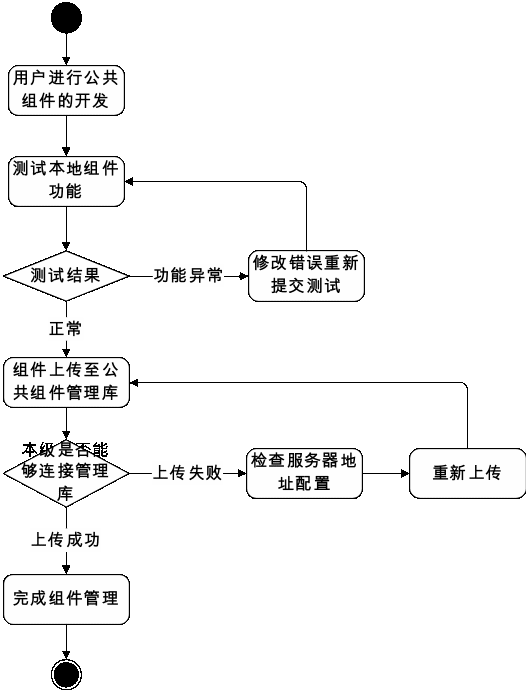
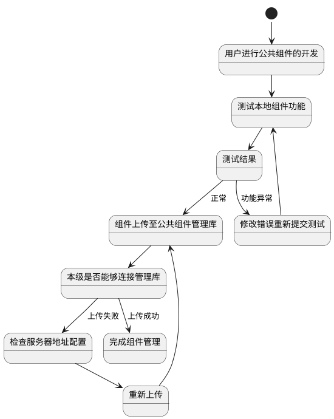
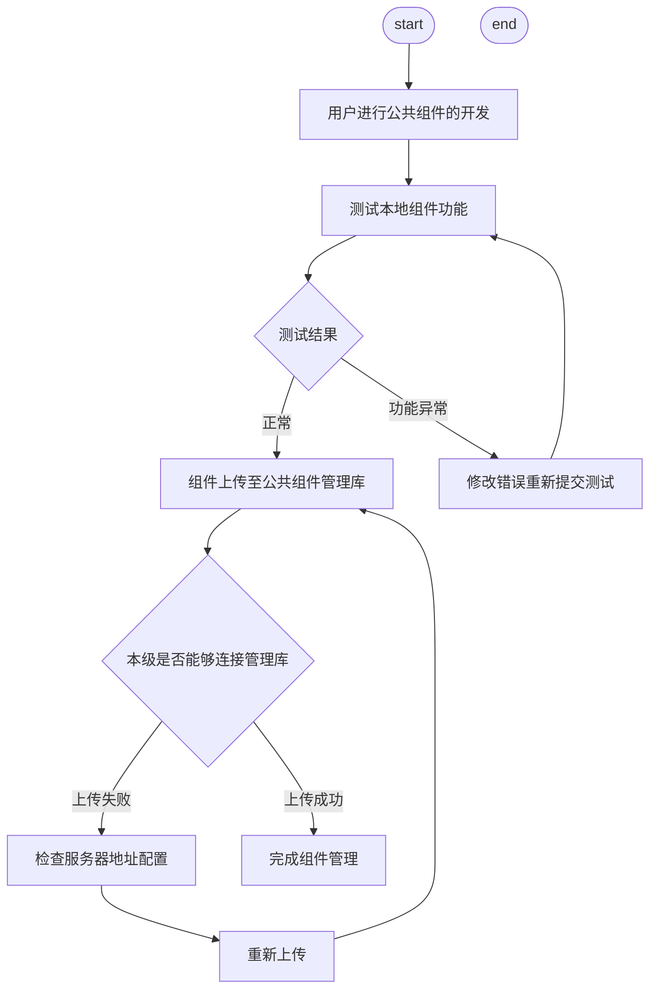

# 2_003 数据对档案

| 字段 | 值 |
|---|---|
| doc | 02界面集成框架软件需求规格说明-终稿 |
| section | 1.8.1.3 |
| image_caption | 图 9公共组件管理流程图 |
| table_caption | 表6 公共组件管理用例描述 |

## 原始图片


*图 9公共组件管理流程图*

## 结构图

*来源: born-digital导出(flowchart, 9节点/11边)*
*类型经几何启发式精化(Master类型识别失败的图, 投影层推断, canonical锚点不变)*

*状态图以PlantUML渲染(UML母语): [*]=起止 | 圆角框=状态 | 箭头标签=迁移事件*



<details><summary>Mermaid兼容投影(通用md渲染器可显示)</summary>



</details>

<details><summary>DOT源码(完整语义, graphviz可渲染)</summary>

```dot
digraph G {
  rankdir=TB;
  node [fontname="Microsoft YaHei"];
  N3271 [shape=box, label="用户进行公共组件的开发"];
  N3294 [shape=box, label="测试结果"];
  N3309 [shape=box, label="组件上传至公共组件管理库"];
  N3332 [shape=box, label="本级是否能够连接管理库"];
  N3347 [shape=box, label="检查服务器地址配置"];
  N3395 [shape=circle, label="start"];
  N3396 [shape=doublecircle, label="end"];
  N3401 [shape=box, label="完成组件管理"];
  N4126 [shape=box, label="测试本地组件功能"];
  N4149 [shape=box, label="修改错误重新提交测试"];
  N4173 [shape=box, label="重新上传"];
  N4173 -> N3309;
  N4149 -> N4126;
  N3271 -> N4126;
  N3347 -> N4173;
  N3332 -> N3401, label="上传成功";
  N3332 -> N3347, label="上传失败";
  N3309 -> N3332;
  N3395 -> N3271;
  N4126 -> N3294;
  N3294 -> N4149, label="功能异常";
  N3294 -> N3309, label="正常";
}
```

</details>

*⚠ 锚点Connect重建存在1个悬空连线端点(线端粘在无文本形状上被语义过滤跳过), 图示边数可能少于原图——渲染只呈现锚点事实, 不编造边; 独立证据可对照VLM通道提取(scene_vlm_extractions.json)*

### 锚点节点结构

| # | 文本 | 类型 |
|---|---|---|
| 1 | 用户进行公共组件的开发 | process |
| 2 | 测试结果 | gateway |
| 3 | 组件上传至公共组件管理库 | process |
| 4 | 本级是否能够连接管理库 | gateway |
| 5 | 检查服务器地址配置 | process |
| 6 |   | start |
| 7 |   | end |
| 8 | 完成组件管理 | process |
| 9 | 测试本地组件功能 | process |
| 10 | 修改错误重新提交测试 | process |
| 11 | 重新上传 | process |

## 表格内容

| Use Case 名称：公共组件管理用例 | Actors：开发人员 |   |
|---|---|---|
| Use Case 名称：公共组件管理用例 | Actors：开发人员 |   |
| 概述：本用例是公共组件管理的扩展用例，描 |   |   |
| 前置条件：数据库连接正常。 |   |   |
| 主事件流 |   |   |
| Actor的动作 | 系统的动作 | 动作约束 （性能、可靠性、容错等） |
| 1.用户提供已经开发好的组件。 |   | 1.软件应使用运维支撑服务提供的日志接口 |
| 2.用户ping公共组件管理服务器，查看 |   |
|   | 3．控制台显示客户端与服务器之间的联通状 |
| 4．用户在开发工程中执行npm run  |   |
|   | 5．系统将用户开发好的组件加载到内存中。 |
|   | 6．系统识别到用户界面上写好的公共组件的 |
| 7．用户明确提供自己组件所对外暴露的接口 |   |
| 8．用户通过npm上传到框架的公共组件管 |   |
| 9．界面集成框架对于公共类型的组件进行二 |   |
|   | 10．系统将用户开发好的第三方公共组件， |
| 11．用户调用由框架提供的第三方的UI控 |   |
|   | 12．系统提供用户公共组件的标签和接口， |
| 13．用户将公共组件通过npm inst |   |
| 异常流E1：服务器与客户端无法连接，用例 |   |   |
| 后置条件：无。 |   |   |

## 正文

开发工程生成是提供用户进行基于界面框架二次开发的模板工程，提供界面组件开发模板生成功能，支持应用软件基于模板开发界面组件。
