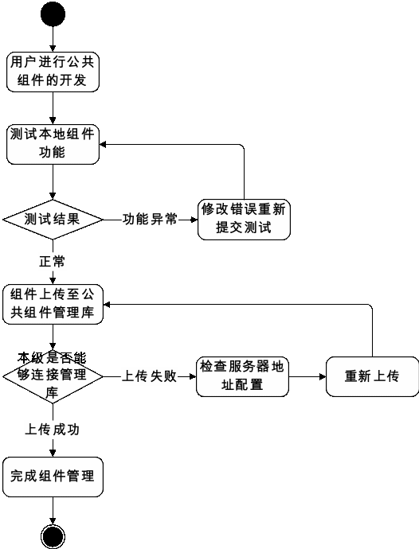
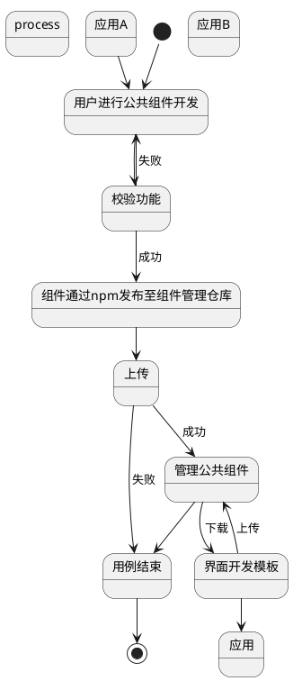
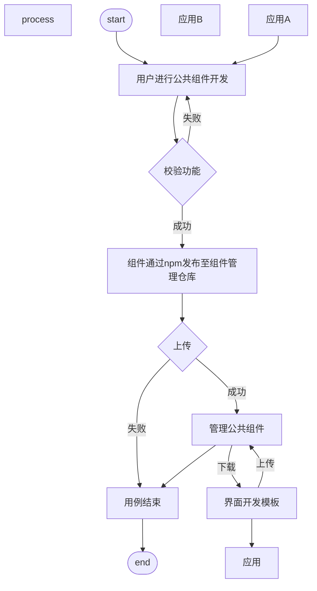

# 2_004 数据对档案

| 字段 | 值 |
|---|---|
| doc | 02界面集成框架软件需求规格说明-终稿 |
| section | 1.8.1.4 |
| image_caption | 图 10组件下载管理流程图 |
| table_caption | 表7 组件下载管理用例描述 |

## 原始图片


*图 10组件下载管理流程图*

## 结构图

*来源: born-digital导出(flowchart, 10节点/13边)*
*类型经几何启发式精化(Master类型识别失败的图, 投影层推断, canonical锚点不变)*

*状态图以PlantUML渲染(UML母语): [*]=起止 | 圆角框=状态 | 箭头标签=迁移事件*



<details><summary>Mermaid兼容投影(通用md渲染器可显示)</summary>



</details>

<details><summary>DOT源码(完整语义, graphviz可渲染)</summary>

```dot
digraph G {
  rankdir=TB;
  node [fontname="Microsoft YaHei"];
  N3427 [shape=box, label="process"];
  N3441 [shape=box, label="用户进行公共组件开发"];
  N3464 [shape=box, label="校验功能"];
  N3480 [shape=box, label="组件通过npm发布至组件管理仓库"];
  N3504 [shape=box, label="界面开发模板"];
  N3527 [shape=box, label="上传"];
  N3542 [shape=box, label="应用A"];
  N3565 [shape=box, label="应用B"];
  N3588 [shape=box, label="应用"];
  N3641 [shape=circle, label="start"];
  N3642 [shape=doublecircle, label="end"];
  N3643 [shape=box, label="用例结束"];
  N4197 [shape=box, label="管理公共组件"];
  N3441 -> N3464;
  N3643 -> N3642;
  N4197 -> N3643;
  N3641 -> N3441;
  N3527 -> N3643, label="失败";
  N3464 -> N3441, label="失败";
  N4197 -> N3504, label="下载";
  N3464 -> N3480, label="成功";
  N3527 -> N4197, label="成功";
  N3504 -> N4197, label="上传";
  N3504 -> N3588;
  N3542 -> N3441;
  N3480 -> N3527;
}
```

</details>

*锚点Connect重建存在4个悬空连线端点, 已几何恢复3条边(连线自由端吸附最近语义节点, 每条带距离证据, via=dangling_snap; canonical锚点不变)*

### 锚点节点结构

| # | 文本 | 类型 |
|---|---|---|
| 1 |   | process |
| 2 | 用户进行公共组件开发 | process |
| 3 | 校验功能 | gateway |
| 4 | 组件通过npm发布至组件管理仓库 | process |
| 5 | 界面开发模板 | process |
| 6 | 上传 | gateway |
| 7 | 应用A | process |
| 8 | 应用B | process |
| 9 | 应用 | process |
| 10 |   | start |
| 11 |   | end |
| 12 | 用例结束 | process |
| 13 | 管理公共组件 | process |

## 表格内容

| Use Case 名称：组件下载管理 | Actors：开发人员 |   |
|---|---|---|
| Use Case 名称：组件下载管理 | Actors：开发人员 |   |
| 概述：本用例是组件下载管理的扩展用例，描 |   |   |
| 前置条件：软件运行正常。能够正常连接公共 |   |   |
| 主事件流 |   |   |
| Actor的动作 | 系统的动作 | 动作约束 （性能、可靠性、容错等） |
| 1.用户ping公共组件管理服务器，查看 |   | 软件异常时，可根据日志中记录的失效原因、 |
|   | 2.控制台显示客户端与服务器之间的联通状 |
| 3.用户安装nodejs运行环境 |   |
| 4.用户通过npm install的方式 |   |
|   | 5.公共组件管理服务器进行响应，将客户端 |
| 6.用户安装最新的界面集成框架依赖。查看 |   |
| 7.用户在开发工程中执行npm run  |   |
|   | 8.界面集成框架将组件中填写的公共组件标 |
| 9.用户观察公共组件是否能够正常的显示和 |   |
| 异常流E1：服务器与客户端无法连接，用例 |   |   |
| 后置条件：无。 |   |   |

## 正文

开发工程生成是提供用户进行基于界面框架二次开发的模板工程，提供界面组件开发模板生成功能，支持应用软件基于模板开发界面组件。
