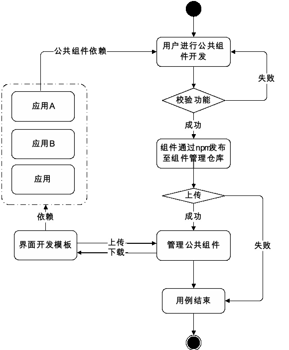
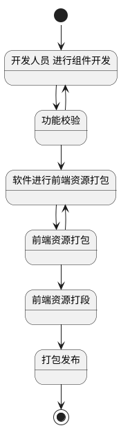
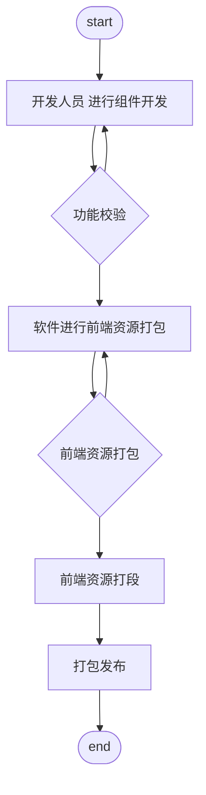
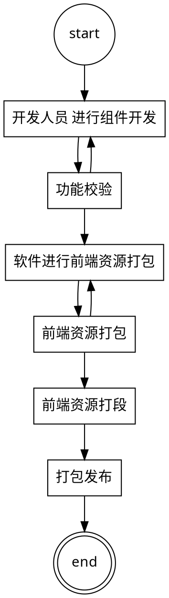

# 2_005 数据对档案

| 字段 | 值 |
|---|---|
| doc | 02界面集成框架软件需求规格说明-终稿 |
| section | 1.8.1.5 |
| image_caption | 图 11组件打包发布流程图 |
| table_caption | 表8 组件打包发布用例描述 |

## 原始图片

*图 11组件打包发布流程图*

## 结构图

*来源: born-digital导出(flowchart, 6节点/9边)*
*类型经几何启发式精化(Master类型识别失败的图, 投影层推断, canonical锚点不变)*

*状态图以PlantUML渲染(UML母语): [*]=起止 | 圆角框=状态 | 箭头标签=迁移事件*

Mermaid兼容投影(通用md渲染器可显示)

DOT源码(完整语义, graphviz可渲染)

### 锚点节点结构

| # | 文本 | 类型 |
|---|---|---|
| 1 | 开发人员
进行组件开发 | process |
| 2 | 功能校验 | gateway |
| 3 | 软件进行前端资源打包 | process |
| 4 | 前端资源打包 | gateway |
| 5 | 前端资源打段 | process |
| 6 | 打包发布 | process |
| 7 |   | start |
| 8 |   | end |

## 表格内容

| Use Case 名称：组件打包发布 | Actors：开发人员 |   |
|---|---|---|
| Use Case 名称：组件打包发布 | Actors：开发人员 |   |
| 概述：本用例是组件打包发布的扩展用例，描 |   |   |
| 前置条件：数据库连接正常。 |   |   |
| 主事件流 |   |   |
| Actor的动作 | 系统的动作 | 动作约束 （性能、可靠性、容错等） |
| 1.用户进行组件的新建开发。 |   |   |
| 2.用户运行软件工程，确保组件可以正常运 |   |   |
|   | 3.界面集成框架将用户的组件加载到内存中 |   |
| 4.用户在main.js中对组件进行正确 |   |   |
| 5.用户在esplug中进行正确的配置和 |   |   |
| 6.用户执行npm run dev打开已 |   |   |
|   | 7.用户的组件可以在界面集成框架中正确的 |   |
| 8.用户在当前的工程目录下运行npm r |   |   |
| 9.用户打开软件打段工具，将前端界面资源 |   |   |
| 10.用户将打好的软件段通过软件安装包的 |   |   |
| 11.用户将打包好的软件包通过软件商店进 |   |   |
| 12.用户打开桌面上的信息系统快捷方式， |   |   |
|   | 13.模板工程正确的生成前端资源包。 |   |
| 异常流E1：npm run dev后控制 |   |   |
| 后置条件：无。 |   |   |

## 正文

组件的打包发布提供应用将开发好的组件打包成软件安装包的形式，并且通过端发布工具进行发布，以软件安装包的形式供用户使用，提供界面组件的打包发布功能，支持对界面组件的混淆和压缩打包。
