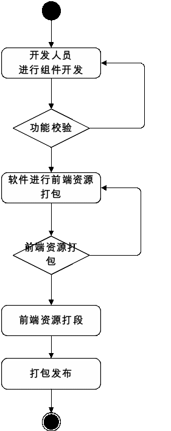
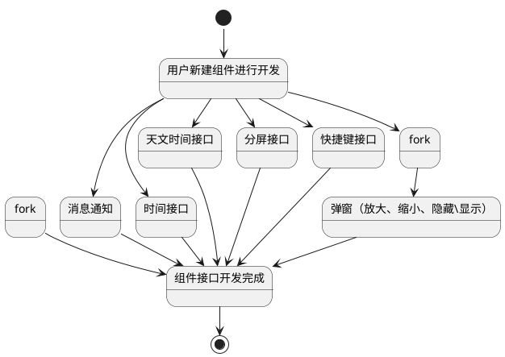
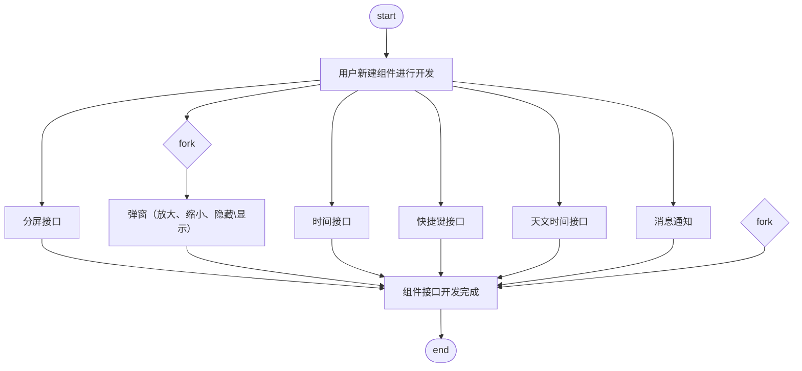
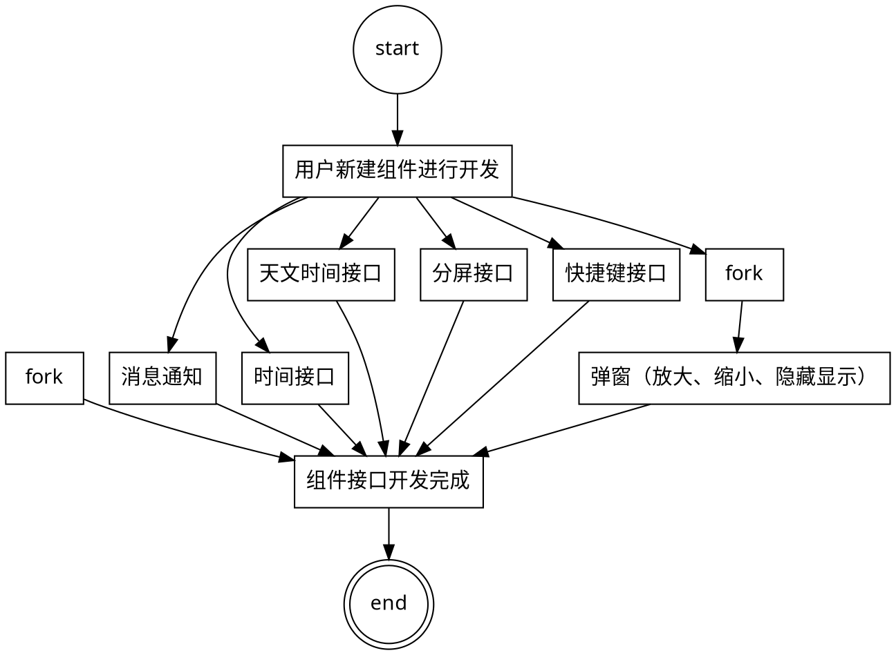

# 2_006 数据对档案

| 字段 | 值 |
|---|---|
| doc | 02界面集成框架软件需求规格说明-终稿 |
| section | 1.8.1.6 |
| image_caption | 图 12组件开发接口流程图 |
| table_caption | 表9 组件开发接口用例描述 |

## 原始图片

*图 12组件开发接口流程图*

## 结构图

*来源: born-digital导出(flowchart, 8节点/16边)*
*类型经几何启发式精化(Master类型识别失败的图, 投影层推断, canonical锚点不变)*

*状态图以PlantUML渲染(UML母语): [*]=起止 | 圆角框=状态 | 箭头标签=迁移事件*

Mermaid兼容投影(通用md渲染器可显示)

DOT源码(完整语义, graphviz可渲染)

*锚点Connect重建存在1个悬空连线端点, 已几何恢复1条边(连线自由端吸附最近语义节点, 每条带距离证据, via=dangling_snap; canonical锚点不变)*

### 锚点节点结构

| # | 文本 | 类型 |
|---|---|---|
| 1 | 用户新建组件进行开发 | process |
| 2 | 消息通知 | process |
| 3 | 弹窗（放大、缩小、隐藏\显示） | process |
| 4 | 时间接口 | process |
| 5 | 天文时间接口 | process |
| 6 | 分屏接口 | process |
| 7 | 快捷键接口 | process |
| 8 |   | start |
| 9 |   | end |
| 10 | 组件接口开发完成 | process |
| 11 |   | fork |
| 12 |   | fork |

## 表格内容

| Use Case 名称：组件开发接口 | Actors：开发人员 |   |
|---|---|---|
| Use Case 名称：组件开发接口 | Actors：开发人员 |   |
| 概述：本用例是组件开发接口的扩展用例，描 |   |   |
| 前置条件：数据库连接正常。 |   |   |
| 主事件流 |   |   |
| Actor的动作 | 系统的动作 | 动作约束 （性能、可靠性、容错等） |
| 1.用户新建组件。 |   | 用户可以得到的组件接口最大数目不超过6， |
| 2.用户以全局注册的方式进行消息通知的订 |   |
|   | 3.界面集成框架与后端进行websock |
| 4.用户以局部注册的方式进行消息通知的订 |   |
|   | 5.界面集成框架与后端进行websock |
| 6.用户分别以局部、全局的方式进行自定义 |   |
|   | 7.界面集成框架与后端进行websock |
| 8.用户调用隐藏/显示弹出窗接口。 |   |
|   | 9.界面集成框架的弹窗进行隐藏/显示，如 |
| 10.用户调用关闭当前弹出窗接口。 |   |
|   | 11.界面集成框架的当前打开的弹窗会被关 |
| 12.用户调用最小化当前弹窗接口。 |   |
|   | 13.界面集成框架当前打开的弹窗被最小化 |
| 14.用户调用最大化当前弹窗接口。 |   |
|   | 15.界面集成框架当前打开的弹窗被最大化 |

## 正文

组件开发接口提供组件注册、打开、关闭、隐藏、最大化、最小化等生命周期管理二次开发接口。
