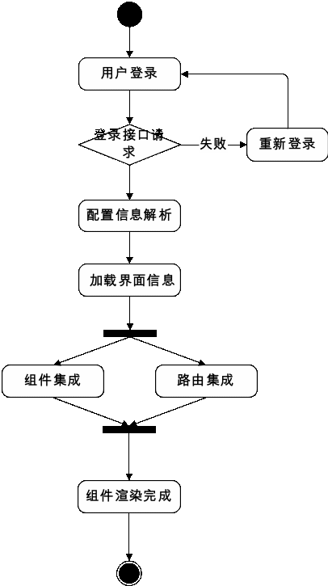
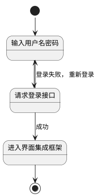
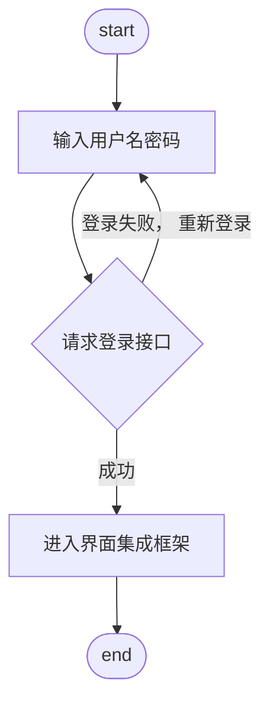
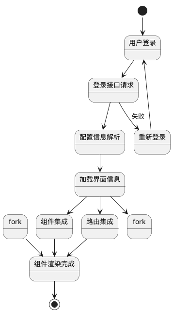
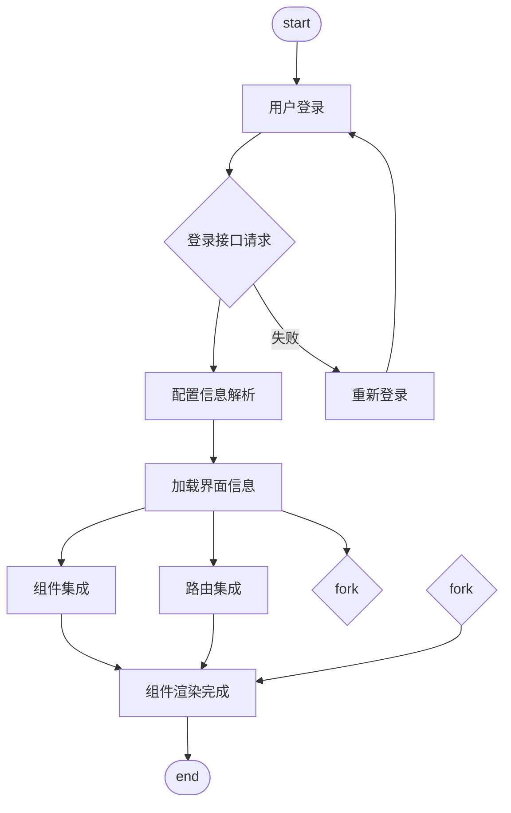

# 2_007 数据对档案

| 字段 | 值 |
|---|---|
| doc | 02界面集成框架软件需求规格说明-终稿 |
| section | 1.8.2.1 |
| image_caption | 图 15用户登录流程图 |
| table_caption | 表11 用户登录用例描述 |

## 原始图片


*图 15用户登录流程图*

## 结构图

*该图为复合图: image.png由2个Visio结构组成(贪心集覆盖并集召回100%, VLM文本匹配判定)*

### 组成部分 1/2 (oleObject15.bin:page1.xml)

*来源: born-digital导出(flowchart, 3节点/5边)*
*类型经几何启发式精化(Master类型识别失败的图, 投影层推断, canonical锚点不变)*

*状态图以PlantUML渲染(UML母语): [*]=起止 | 圆角框=状态 | 箭头标签=迁移事件*



<details><summary>Mermaid兼容投影(通用md渲染器可显示)</summary>



</details>

<details><summary>DOT源码(完整语义, graphviz可渲染)</summary>

```dot
digraph G {
  rankdir=TB;
  node [fontname="Microsoft YaHei"];
  N1437 [shape=box, label="输入用户名密码"];
  N1460 [shape=box, label="请求登录接口"];
  N1475 [shape=box, label="进入界面集成框架"];
  N3243 [shape=circle, label="start"];
  N3244 [shape=doublecircle, label="end"];
  N1460 -> N1437, label="登录失败， 重新登录";
  N3243 -> N1437;
  N1437 -> N1460;
  N1460 -> N1475, label="成功";
  N1475 -> N3244;
}
```

</details>

### 组成部分 2/2 (oleObject14.bin:page1.xml)

*来源: born-digital导出(flowchart, 8节点/13边)*
*类型经几何启发式精化(Master类型识别失败的图, 投影层推断, canonical锚点不变)*

*状态图以PlantUML渲染(UML母语): [*]=起止 | 圆角框=状态 | 箭头标签=迁移事件*



<details><summary>Mermaid兼容投影(通用md渲染器可显示)</summary>



</details>

<details><summary>DOT源码(完整语义, graphviz可渲染)</summary>

```dot
digraph G {
  rankdir=TB;
  node [fontname="Microsoft YaHei"];
  N1010 [shape=box, label="用户登录"];
  N1033 [shape=box, label="登录接口请求"];
  N1048 [shape=box, label="配置信息解析"];
  N1071 [shape=box, label="加载界面信息"];
  N1107 [shape=box, label="组件集成"];
  N1130 [shape=box, label="路由集成"];
  N1237 [shape=box, label="组件渲染完成"];
  N3239 [shape=circle, label="start"];
  N3240 [shape=doublecircle, label="end"];
  N4264 [shape=box, label="重新登录"];
  N4311 [shape=box, label="fork"];
  N4317 [shape=box, label="fork"];
  N1107 -> N1237;
  N1130 -> N1237;
  N1071 -> N4311;
  N4264 -> N1010;
  N1033 -> N4264, label="失败";
  N1237 -> N3240;
  N4317 -> N1237;
  N1071 -> N1130;
  N1071 -> N1107;
  N3239 -> N1010;
  N1010 -> N1033;
  N1033 -> N1048;
  N1048 -> N1071;
}
```

</details>


### 锚点节点结构

| # | 文本 | 类型 |
|---|---|---|
| 1 | 输入用户名密码 | process |
| 2 | 请求登录接口 | gateway |
| 3 | 进入界面集成框架 | process |
| 4 |   | start |
| 5 |   | end |

## 表格内容

| Use Case 名称：用户登录 | Actors：使用人员 |   |
|---|---|---|
| Use Case 名称：用户登录 | Actors：使用人员 |   |
| 概述：本用例是用户登录的扩展用例，描述用 |   |   |
| 前置条件：数据库连接正常。 |   |   |
| 主事件流 |   |   |
| Actor的动作 | 系统的动作 | 动作约束 （性能、可靠性、容错等） |
| 1.用户打开界面集成框架开发模板。 |   | 支持首屏加载时间不小于2秒，用户响应时间 |
| 2.用户输入npm run dev运行命 |   |
|   | 3.界面集成框架将程序加载至内存，进行组 |
| 4.用户在浏览器中输入 http://l |   |
|   | 5.界面集成框架跳转至登录界面，登录界面 |
| 6.用户输入错误的用户名与密码。 |   |
|   | 7.登录界面的用户名与输入框旁边会出现错 |
|   | 8.界面集成框架请求登录接口，验证用户信 |
| 9.用户输入正确的用户名与密码。 |   |
|   | 10.登录界面的用户名与输入框不会出现错 |
|   | 11.界面集成框架请求登录接口，验证用户 |
|   | 12.登录进度条加载完毕，从登录页面跳转 |
| 13.用户查看左上角的用户信息，验证是否 |   |
| 异常流E1：界面空白，没有任何组件，用例 |   |   |
| 后置条件：无。 |   |   |

## 正文

用户登录功能提供用户登录功能，支持通过用户名、密码的登录验证。
