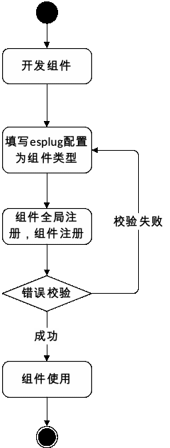
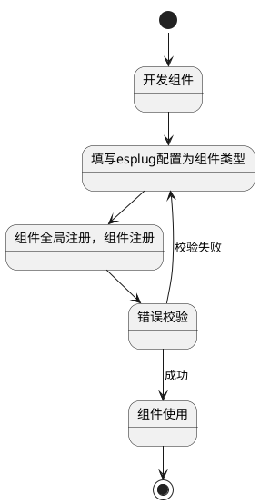
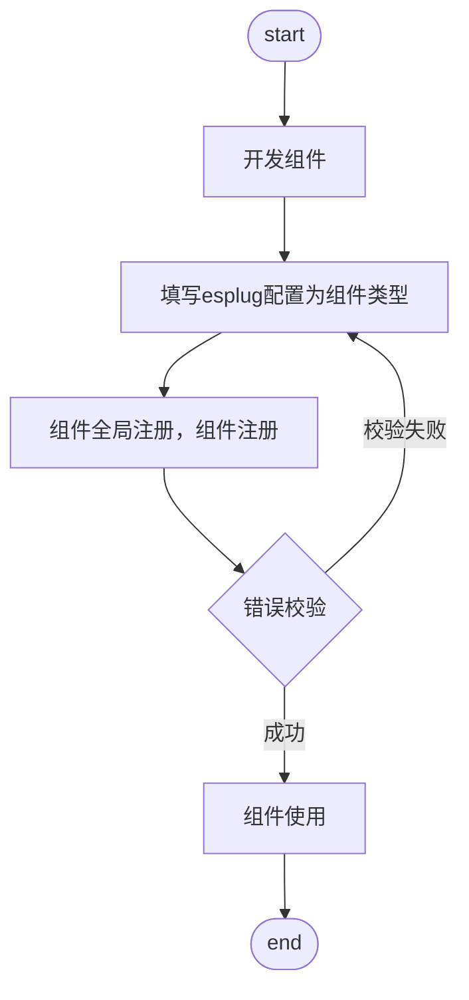

# 2_009 数据对档案

| 字段 | 值 |
|---|---|
| doc | 02界面集成框架软件需求规格说明-终稿 |
| section | 1.8.2.3 |
| image_caption | 图 17组件集成流程图 |
| table_caption | 表13 组件集成用例描述 |

## 原始图片


*图 17组件集成流程图*

## 结构图

*来源: born-digital导出(flowchart, 5节点/7边)*
*类型经几何启发式精化(Master类型识别失败的图, 投影层推断, canonical锚点不变)*

*状态图以PlantUML渲染(UML母语): [*]=起止 | 圆角框=状态 | 箭头标签=迁移事件*



<details><summary>Mermaid兼容投影(通用md渲染器可显示)</summary>



</details>

<details><summary>DOT源码(完整语义, graphviz可渲染)</summary>

```dot
digraph G {
  rankdir=TB;
  node [fontname="Microsoft YaHei"];
  N1669 [shape=box, label="开发组件"];
  N1692 [shape=box, label="填写esplug配置为组件类型"];
  N1715 [shape=box, label="组件全局注册，组件注册"];
  N1738 [shape=box, label="错误校验"];
  N1753 [shape=box, label="组件使用"];
  N3245 [shape=circle, label="start"];
  N3246 [shape=doublecircle, label="end"];
  N1753 -> N3246;
  N1738 -> N1692, label="校验失败";
  N1738 -> N1753, label="成功";
  N3245 -> N1669;
  N1669 -> N1692;
  N1692 -> N1715;
  N1715 -> N1738;
}
```

</details>

### 锚点节点结构

| # | 文本 | 类型 |
|---|---|---|
| 1 | 开发组件 | process |
| 2 | 填写esplug配置为组件类型 | process |
| 3 | 组件全局注册，组件注册 | process |
| 4 | 错误校验 | gateway |
| 5 | 组件使用 | process |
| 6 |   | start |
| 7 |   | end |

## 表格内容

| Use Case 名称：组件集成 | Actors：开发人员 |   |
|---|---|---|
| Use Case 名称：组件集成 | Actors：开发人员 |   |
| 概述：本用例是组件集成的扩展用例，描述组 |   |   |
| 前置条件：数据库连接正常。 |   |   |
| 主事件流 |   |   |
| Actor的动作 | 系统的动作 | 动作约束 （性能、可靠性、容错等） |
| 1.用户打开开发模板工程，新建界面组件。 |   |   |
| 2.用户在main.js中进行界面组件的 |   |   |
| 3.用户在esplug.json中进行界 |   |   |
|   | 4.界面开发工具校验用户填写的esplu |   |
| 5.用户运行npm run dev 执行 |   |   |
| 6 .用户输入测试用户test，输入密码 |   | 如果输入参数不合法，则提示用户，修改输入 |
|   | 7 .界面集成框架将组件内容加载到内存中 |   |
|   | 8.界面集成框架读取esplug.jso | 如果是在本地开发环境下，此接口将会请求失 |
|   | 9. 界面集成框架从登录界面跳转至主页面 | 主页面会根据esplug.json中配置 |
| 10.用户配置一个弹窗类型的组件，按照界 |   |   |
| 11.用户刷新当前页面。 |   |   |
|   | 11.界面集成框架将用户配置好的组件，按 | 支持同时集成的界面组件数量不少于80个。 |
| 12.用户配置一个底部缩略显控的组件，按 |   |   |
| 13.用户刷新当前页面。 |   |   |
|   | 14.界面集成框架将用户配置好的组件，按 |   |

## 正文

组件集成提供组件化集成与引用功能，支持通过界面组件名称获得其提供的数据和接口，实现界面组件之间的模块化调用。
