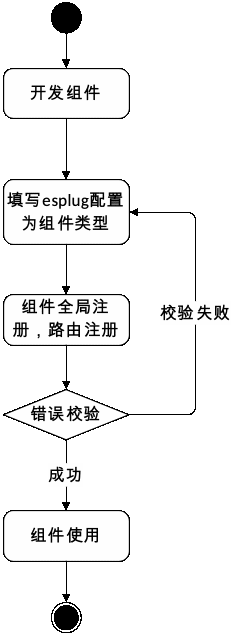
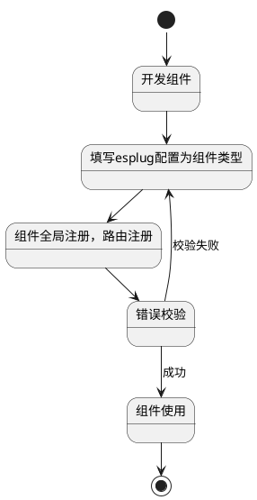
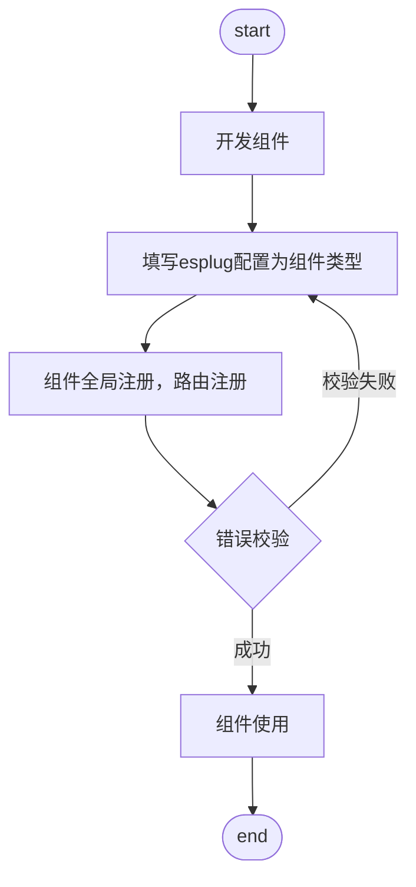

# 2_010 数据对档案

| 字段 | 值 |
|---|---|
| doc | 02界面集成框架软件需求规格说明-终稿 |
| section | 1.8.2.4 |
| image_caption | 图 18路由集成流程图 |
| table_caption | 表14 路由集成用例描述 |

## 原始图片


*图 18路由集成流程图*

## 结构图

*来源: born-digital导出(flowchart, 5节点/7边)*
*类型经几何启发式精化(Master类型识别失败的图, 投影层推断, canonical锚点不变)*

*状态图以PlantUML渲染(UML母语): [*]=起止 | 圆角框=状态 | 箭头标签=迁移事件*



<details><summary>Mermaid兼容投影(通用md渲染器可显示)</summary>



</details>

<details><summary>DOT源码(完整语义, graphviz可渲染)</summary>

```dot
digraph G {
  rankdir=TB;
  node [fontname="Microsoft YaHei"];
  N4438 [shape=box, label="开发组件"];
  N4461 [shape=box, label="填写esplug配置为组件类型"];
  N4484 [shape=box, label="组件全局注册，路由注册"];
  N4507 [shape=box, label="错误校验"];
  N4522 [shape=box, label="组件使用"];
  N4551 [shape=circle, label="start"];
  N4552 [shape=doublecircle, label="end"];
  N4522 -> N4552;
  N4507 -> N4461, label="校验失败";
  N4507 -> N4522, label="成功";
  N4551 -> N4438;
  N4438 -> N4461;
  N4461 -> N4484;
  N4484 -> N4507;
}
```

</details>

### 锚点节点结构

| # | 文本 | 类型 |
|---|---|---|
| 1 | 开发组件 | process |
| 2 | 填写esplug配置为组件类型 | process |
| 3 | 组件全局注册，路由注册 | process |
| 4 | 错误校验 | gateway |
| 5 | 组件使用 | process |
| 6 |   | start |
| 7 |   | end |

## 表格内容

| Use Case 名称：路由集成 | Actors：开发人员 |   |
|---|---|---|
| Use Case 名称：路由集成 | Actors：开发人员 |   |
| 概述：本用例是路由集成的扩展用例，描述路 |   |   |
| 前置条件：数据库连接正常。 |   |   |
| 主事件流 |   |   |
| Actor的动作 | 系统的动作 | 动作约束 （性能、可靠性、容错等） |
| 1.用户打开开发模板工程，新建界面组件 |   |   |
| 2.用户在main.js中进行界面组件的 |   |   |
| 3.用户在esplug.json中进行界 |   |   |
|   | 4.界面开发工具校验用户填写的esplu |   |
| 5.用户运行npm run dev 执行 |   |   |
| 6.用户输入测试用户test，输入密码后 |   | 如果输入参数不合法，则提示用户，修改输入 |
|   | 7.界面集成框架将组件内容加载到内存中， |   |
|   | 8.界面集成框架读取esplug.jso |   |
|   | 9.界面集成框架从登录界面跳转至主页面， |   |
| 10 .用户在界面集成框架模板开发工程中 |   |   |
| 11.用户将自己写好的router结构在 |   |   |
| 12.用户在esplug.json中正确 |   |   |
| 13.用户刷新界面，在菜单栏中点击自己配 |   |   |
|   | 14.界面集成框架由当页，跳转至用户配置 |   |
| 15.用户修改组件的路由配置信息，在当前 |   |   |

## 正文

路由集成提供路由集成与引用功能，支持通过路由方式控制页面跳转。
