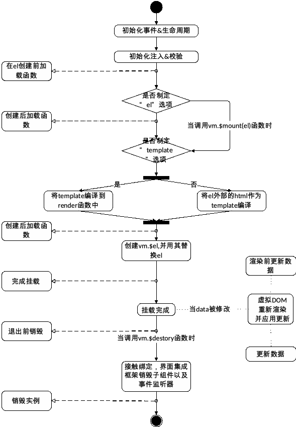
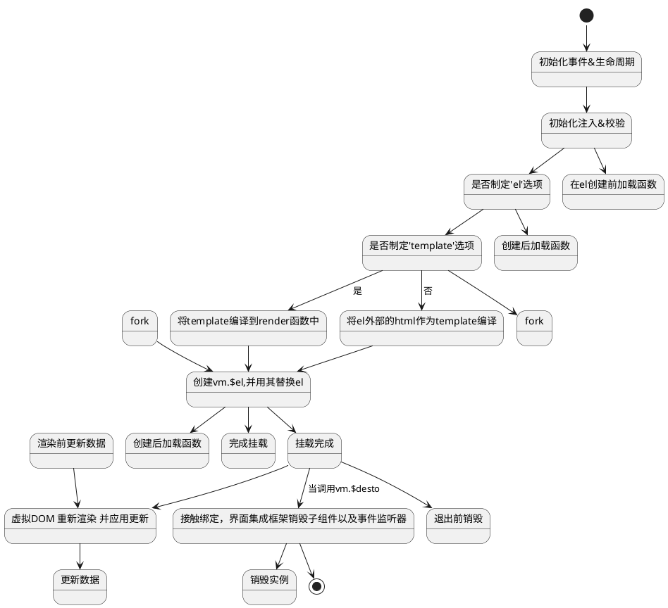
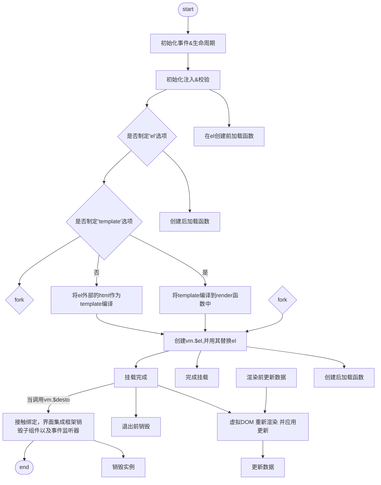

# 2_011 数据对档案

| 字段 | 值 |
|---|---|
| doc | 02界面集成框架软件需求规格说明-终稿 |
| section | 1.8.2.5 |
| image_caption | 图 19生命周期管理流程图 |
| table_caption | 表15 生命周期管理用例描述 |

## 原始图片


*图 19生命周期管理流程图*

## 结构图

*来源: born-digital导出(flowchart, 18节点/22边)*
*类型经几何启发式精化(Master类型识别失败的图, 投影层推断, canonical锚点不变)*

*状态图以PlantUML渲染(UML母语): [*]=起止 | 圆角框=状态 | 箭头标签=迁移事件*



<details><summary>Mermaid兼容投影(通用md渲染器可显示)</summary>



</details>

<details><summary>DOT源码(完整语义, graphviz可渲染)</summary>

```dot
digraph G {
  rankdir=TB;
  node [fontname="Microsoft YaHei"];
  N1949 [shape=box, label="初始化事件&生命周期"];
  N1972 [shape=box, label="初始化注入&校验"];
  N1995 [shape=box, label="是否制定'el'选项"];
  N2010 [shape=box, label="是否制定'template'选项"];
  N2025 [shape=box, label="将template编译到render函数中"];
  N2048 [shape=box, label="将el外部的html作为template编译"];
  N2071 [shape=box, label="创建vm.$el,并用其替换el"];
  N2107 [shape=box, label="接触绑定，界面集成框架销毁子组件以及事件监听器"];
  N2155 [shape=box, label="在el创建前加载函数"];
  N2178 [shape=box, label="创建后加载函数"];
  N2201 [shape=box, label="创建后加载函数"];
  N2224 [shape=box, label="完成挂载"];
  N2247 [shape=box, label="退出前销毁"];
  N2270 [shape=box, label="销毁实例"];
  N2293 [shape=box, label="虚拟DOM 重新渲染 并应用更新"];
  N2316 [shape=box, label="渲染前更新数据"];
  N2339 [shape=box, label="更新数据"];
  N3247 [shape=circle, label="start"];
  N3248 [shape=doublecircle, label="end"];
  N3397 [shape=box, label="fork"];
  N4555 [shape=box, label="fork"];
  N4559 [shape=box, label="挂载完成"];
  N4555 -> N2071;
  N2010 -> N3397;
  N2316 -> N2293;
  N2293 -> N2339;
  N2107 -> N3248;
  N4559 -> N2107, label="当调用vm.$desto";
  N2071 -> N4559;
  N2048 -> N2071;
  N2025 -> N2071;
  N2010 -> N2048, label="否";
  N2010 -> N2025, label="是";
  N3247 -> N1949;
  N1949 -> N1972;
  N1972 -> N1995;
  N1995 -> N2010;
  N1995 -> N2178;
  N2107 -> N2270;
  N4559 -> N2247;
  N2071 -> N2224;
  N2071 -> N2201;
  N1972 -> N2155;
  N4559 -> N2293;
}
```

</details>

*锚点Connect重建存在8个悬空连线端点, 已几何恢复7条边(连线自由端吸附最近语义节点, 每条带距离证据, via=dangling_snap; canonical锚点不变)*

### 锚点节点结构

| # | 文本 | 类型 |
|---|---|---|
| 1 | 初始化事件&生命周期 | process |
| 2 | 初始化注入&校验 | process |
| 3 | 是否制定“el”选项 | gateway |
| 4 | 是否制定“template”选项 | gateway |
| 5 | 将template编译到render函数中 | process |
| 6 | 将el外部的html作为template编译 | process |
| 7 | 创建vm.$el,并用其替换el | process |
| 8 | 接触绑定，界面集成框架销毁子组件以及事件监听器 | process |
| 9 | 在el创建前加载函数 | process |
| 10 | 创建后加载函数 | process |
| 11 | 创建后加载函数 | process |
| 12 | 完成挂载 | process |
| 13 | 退出前销毁 | process |
| 14 | 销毁实例 | process |
| 15 | 虚拟DOM
重新渲染
并应用更新 | process |
| … | 共22个节点 | |

## 表格内容

| Use Case 名称：生命周期管理 | Actors：开发人员 |   |
|---|---|---|
| Use Case 名称：生命周期管理 | Actors：开发人员 |   |
| 概述：本用例是生命周期管理的扩展用例，描 |   |   |
| 前置条件：数据库连接正常。 |   |   |
| 主事件流 |   |   |
| Actor的动作 | 系统的动作 | 动作约束 （性能、可靠性、容错等） |
| 1.用户打开开发模板工程，新建界面组件。 |   |   |
| 2.用户在main.js中进行界面组件的 |   |   |
| 3.用户在esplug.json中进行界 |   |   |
|   | 4.界面开发工具校验用户填写的esplu |   |
| 5.用户运行npm run dev 执行 |   |   |
| 6 .用户输入测试用户test，输入密码 |   | 如果输入参数不合法，则提示用户，修改输入 |
|   | 7. 界面集成框架将组件内容加载到内存中 |   |
|   | 8.界面集成框架读取esplug.jso |   |
|   | 9. 界面集成框架从登录界面跳转至主页面 | 主页面会根据esplug.json中配置 |
| 10.用户在开发好的组件中分别创建bef |   |   |
| 11.用户将组件注册为弹出窗类型的组件。 |   |   |
| 12.用户将软件进行打段，并且将段制作成 |   |   |
| 13.用户打开信息系统软件。用户通过菜单 |   |   |
|   | 14.界面集成框架读取esplug接口中 |   |
|   | 15.界面集成框架根据esplug接口中 |   |

## 正文

生命周期管理提供界面组件的生命周期管理功能，能够依据用户操作对对组件的加载、运行和卸载进行控制，实现组件按需运行。
