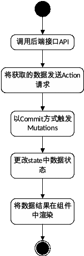
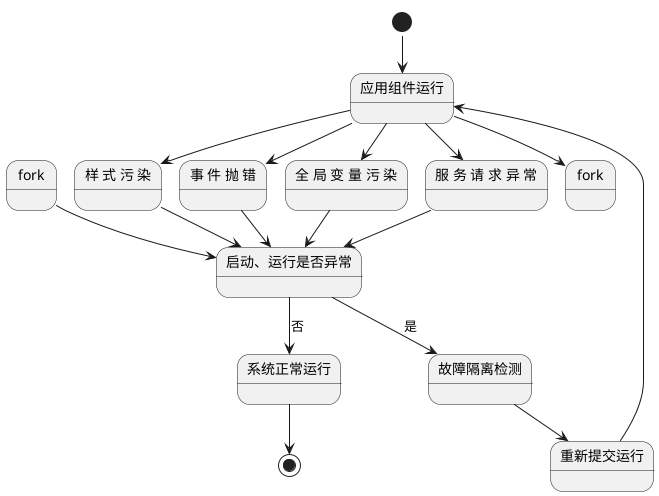
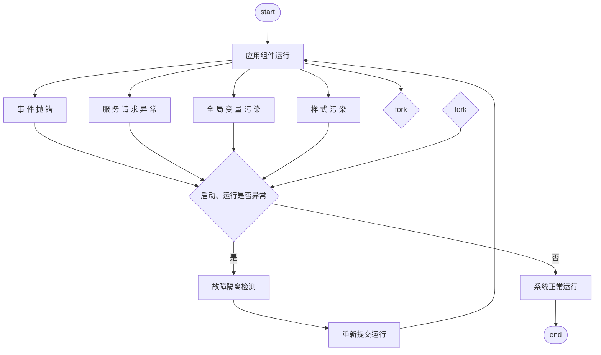

# 2_012 数据对档案

| 字段 | 值 |
|---|---|
| doc | 02界面集成框架软件需求规格说明-终稿 |
| section | 1.8.2.6 |
| image_caption | 图 20故障隔离检测流程图 |
| table_caption | 表16 故障隔离检测用例描述 |

## 原始图片


*图 20故障隔离检测流程图*

## 结构图

*来源: born-digital导出(flowchart, 9节点/16边)*
*类型经几何启发式精化(Master类型识别失败的图, 投影层推断, canonical锚点不变)*

*状态图以PlantUML渲染(UML母语): [*]=起止 | 圆角框=状态 | 箭头标签=迁移事件*



<details><summary>Mermaid兼容投影(通用md渲染器可显示)</summary>



</details>

<details><summary>DOT源码(完整语义, graphviz可渲染)</summary>

```dot
digraph G {
  rankdir=TB;
  node [fontname="Microsoft YaHei"];
  N2418 [shape=box, label="应用组件运行"];
  N2441 [shape=box, label="样 式 污 染"];
  N2464 [shape=box, label="事 件 抛 错"];
  N2487 [shape=box, label="全 局 变 量 污 染"];
  N2510 [shape=box, label="服 务 请 求 异 常"];
  N2533 [shape=box, label="故障隔离检测"];
  N2556 [shape=box, label="启动、运行是否异常"];
  N3249 [shape=circle, label="start"];
  N3250 [shape=doublecircle, label="end"];
  N4582 [shape=box, label="系统正常运行"];
  N4606 [shape=box, label="重新提交运行"];
  N4630 [shape=box, label="fork"];
  N4633 [shape=box, label="fork"];
  N2464 -> N2556;
  N2510 -> N2556;
  N2487 -> N2556;
  N2441 -> N2556;
  N2418 -> N2487;
  N2418 -> N2464;
  N2418 -> N2510;
  N2418 -> N2441;
  N4606 -> N2418;
  N4582 -> N3250;
  N4633 -> N2556;
  N2418 -> N4630;
  N3249 -> N2418;
  N2556 -> N2533, label="是";
  N2533 -> N4606;
  N2556 -> N4582, label="否";
}
```

</details>

### 锚点节点结构

| # | 文本 | 类型 |
|---|---|---|
| 1 | 应用组件运行 | process |
| 2 | 样
式
污
染 | process |
| 3 | 事
件
抛
错 | process |
| 4 | 全
局
变
量
污
染 | process |
| 5 | 服
务
请
求
异
常 | process |
| 6 | 故障隔离检测 | process |
| 7 | 启动、运行是否异常 | gateway |
| 8 |   | start |
| 9 |   | end |
| 10 | 系统正常运行 | process |
| 11 | 重新提交运行 | process |
| 12 |   | fork |
| 13 |   | fork |

## 表格内容

| Use Case 名称：故障隔离检测 | Actors：开发人员 |   |
|---|---|---|
| Use Case 名称：故障隔离检测 | Actors：开发人员 |   |
| 概述：本用例是故障隔离检测的扩展用例，描 |   |   |
| 前置条件：数据库连接正常。 |   |   |
| 主事件流 |   |   |
| Actor的动作 | 系统的动作 | 动作约束 （性能、可靠性、容错等） |
| 1.用户打开开发模板工程，新建界面组件。 |   |   |
| 2.用户在main.js中进行界面组件的 |   |   |
| 3.用户在esplug.json中进行界 |   |   |
|   | 4.界面开发工具校验用户填写的esplu |   |
| 5.用户运行npm run dev 执行 |   |   |
| 6 .用户输入测试用户test，输入密码 |   | 如果输入参数不合法，则提示用户，修改输入 |
| 7.用户将两个组件分别写重名的相同样式。 |   |   |
| 8.用户打开浏览器，在菜单中打开此组件。 |   |   |
|   | 9.界面集成框架对组件进行加载，对组件的 |   |
| 10.用户在组件A中新增一个函数名为te |   |   |
| 11.用户打开浏览器，在菜单中打开此组件 |   |   |
|   | 12.界面集成框架对组件进行加载和渲染， |   |
| 13.用户在组件A中定义一个全局变量A  |   |   |
| 14.用户打开浏览器，在菜单中打开此组件 |   |   |
|   | 15.界面集成框架对组件进行加载和渲染， |   |

## 正文

故障隔离检测提供界面组件的故障隔离功能，支持组件之间样式、事件、全局变量、服务请求的异常隔离。
