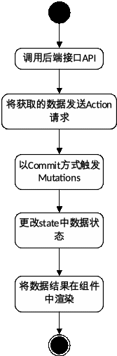
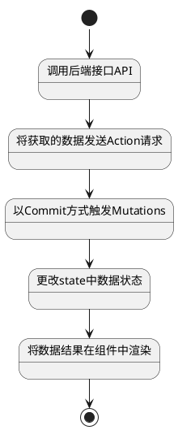
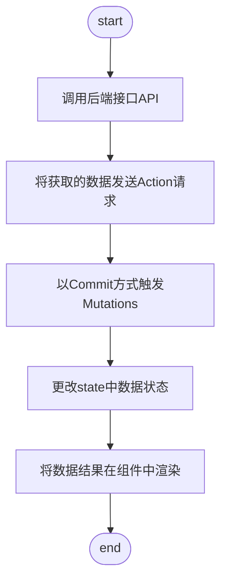
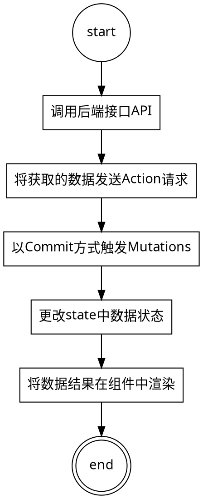

# 2_013 数据对档案

| 字段 | 值 |
|---|---|
| doc | 02界面集成框架软件需求规格说明-终稿 |
| section | 1.8.2.7 |
| image_caption | 图 21数据状态管理流程图 |
| table_caption | 表17 数据状态管理描述 |

## 原始图片

*图 21数据状态管理流程图*

## 结构图

*来源: born-digital导出(flowchart, 5节点/6边)*
*类型经几何启发式精化(Master类型识别失败的图, 投影层推断, canonical锚点不变)*

*状态图以PlantUML渲染(UML母语): [*]=起止 | 圆角框=状态 | 箭头标签=迁移事件*

Mermaid兼容投影(通用md渲染器可显示)

DOT源码(完整语义, graphviz可渲染)

### 锚点节点结构

| # | 文本 | 类型 |
|---|---|---|
| 1 | 调用后端接口API | process |
| 2 | 以Commit方式触发Mutations | process |
| 3 | 将数据结果在组件中渲染 | process |
| 4 |   | start |
| 5 |   | end |
| 6 | 将获取的数据发送Action请求 | process |
| 7 | 更改state中数据状态 | process |

## 表格内容

| Use Case 名称：数据状态管理 | Actors：开发人员 |   |
|---|---|---|
| Use Case 名称：数据状态管理 | Actors：开发人员 |   |
| 概述：本用例是数据状态管理的扩展用例，描 |   |   |
| 前置条件：数据库连接正常。 |   |   |
| 主事件流 |   |   |
| Actor的动作 | 系统的动作 | 动作约束 （性能、可靠性、容错等） |
| 1.用户打开开发模板工程，新建界面组件。 |   |   |
| 2.用户在main.js中进行界面组件的 |   |   |
| 3.用户在esplug.json中进行界 |   |   |
|   | 4界面开发工具校验用户填写的esplug |   |
| 5用户运行npm run dev 执行运 |   |   |
| 6 用户输入测试用户test，输入密码后 |   | 如果输入参数不合法，则提示用户，修改输入 |
| 7用户在工程中的store文件夹下的in |   |   |
|   | 8界面集成框架对组件进行加载和渲染，并且 |   |
| 9用户在组件B中创建函数test，事件内 |   |   |
|   | 10界面集成框架对组件进行加载和渲染，当 |   |
| 11用户将组件A在esplug.json |   |   |
|   | 11界面集成框架对组件进行加载和渲染，并 |   |
| 12用户在组件A中订阅框架退出登录的事件 |   |   |
|   | 13界面集成框架退出登录，并且在loca |   |
| 14用户执行调用框架当前登录用户信息的接 |   |   |

## 正文

数据状态管理提供界面数据共享功能，支持界面组件之间、组件与框架之间的事件交互和数据传递。
