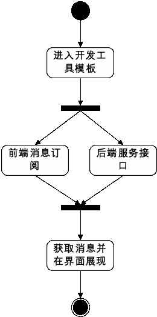
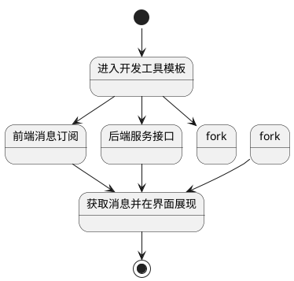
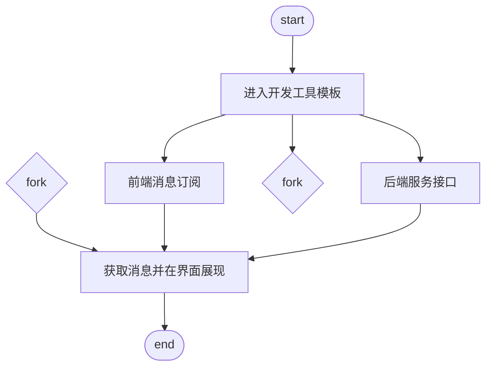
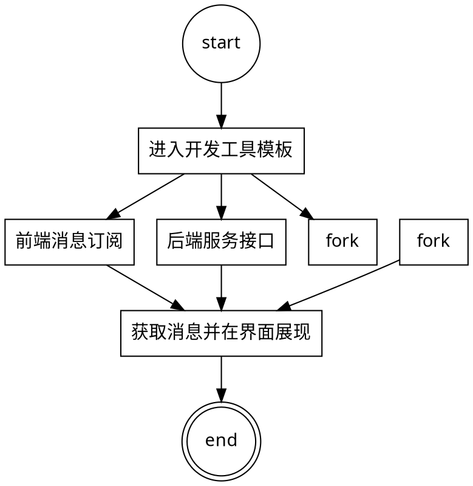

# 2_014 数据对档案

| 字段 | 值 |
|---|---|
| doc | 02界面集成框架软件需求规格说明-终稿 |
| section | 1.8.2.8 |
| image_caption | 图 22消息通知流程图 |
| table_caption | 表18 消息通知用例描述 |

## 原始图片

*图 22消息通知流程图*

## 结构图

*来源: born-digital导出(flowchart, 4节点/8边)*
*类型经几何启发式精化(Master类型识别失败的图, 投影层推断, canonical锚点不变)*

*状态图以PlantUML渲染(UML母语): [*]=起止 | 圆角框=状态 | 箭头标签=迁移事件*

Mermaid兼容投影(通用md渲染器可显示)

DOT源码(完整语义, graphviz可渲染)

### 锚点节点结构

| # | 文本 | 类型 |
|---|---|---|
| 1 | 前端消息订阅 | process |
| 2 | 后端服务接口 | process |
| 3 |   | start |
| 4 |   | end |
| 5 |   | fork |
| 6 |   | fork |
| 7 | 进入开发工具模板 | process |
| 8 | 获取消息并在界面展现 | process |

## 表格内容

| Use Case 名称：消息通知 | Actors：开发人员 |   |
|---|---|---|
| Use Case 名称：消息通知 | Actors：开发人员 |   |
| 概述：本用例是消息通知的扩展用例，描述消 |   |   |
| 前置条件：数据库连接正常。 |   |   |
| 主事件流 |   |   |
| Actor的动作 | 系统的动作 | 动作约束 （性能、可靠性、容错等） |
| 1用户打开开发模板工程，新建界面组件组件 |   |   |
| 2用户在main.js中进行界面组件的全 |   |   |
| 3用户在esplug.json中进行界面 |   |   |
|   | 4界面开发工具校验用户填写的esplug |   |
| 5用户运行npm run dev 执行运 |   |   |
| 6 用户输入测试用户test，输入密码后 |   | 如果输入参数不合法，则提示用户，修改输入 |
| 7用户在组件A中，创建消息通知的实例。将 |   |   |
|   | 8界面集成框架对组件进行加载和渲染， 当 |   |
| 9用户在控制台查看消息通知的回调函数内是 |   |   |
| 10用户点击消息中心，查看消息、点击已读 |   |   |
|   | 11当用户点击消息中心，界面集成框架会显 |   |
| 12用户按照程序员手册进行自定义消息通道 |   |   |
|   | 13界面集成框架收到后端推送的消息后，会 |   |
| 14用户在控制台查看消息通知的回调函数内 |   |   |
|   | 15用例结束。 |   |

## 正文

消息通知提供消息通知功能，支持对服务推送到界面数据的统一接收处理和统一组织显示。
