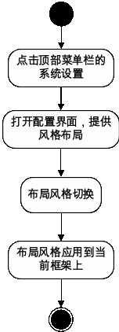
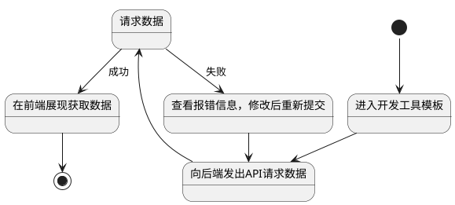
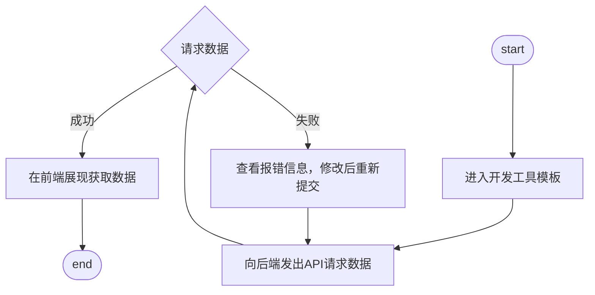

# 2_015 数据对档案

| 字段 | 值 |
|---|---|
| doc | 02界面集成框架软件需求规格说明-终稿 |
| section | 1.8.2.9 |
| image_caption | 图 23服务请求流程 |
| table_caption | 表19 服务请求用例描述 |

## 原始图片


*图 23服务请求流程*

## 结构图

*来源: born-digital导出(flowchart, 5节点/7边)*
*类型经几何启发式精化(Master类型识别失败的图, 投影层推断, canonical锚点不变)*

*状态图以PlantUML渲染(UML母语): [*]=起止 | 圆角框=状态 | 箭头标签=迁移事件*



<details><summary>Mermaid兼容投影(通用md渲染器可显示)</summary>



</details>

<details><summary>DOT源码(完整语义, graphviz可渲染)</summary>

```dot
digraph G {
  rankdir=TB;
  node [fontname="Microsoft YaHei"];
  N4798 [shape=box, label="请求数据"];
  N5258 [shape=circle, label="start"];
  N5259 [shape=doublecircle, label="end"];
  N5260 [shape=box, label="进入开发工具模板"];
  N5283 [shape=box, label="向后端发出API请求数据"];
  N5306 [shape=box, label="查看报错信息，修改后重新提交"];
  N5329 [shape=box, label="在前端展现获取数据"];
  N5258 -> N5260;
  N5329 -> N5259;
  N4798 -> N5329, label="成功";
  N4798 -> N5306, label="失败";
  N5260 -> N5283;
  N5306 -> N5283;
  N5283 -> N4798;
}
```

</details>

### 锚点节点结构

| # | 文本 | 类型 |
|---|---|---|
| 1 | 请求数据 | gateway |
| 2 |   | start |
| 3 |   | end |
| 4 | 进入开发工具模板 | process |
| 5 | 向后端发出API请求数据 | process |
| 6 | 查看报错信息，修改后重新提交 | process |
| 7 | 在前端展现获取数据 | process |

## 表格内容

| Use Case 名称：服务请求 | Actors：界面集成框架 |   |
|---|---|---|
| Use Case 名称：服务请求 | Actors：界面集成框架 |   |
| 概述：本用例是服务请求的扩展用例，描述服 |   |   |
| 前置条件：数据库连接正常。 |   |   |
| 主事件流 |   |   |
| Actor的动作 | 系统的动作 | 动作约束 （性能、可靠性、容错等） |
| 1用户打开开发模板工程，新建界面组件。 |   |   |
| 2用户在main.js中进行界面组件的全 |   |   |
| 3用户在esplug.json中进行界面 |   |   |
|   | 4界面开发工具校验用户填写的esplug |   |
| 5用户运行npm run dev 执行运 |   |   |
| 6 用户输入测试用户test，输入密码后 |   | 如果输入参数不合法，则提示用户，修改输入 |
| 7用户在组件中调用界面集成框架提供的$a |   |   |
| 8 用户在后端利用服务开发框架创建类型为 |   |   |
|   | 9界面集成框架接收步骤8中4中类型接口所 |   |
|   | 10用例结束。 |   |
| 异常流E1：接口无法正常连接，出现404 |   |   |
| 后置条件：无。 |   |   |

## 正文

服务请求提供服务请求功能，支持通过Restful接口对服务资源的新建、获取、更新、删除操作。
