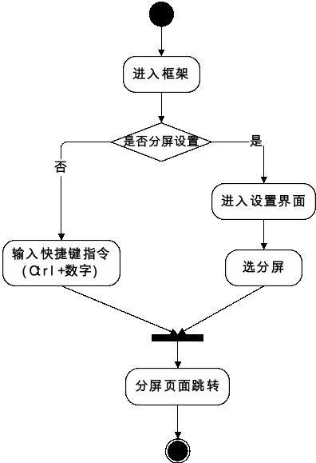
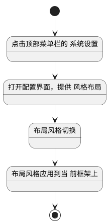
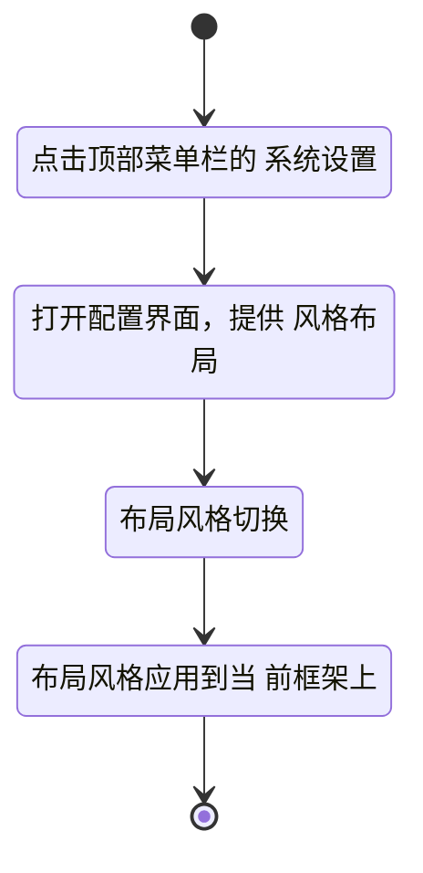
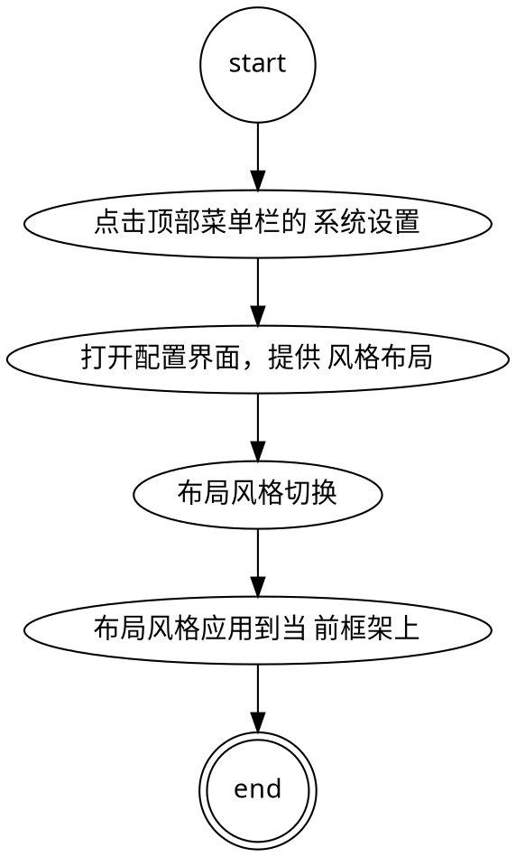

# 2_016 数据对档案

| 字段 | 值 |
|---|---|
| doc | 02界面集成框架软件需求规格说明-终稿 |
| section | 1.8.3.1 |
| image_caption | 图 26开发工程流程图 |
| table_caption | 表21 布局控制用例描述 |

## 原始图片

*图 26开发工程流程图*

## 结构图

*来源: born-digital导出(state, 4节点/5边)*
*类型经几何启发式精化(Master类型识别失败的图, 投影层推断, canonical锚点不变)*

*状态图以PlantUML渲染(UML母语): [*]=起止 | 圆角框=状态 | 箭头标签=迁移事件*

Mermaid兼容投影(通用md渲染器可显示)

DOT源码(完整语义, graphviz可渲染)

### 锚点节点结构

| # | 文本 | 类型 |
|---|---|---|
| 1 | 布局风格切换 | state |
| 2 | 点击顶部菜单栏的
系统设置 | state |
| 3 |   | start |
| 4 | 布局风格应用到当
前框架上 | state |
| 5 |   | end |
| 6 | 打开配置界面，提供
风格布局 | state |

## 表格内容

| Use Case 名称：布局控制 | Actors：开发人员 |   |
|---|---|---|
| Use Case 名称：布局控制 | Actors：开发人员 |   |
| 概述：本用例是用户对当前框架布局进行操作 |   |   |
| 前置条件：框架正常提供布局风格。 |   |   |
| 主事件流 |   |   |
| Actor的动作 | 系统的动作 | 动作约束 （性能、可靠性、容错等） |
| 1.用户进入框架全屏界面后 点击顶部菜单 |   |   |
|   | 2.系统根据用户操作打开配置界面 提供可 |   |
| 3.打开配置界面 找到风格栏选择相应的风 |   | 基于2个键值组合的快捷键种类不少于36种 |
|   | 4．系统将用户选择的布局风格应用到当前框 |   |
| 异常流E1：切换布局失败则进入异常E1， |   |   |
| 后置条件：无。 |   |   |

## 正文

布局控制提供布局显示控制功能，支持用户对界面组件位置、大小、分屏等界面状态的调整；（提供桌面版、平板版、手持版三种版本形态）。
