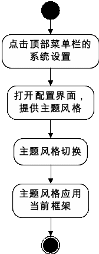
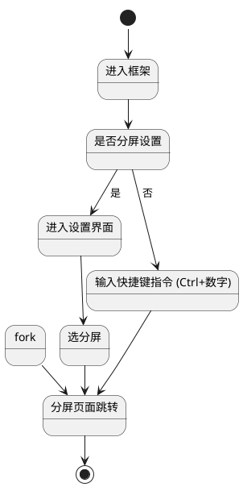
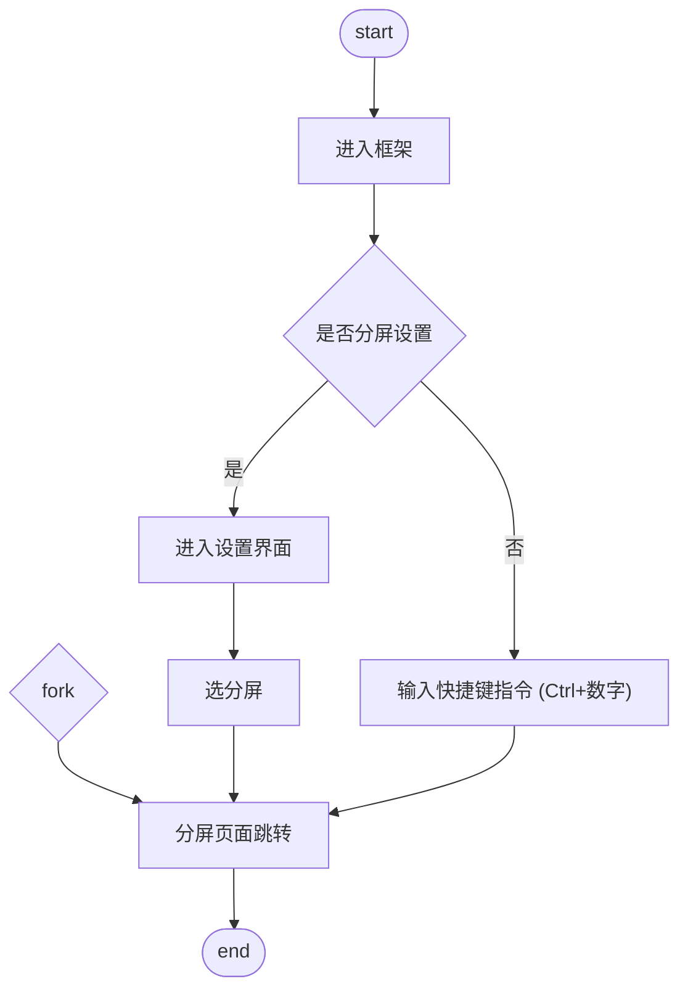

# 2_017 数据对档案

| 字段 | 值 |
|---|---|
| doc | 02界面集成框架软件需求规格说明-终稿 |
| section | 1.8.3.2 |
| image_caption | 图 27分屏管理流程图 |
| table_caption | 表22 分屏管理用例描述 |

## 原始图片


*图 27分屏管理流程图*

## 结构图

*来源: born-digital导出(flowchart, 6节点/9边)*
*类型经几何启发式精化(Master类型识别失败的图, 投影层推断, canonical锚点不变)*

*状态图以PlantUML渲染(UML母语): [*]=起止 | 圆角框=状态 | 箭头标签=迁移事件*



<details><summary>Mermaid兼容投影(通用md渲染器可显示)</summary>



</details>

<details><summary>DOT源码(完整语义, graphviz可渲染)</summary>

```dot
digraph G {
  rankdir=TB;
  node [fontname="Microsoft YaHei"];
  N5647 [shape=box, label="fork"];
  N5696 [shape=ellipse, label="进入框架"];
  N5700 [shape=circle, label="start"];
  N5701 [shape=ellipse, label="分屏页面跳转"];
  N5705 [shape=doublecircle, label="end"];
  N5715 [shape=box, label="是否分屏设置"];
  N5730 [shape=ellipse, label="进入设置界面"];
  N5735 [shape=ellipse, label="选分屏"];
  N5740 [shape=ellipse, label="输入快捷键指令 (Ctrl+数字)"];
  N5647 -> N5701;
  N5715 -> N5740, label="否";
  N5730 -> N5735;
  N5715 -> N5730, label="是";
  N5701 -> N5705;
  N5700 -> N5696;
  N5735 -> N5701;
  N5740 -> N5701;
  N5696 -> N5715;
}
```

</details>

### 锚点节点结构

| # | 文本 | 类型 |
|---|---|---|
| 1 |   | fork |
| 2 | 进入框架 | state |
| 3 |   | start |
| 4 | 分屏页面跳转 | state |
| 5 |   | end |
| 6 | 是否分屏设置 | gateway |
| 7 | 进入设置界面 | state |
| 8 | 选分屏 | state |
| 9 | 输入快捷键指令
(Ctrl+数字) | state |

## 表格内容

| Use Case 名称：分屏管理 | Actors：开发人员 |   |
|---|---|---|
| Use Case 名称：分屏管理 | Actors：开发人员 |   |
| 概述：本用例是框架界面展示分屏管理 提供 |   |   |
| 前置条件：系统正常登陆进入全屏界面。 |   |   |
| 主事件流 |   |   |
| Actor的动作 | 系统的动作 | 动作约束 （性能、可靠性、容错等） |
| 1.用户点击进入框架全屏界面后 点击顶部 |   |   |
|   | 2.系统根据用户操作打开配置界面 提供可 |   |
| 3.用户选择对应分屏。 |   |   |
|   | 4．系统根据用户选择的分屏(全屏 二分屏 |   |
| 5.用户选中需要将组件打开到对应的分屏第 |   |   |
|   | 6.系统根据用户点击分屏选中当前分屏(将 |   |
| 7.用户点击底部组件名称。 |   |   |
|   | 8.系统根据用户选择应用将其打开到当前激 |   |
| 9.上边的1/3步骤也可使用快捷键操作快 |   |   |
|   | 10.系统接受用户键盘输入的快捷键 根据 | 支持首屏加载时间不小于2秒，用户响应时间 |
| 11.上边的5 7步骤通过拖拽底部组件名 |   |   |
|   | 12.系统根据用户拖拽的组件最后停留的分 |   |
| 13.用户通过快捷键操作’ALT + 数 |   |   |
|   | 14.系统根据用户快捷键输入 最大化/还 |   |
| 异常流E1：当前无分屏 请重新操作。 异 |   |   |

## 正文

分屏管理提供分屏状态每一屏展示组件的定制功能，支持将组件拖曳到分屏窗口；（提供桌面版、平板版、手持版三种版本形态）。
