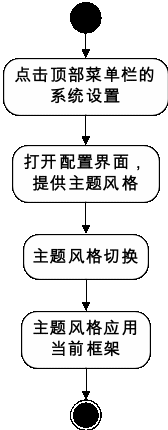
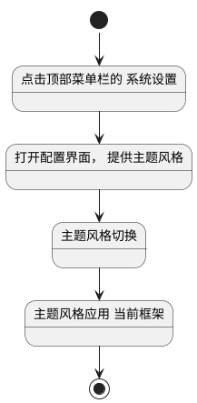
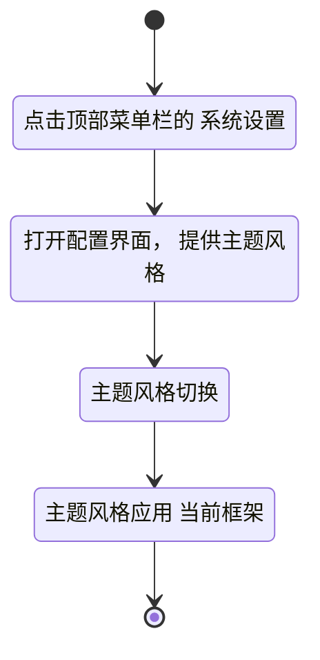
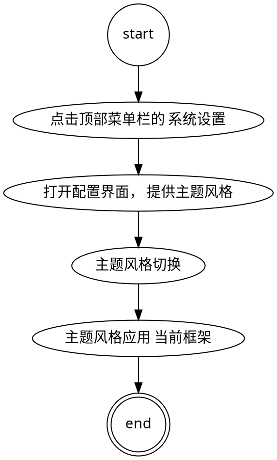

# 2_018 数据对档案

| 字段 | 值 |
|---|---|
| doc | 02界面集成框架软件需求规格说明-终稿 |
| section | 1.8.3.3 |
| image_caption | 图 28主题管理流程图 |
| table_caption | 表23 主题管理用例描述 |

## 原始图片

*图 28主题管理流程图*

## 结构图

*来源: born-digital导出(state, 4节点/5边)*
*类型经几何启发式精化(Master类型识别失败的图, 投影层推断, canonical锚点不变)*

*状态图以PlantUML渲染(UML母语): [*]=起止 | 圆角框=状态 | 箭头标签=迁移事件*

Mermaid兼容投影(通用md渲染器可显示)

DOT源码(完整语义, graphviz可渲染)

### 锚点节点结构

| # | 文本 | 类型 |
|---|---|---|
| 1 | 主题风格切换 | state |
| 2 | 点击顶部菜单栏的
系统设置 | state |
| 3 |   | start |
| 4 | 主题风格应用
当前框架 | state |
| 5 |   | end |
| 6 | 打开配置界面，
提供主题风格 | state |

## 表格内容

| Use Case 名称：主题管理 | Actors：开发人员 |   |
|---|---|---|
| Use Case 名称：主题管理 | Actors：开发人员 |   |
| 概述：本用例是用户对系统框架的主题进行管 |   |   |
| 前置条件：框架主题设定开放。 |   |   |
| 主事件流 |   |   |
| Actor的动作 | 系统的动作 | 动作约束 （性能、可靠性、容错等） |
| 1.用户进入框架全屏界面后 点击顶部菜单 |   |   |
|   | 2.系统根据用户操作打开配置界面 提供可 |   |
| 3.打开配置界面 找到主题栏选择相应的主 |   |   |
|   | 4．系统将用户选择的主题风格应用到当前框 |   |
| 异常流E1：切换主题失败，用例失败。 |   |   |
| 后置条件：无。 |   |   |

## 正文

主题管理提供主题样式管理功能，支持界面字号、皮肤等样式的统一设置；（提供桌面版、平板版、手持版三种版本形态。
