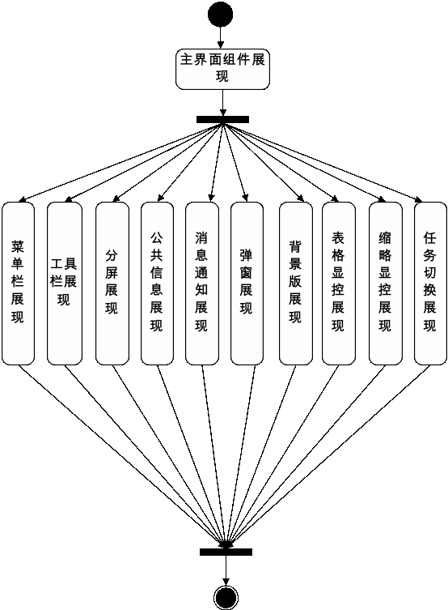
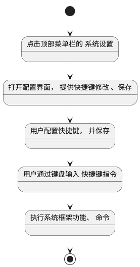
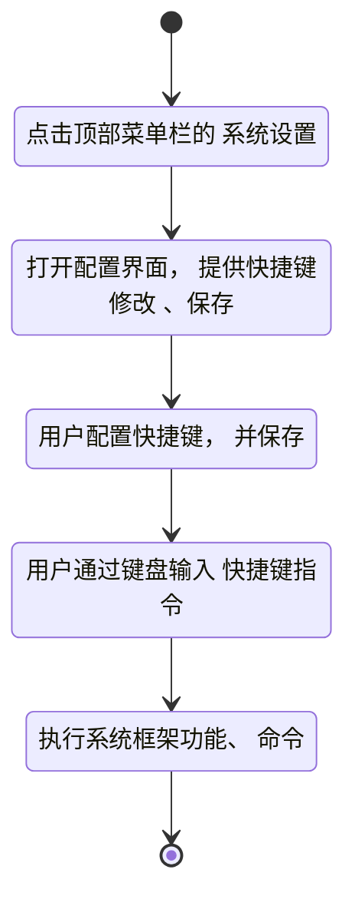
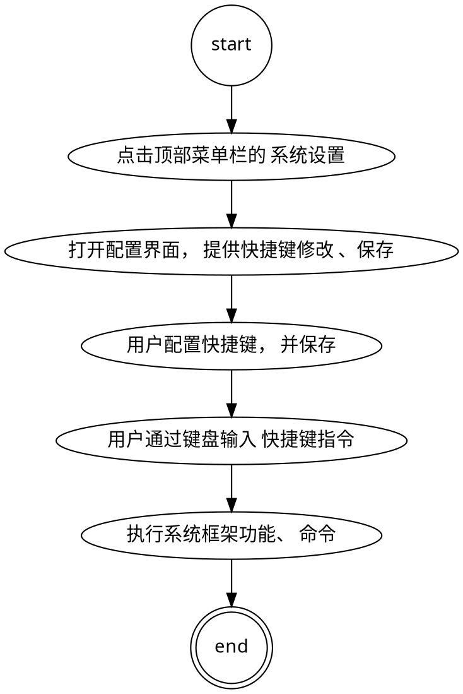

# 2_019 数据对档案

| 字段 | 值 |
|---|---|
| doc | 02界面集成框架软件需求规格说明-终稿 |
| section | 1.8.3.4 |
| image_caption | 图 29快捷操控流程图 |
| table_caption | 表24 快捷操控用例描述 |

## 原始图片

*图 29快捷操控流程图*

## 结构图

*来源: born-digital导出(state, 5节点/6边)*
*类型经几何启发式精化(Master类型识别失败的图, 投影层推断, canonical锚点不变)*

*状态图以PlantUML渲染(UML母语): [*]=起止 | 圆角框=状态 | 箭头标签=迁移事件*

Mermaid兼容投影(通用md渲染器可显示)

DOT源码(完整语义, graphviz可渲染)

### 锚点节点结构

| # | 文本 | 类型 |
|---|---|---|
| 1 | 用户配置快捷键，
并保存 | state |
| 2 | 点击顶部菜单栏的
系统设置 | state |
| 3 |   | start |
| 4 | 用户通过键盘输入
快捷键指令 | state |
| 5 |   | end |
| 6 | 打开配置界面，
提供快捷键修改
、保存 | state |
| 7 | 执行系统框架功能、
命令 | state |

## 表格内容

| Use Case 名称：快捷操控 | Actors：开发人员 |   |
|---|---|---|
| Use Case 名称：快捷操控 | Actors：开发人员 |   |
| 概述：本用例是对系统框架提供快捷指令 用 |   |   |
| 前置条件：无。 |   |   |
| 主事件流 |   |   |
| Actor的动作 | 系统的动作 | 动作约束 （性能、可靠性、容错等） |
| 1.用户进入框架全屏界面后 点击顶部菜单 |   | 基于2个键值组合的快捷键种类不少于36种 |
|   | 2.系统根据用户操作打开配置界面 提供可 |   |
| 3.用户找到相对的快捷设置页面 找到框架 |   |   |
|   | 4．系统将用户设置修改/保存快捷键保存到 |   |
| 5.用户在框架中根据不同的框架功能 使用 |   |   |
|   | 6.系统根据用户键盘输入的快捷指令 执行 |   |
| 异常流E1：快捷键设置冲突 请重新设置。 |   |   |
| 后置条件：无。 |   |   |

## 正文

快捷操控提供键盘快捷键定制功能，支持对应用所设置快捷键的冲突检测，支持用户对快捷键的重新设置；（提供能桌面版形态）。
