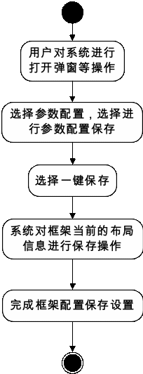
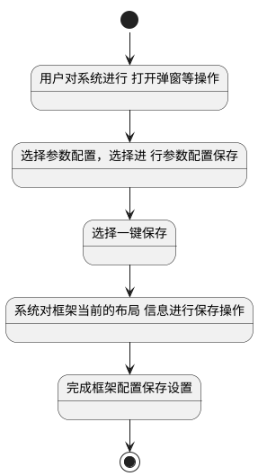
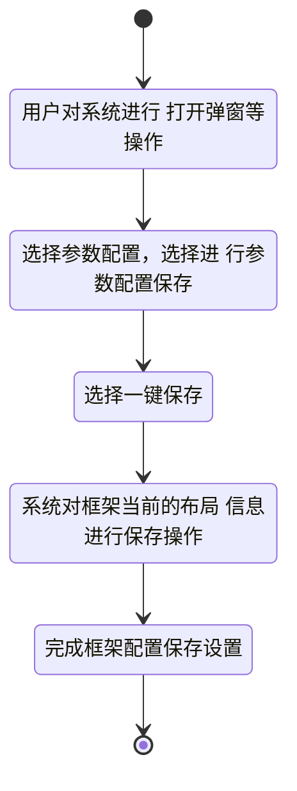
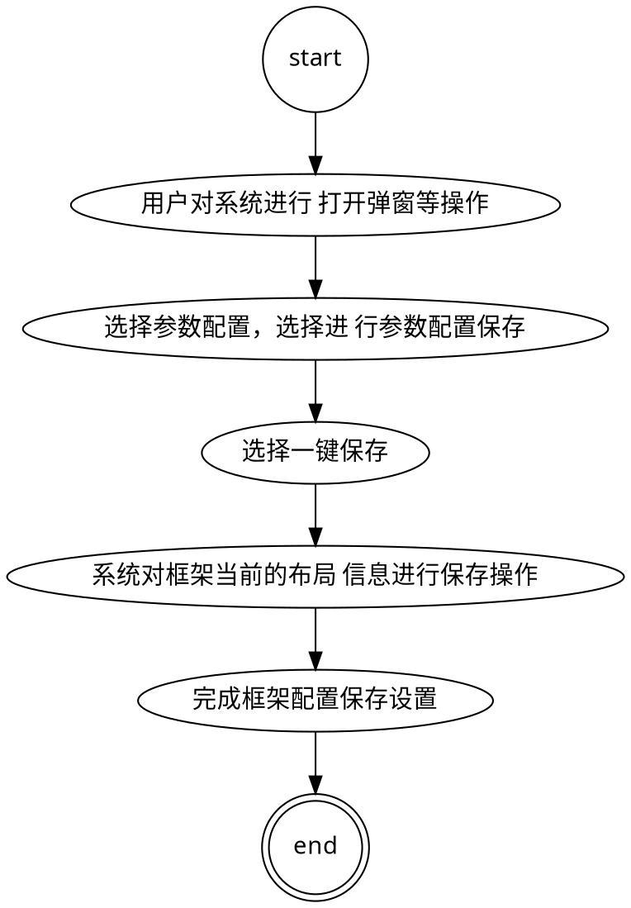

# 2_020 数据对档案

| 字段 | 值 |
|---|---|
| doc | 02界面集成框架软件需求规格说明-终稿 |
| section | 1.8.3.5 |
| image_caption | 图 30界面配置流程图 |
| table_caption | 表25 界面配置保存用例描述 |

## 原始图片

*图 30界面配置流程图*

## 结构图

*来源: born-digital导出(state, 5节点/6边)*
*类型经几何启发式精化(Master类型识别失败的图, 投影层推断, canonical锚点不变)*

*状态图以PlantUML渲染(UML母语): [*]=起止 | 圆角框=状态 | 箭头标签=迁移事件*

Mermaid兼容投影(通用md渲染器可显示)

DOT源码(完整语义, graphviz可渲染)

### 锚点节点结构

| # | 文本 | 类型 |
|---|---|---|
| 1 | 选择一键保存 | state |
| 2 | 用户对系统进行
打开弹窗等操作 | state |
| 3 |   | start |
| 4 | 系统对框架当前的布局
信息进行保存操作 | state |
| 5 |   | end |
| 6 | 选择参数配置，选择进
行参数配置保存 | state |
| 7 | 完成框架配置保存设置 | state |

## 表格内容

| Use Case 名称：界面配置保存 | Actors：开发人员 |   |
|---|---|---|
| Use Case 名称：界面配置保存 | Actors：开发人员 |   |
| 概述：本用例是框架界面提供的在操作框架过 |   |   |
| 前置条件：除系统界面框架外 应用需单独提 |   |   |
| 主事件流 |   |   |
| Actor的动作 | 系统的动作 | 动作约束 （性能、可靠性、容错等） |
| 1.用户登录进入框架后 打开弹窗、右侧组 |   |   |
|   | 2．在右上角参数配置中勾选从上次停下来的 |   |
| 3.从右上角设置中选择一键保存。 |   |   |
|   | 4．系统对框架当前的布局信息等进行保存操 |   |
| 异常流：无。 |   |   |
| 后置条件：无。 |   |   |

## 正文

界面配置保存提供依据用户身份保存与加载界面配置信息功能，包括界面布局等信息。（提供桌面版、平板版、手持版三种版本形态）。
