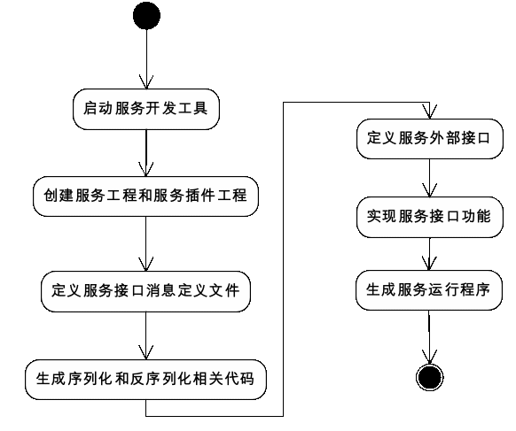
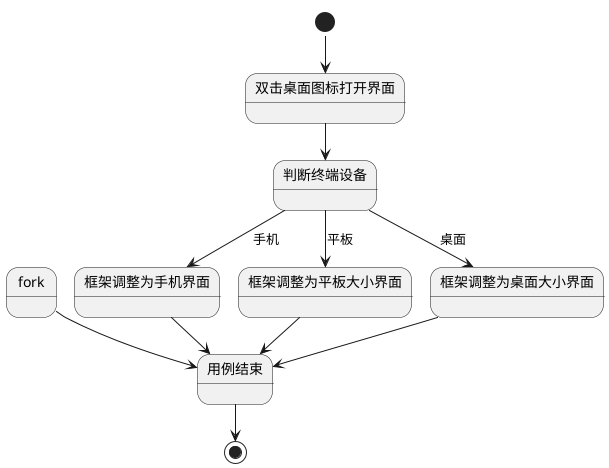
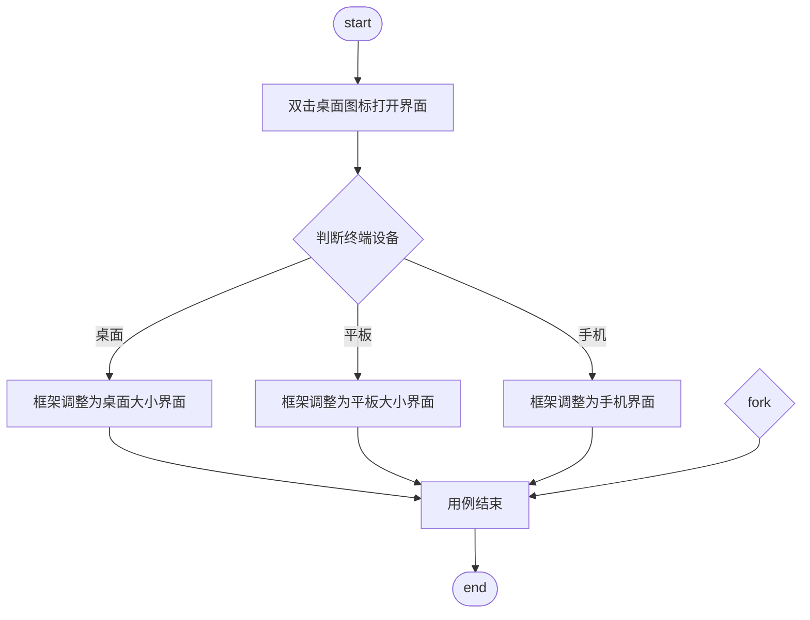

# 2_021 数据对档案

| 字段 | 值 |
|---|---|
| doc | 02界面集成框架软件需求规格说明-终稿 |
| section | 1.8.5.2 |
| image_caption | 图 40界面自适应流程图 |
| table_caption | 表45 开发工程生成用例描述 |

## 原始图片


*图 40界面自适应流程图*

## 结构图

*来源: born-digital导出(flowchart, 6节点/10边)*
*类型经几何启发式精化(Master类型识别失败的图, 投影层推断, canonical锚点不变)*

*状态图以PlantUML渲染(UML母语): [*]=起止 | 圆角框=状态 | 箭头标签=迁移事件*



<details><summary>Mermaid兼容投影(通用md渲染器可显示)</summary>



</details>

<details><summary>DOT源码(完整语义, graphviz可渲染)</summary>

```dot
digraph G {
  rankdir=TB;
  node [fontname="Microsoft YaHei"];
  N7168 [shape=box, label="双击桌面图标打开界面"];
  N7191 [shape=box, label="判断终端设备"];
  N7200 [shape=box, label="框架调整为手机界面"];
  N7223 [shape=box, label="框架调整为平板大小界面"];
  N7246 [shape=box, label="框架调整为桌面大小界面"];
  N7274 [shape=box, label="fork"];
  N7303 [shape=circle, label="start"];
  N7304 [shape=doublecircle, label="end"];
  N7585 [shape=box, label="用例结束"];
  N7585 -> N7304;
  N7246 -> N7585;
  N7223 -> N7585;
  N7200 -> N7585;
  N7274 -> N7585;
  N7191 -> N7246, label="桌面";
  N7303 -> N7168;
  N7168 -> N7191;
  N7191 -> N7200, label="手机";
  N7191 -> N7223, label="平板";
}
```

</details>

### 锚点节点结构

| # | 文本 | 类型 |
|---|---|---|
| 1 | 双击桌面图标打开界面 | process |
| 2 | 判断终端设备 | gateway |
| 3 | 框架调整为手机界面 | process |
| 4 | 框架调整为平板大小界面 | process |
| 5 | 框架调整为桌面大小界面 | process |
| 6 |   | fork |
| 7 |   | start |
| 8 |   | end |
| 9 | 用例结束 | process |

## 表格内容

| Use Case 名称：界面自适应调整 | Actors：用户 |   |
|---|---|---|
| Use Case 名称：界面自适应调整 | Actors：用户 |   |
| 概述：本用例是界面自适应调整的扩展用例， |   |   |
| 前置条件：数据库连接正常。 |   |   |
| 主事件流 |   |   |
| Actor的动作 | 系统的动作 | 动作约束 （性能、可靠性、容错等） |
| 1.用户双击桌面的界面集成框架图标。 |   |   |
|   | 2.框架开始加载并打开登录界面。如果界面 |   |
| 3.用户使用不同尺寸的显示器进行操作。 |   |   |
|   | 4.框架中的内容将跟随显示器尺寸对框架中 |   |
| 异常流E1：系统启动失败，用例结束。 |   |   |
| 后置条件：无。 |   |   |

## 正文

界面自适应调整支持依据终端的硬件形态、尺寸大小和分辨率提供相应的界面展现风格和界面手段；（提供桌面版、平板版、手持版三种版本形态）。
