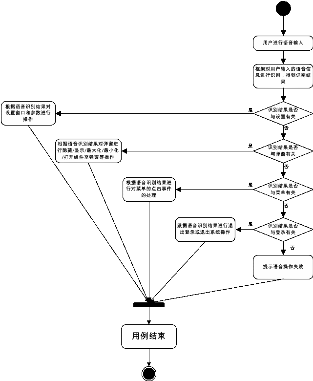
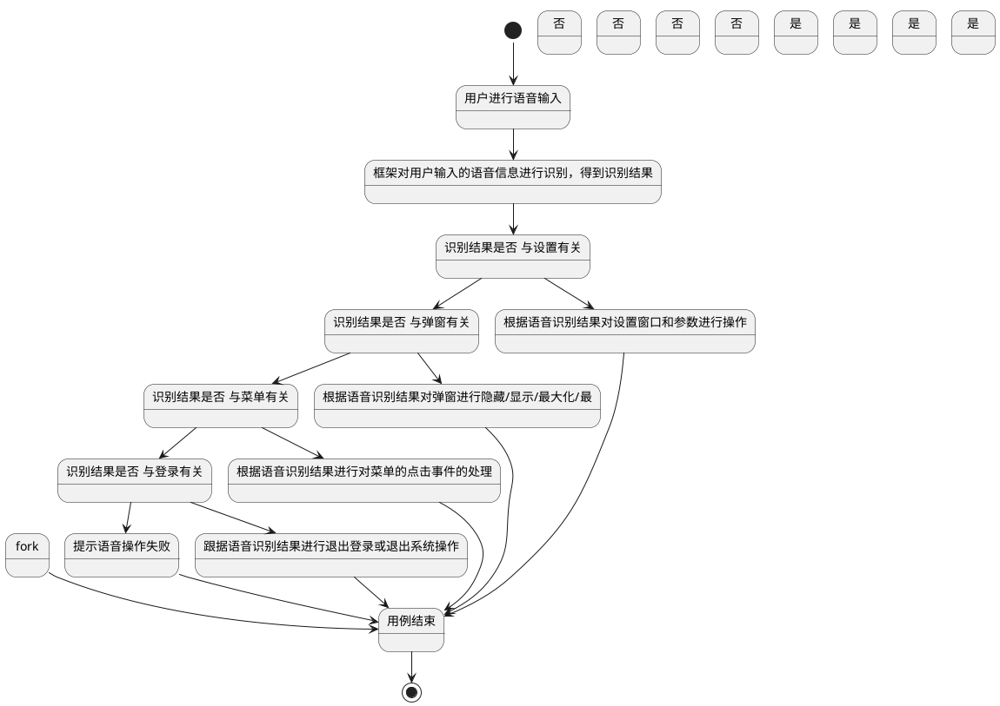
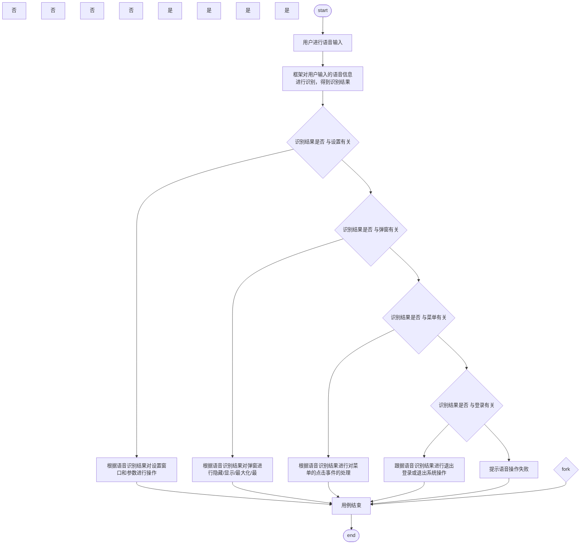
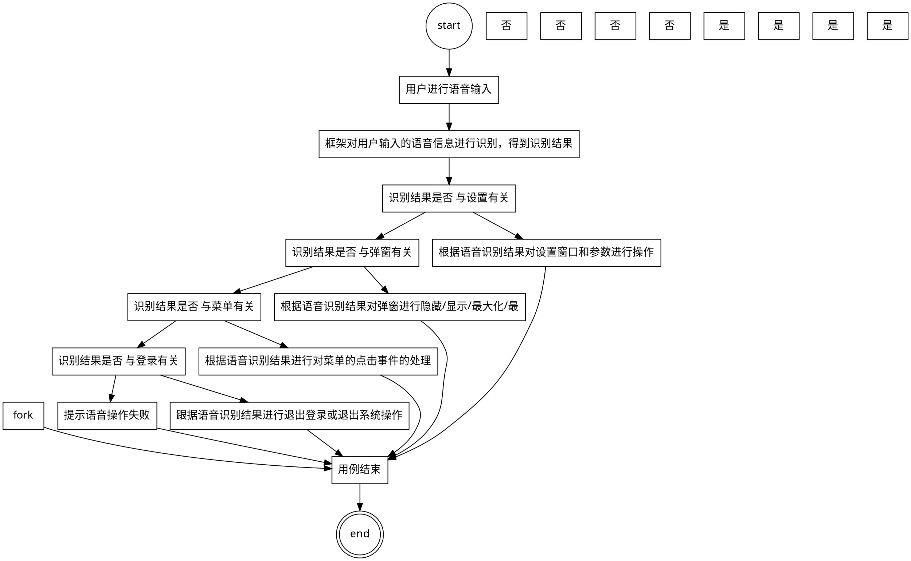

# 2_022 数据对档案

| 字段 | 值 |
|---|---|
| doc | 02界面集成框架软件需求规格说明-终稿 |
| section | 1.8.5.5 |
| image_caption | 图 41语音交互流程图 |
| table_caption | 表48 组件打包发布用例描述 |

## 原始图片

*图 41语音交互流程图*

## 结构图

*来源: born-digital导出(flowchart, 20节点/18边)*
*类型经几何启发式精化(Master类型识别失败的图, 投影层推断, canonical锚点不变)*

*状态图以PlantUML渲染(UML母语): [*]=起止 | 圆角框=状态 | 箭头标签=迁移事件*

Mermaid兼容投影(通用md渲染器可显示)

DOT源码(完整语义, graphviz可渲染)

### 锚点节点结构

| # | 文本 | 类型 |
|---|---|---|
| 1 | 用户进行语音输入 | process |
| 2 | 识别结果是否
与设置有关 | gateway |
| 3 | 框架对用户输入的语音信息进行识别，得到识别结果 | process |
| 4 | 识别结果是否
与弹窗有关 | gateway |
| 5 | 识别结果是否
与菜单有关 | gateway |
| 6 | 识别结果是否
与登录有关 | gateway |
| 7 | 提示语音操作失败 | process |
| 8 | 否 | other |
| 9 | 否 | other |
| 10 | 否 | other |
| 11 | 跟据语音识别结果进行退出登录或退出系统操作 | process |
| 12 | 根据语音识别结果进行对菜单的点击事件的处理 | process |
| 13 | 根据语音识别结果对弹窗进行隐藏/显示/最大化/最 | process |
| 14 | 根据语音识别结果对设置窗口和参数进行操作 | process |
| 15 | 否 | other |
| … | 共23个节点 | |

## 表格内容

| Use Case 名称：语音交互 | Actors：用户 |   |
|---|---|---|
| Use Case 名称：语音交互 | Actors：用户 |   |
| 概述：本用例是语音交互的扩展用例，描述用 |   |   |
| 前置条件：数据库连接正常。 |   |   |
| 主事件流 |   |   |
| Actor的动作 | 系统的动作 | 动作约束 （性能、可靠性、容错等） |
| 1.用户说“打开设置”。 |   |   |
|   | 2.框架打开设置界面。可能会因为语音识别 |   |
| 3.用户说“切换分屏设置为六分屏”。 |   |   |
|   | 4.框架切换分屏为六分屏。 | 若当前分屏状态为六分屏时，提示当前已为六 |
| 5.用户说“切换主题为主题二”。 |   |   |
|   | 6.框架切换主题为主题二。 | 若当前主题为主题二时，提示当前主题已为主 |
| 7．用户说“打开军标面板”。 |   |   |
|   | 8.框架打开军标面板组件。 | 若打开失败则提示军标面板打开失败，请检查 |
| 9.用户说“弹窗最大化”。 |   |   |
|   | 10.框架将当前弹窗最大化。 | 若弹窗未获取焦点，则最大化最近打开的弹窗 |
| 11.用户说“弹窗最小化”。 |   |   |
|   | 12.框架将当前弹窗最小化。 | 若弹窗未获取焦点，则将所有弹窗最小化 |
| 13.用户说“关闭弹窗”。 |   |   |
|   | 14.框架将关闭当前弹窗。 | 若弹窗未获取焦点，则关闭所有弹窗 |
| 15.用户说“查看消息通知”。 |   |   |

## 正文

语音交互提供支持触摸、语音的界面方式。
