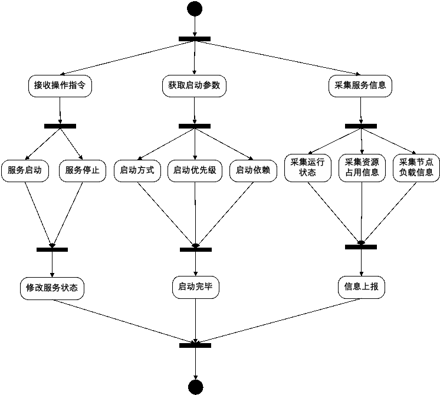
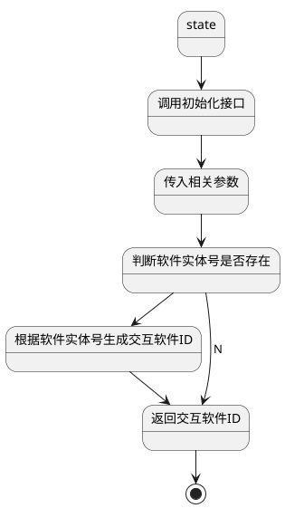
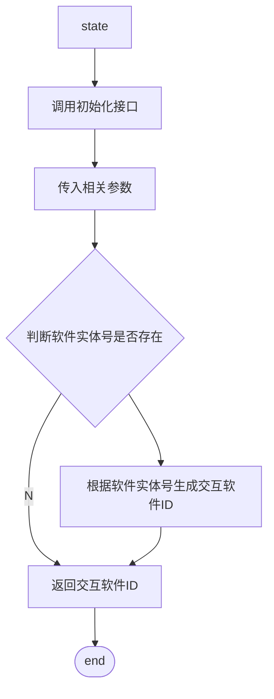

# 2_023 数据对档案

| 字段 | 值 |
|---|---|
| doc | 04数据统一访问服务软件需求规格说明-终稿 |
| section | 3.2.1.1.1.1 |
| image_caption | 图 5数据库初始化流程图 |
| table_caption | 表5 数据库初始化用例描述 |

## 原始图片


*图 5数据库初始化流程图*

## 结构图

*来源: born-digital导出(flowchart, 5节点/7边)*
*类型经几何启发式精化(Master类型识别失败的图, 投影层推断, canonical锚点不变)*

*状态图以PlantUML渲染(UML母语): [*]=起止 | 圆角框=状态 | 箭头标签=迁移事件*



<details><summary>Mermaid兼容投影(通用md渲染器可显示)</summary>



</details>

<details><summary>DOT源码(完整语义, graphviz可渲染)</summary>

```dot
digraph G {
  rankdir=TB;
  node [fontname="Microsoft YaHei"];
  N1 [shape=box, label="调用初始化接口"];
  N2 [shape=box, label="传入相关参数"];
  N3 [shape=box, label="判断软件实体号是否存在"];
  N22 [shape=box, label="根据软件实体号生成交互软件ID"];
  N23 [shape=box, label="返回交互软件ID"];
  N49 [shape=ellipse, label="state"];
  N55 [shape=doublecircle, label="end"];
  N49 -> N1;
  N23 -> N55;
  N1 -> N2;
  N2 -> N3;
  N3 -> N23, label="N";
  N22 -> N23;
  N3 -> N22;
}
```

</details>

*锚点Connect重建存在1个悬空连线端点, 已几何恢复1条边(连线自由端吸附最近语义节点, 每条带距离证据, via=dangling_snap; canonical锚点不变)*

### 锚点节点结构

| # | 文本 | 类型 |
|---|---|---|
| 1 | 调用初始化接口 | process |
| 2 | 传入相关参数 | process |
| 3 | 判断软件实体号是否存在 | gateway |
| 4 | 根据软件实体号生成交互软件ID | process |
| 5 | 返回交互软件ID | process |
| 6 |   | state |
| 7 |   | end |

## 表格内容

| Use Case 名称：数据库初始化 | Actors：应用软件 |   |
|---|---|---|
| Use Case 名称：数据库初始化 | Actors：应用软件 |   |
| 概述：本用例是SQL访问的扩展用例，描述 |   |   |
| 前置条件：无。 |   |   |
| 主事件流 |   |   |
| Actor的动作 | 系统的动作 | 动作约束 （性能、可靠性、容错等） |
| 1.应用软件调用数据库初始化接口输入相关 | 2．与数据统一访问服务服务端进行交互，如 | 如果无法连接到服务端，提示连接错误。 |
| 异常流E1：系统提示初始化失败，用例结束 |   |   |
| 后置条件：无。 |   |   |

## 正文

数据库初始化用例场景，见表5所示。
