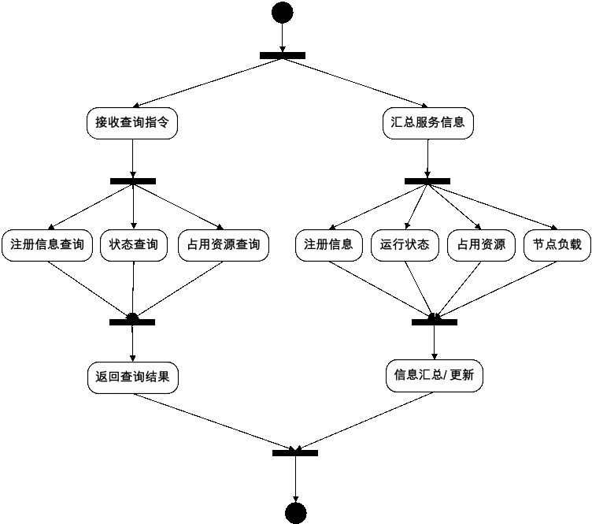
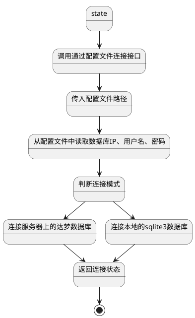
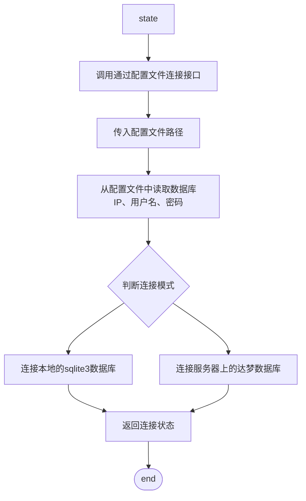
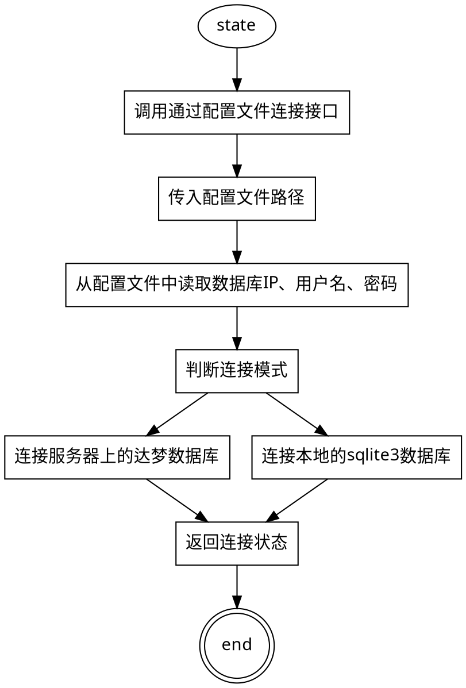

# 2_024 数据对档案

| 字段 | 值 |
|---|---|
| doc | 04数据统一访问服务软件需求规格说明-终稿 |
| section | 3.2.1.1.1.2 |
| image_caption | 图 6读取配置文件连接流程图 |

## 原始图片

*图 6读取配置文件连接流程图*

## 结构图

*来源: born-digital导出(flowchart, 7节点/9边)*
*类型经几何启发式精化(Master类型识别失败的图, 投影层推断, canonical锚点不变)*

*状态图以PlantUML渲染(UML母语): [*]=起止 | 圆角框=状态 | 箭头标签=迁移事件*

Mermaid兼容投影(通用md渲染器可显示)

DOT源码(完整语义, graphviz可渲染)

*锚点Connect重建存在1个悬空连线端点, 已几何恢复1条边(连线自由端吸附最近语义节点, 每条带距离证据, via=dangling_snap; canonical锚点不变)*

### 锚点节点结构

| # | 文本 | 类型 |
|---|---|---|
| 1 | 调用通过配置文件连接接口 | process |
| 2 | 传入配置文件路径 | process |
| 3 | 判断连接模式 | gateway |
| 4 | 连接服务器上的达梦数据库 | process |
| 5 | 连接本地的sqlite3数据库 | process |
| 6 |   | state |
| 7 |   | end |
| 8 | 从配置文件中读取数据库IP、用户名、密码 | process |
| 9 | 返回连接状态 | process |

## 表格内容

| Use Case 名称：读取配置文件连接 | Actors：应用软件 |   |
|---|---|---|
| Use Case 名称：读取配置文件连接 | Actors：应用软件 |   |
| 概述：本用例是SQL访问的扩展用例，描述 |   |   |
| 前置条件：数据库初始化成功。 |   |   |
| 主事件流 |   |   |
| Actor的动作 | 系统的动作 | 动作约束 （性能、可靠性、容错等） |
| 1.应用软件调用读取配置文件连接接口输入 | 2．读取配置文件中的的用户名、密码、IP | 如果无法连接到服务端，提示连接错误。 |
| 异常流E1：系统提示连接失败，用例结束。 |   |   |
| 后置条件：无。 |   |   |

## 正文

读取配置文件连接用例场景，见表6所示。
