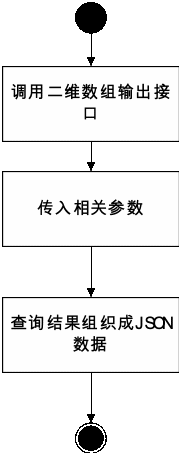
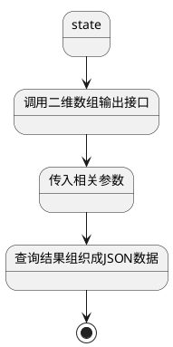
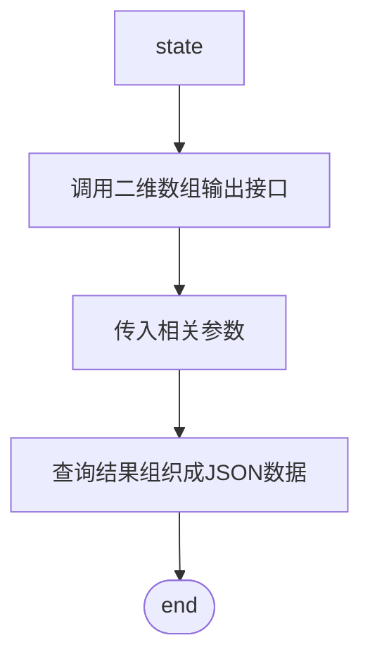
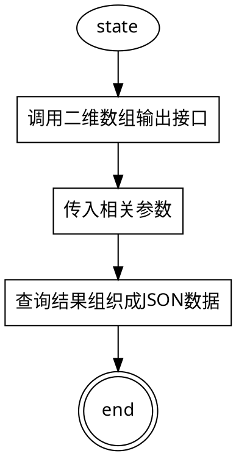

# 2_032 数据对档案

| 字段 | 值 |
|---|---|
| doc | 04数据统一访问服务软件需求规格说明-终稿 |
| section | 3.2.1.3.1.4 |
| image_caption | 图 17 JSON输出流程图 |

## 原始图片

*图 17 JSON输出流程图*

## 结构图

*来源: born-digital导出(flowchart, 3节点/4边)*
*类型经几何启发式精化(Master类型识别失败的图, 投影层推断, canonical锚点不变)*

*状态图以PlantUML渲染(UML母语): [*]=起止 | 圆角框=状态 | 箭头标签=迁移事件*

Mermaid兼容投影(通用md渲染器可显示)

DOT源码(完整语义, graphviz可渲染)

### 锚点节点结构

| # | 文本 | 类型 |
|---|---|---|
| 1 | 调用二维数组输出接口 | process |
| 2 | 传入相关参数 | process |
| 3 | 查询结果组织成JSON数据 | process |
| 4 |   | state |
| 5 |   | end |

## 表格内容

| Use Case 名称：JSON输出 | Actors：应用软件 |   |
|---|---|---|
| Use Case 名称：JSON输出 | Actors：应用软件 |   |
| 概述：本用例是SQL访问的扩展用例，描述 |   |   |
| 前置条件：数据库连接正常。 |   |   |
| 主事件流 |   |   |
| Actor的动作 | 系统的动作 | 动作约束 （性能、可靠性、容错等） |
| 1.应用软件调用通过JSON获取数据的接 | 2．将查询的数据组织成JSON中返回，其 | 如果无法连接到服务端，提示连接错误。 |
| 异常流E1：系统提示获取失败，用例结束。 |   |   |
| 后置条件：无。 |   |   |

## 正文

JSON输出流程图如图 17所示：
