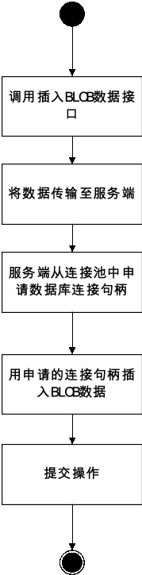
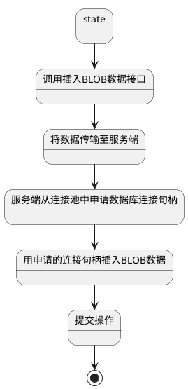
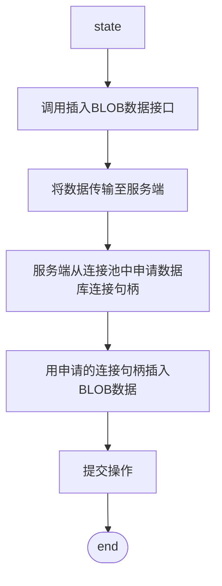
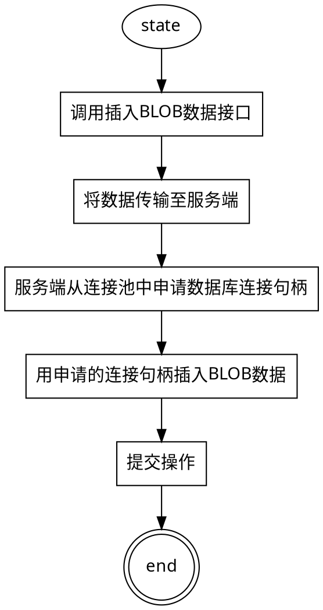

# 2_038 数据对档案

| 字段 | 值 |
|---|---|
| doc | 04数据统一访问服务软件需求规格说明-终稿 |
| section | 3.2.1.4.1.1 |
| image_caption | 图 24 BLOB数据插入流程图 |

## 原始图片

*图 24 BLOB数据插入流程图*

## 结构图

*来源: born-digital导出(flowchart, 5节点/6边)*
*类型经几何启发式精化(Master类型识别失败的图, 投影层推断, canonical锚点不变)*

*状态图以PlantUML渲染(UML母语): [*]=起止 | 圆角框=状态 | 箭头标签=迁移事件*

Mermaid兼容投影(通用md渲染器可显示)

DOT源码(完整语义, graphviz可渲染)

### 锚点节点结构

| # | 文本 | 类型 |
|---|---|---|
| 1 | 调用插入BLOB数据接口 | process |
| 2 | 将数据传输至服务端 | process |
| 3 |   | state |
| 4 |   | end |
| 5 | 服务端从连接池中申请数据库连接句柄 | process |
| 6 | 用申请的连接句柄插入BLOB数据 | process |
| 7 | 提交操作 | process |

## 表格内容

| Use Case 名称：Blob数据插入 | Actors：应用软件、数据库 |   |
|---|---|---|
| Use Case 名称：Blob数据插入 | Actors：应用软件、数据库 |   |
| 概述：本用例是SQL访问的扩展用例，描述 |   |   |
| 前置条件：数据库连接正常。 |   |   |
| 主事件流 |   |   |
| Actor的动作 | 系统的动作 | 动作约束 （性能、可靠性、容错等） |
| 1.应用软件调用数据查询接口输入相关参数 | 2.则将sql语句、blob数据数组组织 | 每个BLOB数据大小应不大于65535字 |
| 异常流E1：系统提示BLOB数据插入失败 |   |   |
| 后置条件：无。 |   |   |

## 正文

BLOB数据插入流程图如图 24所示：
