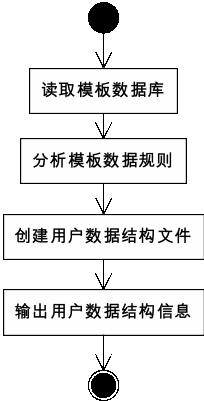
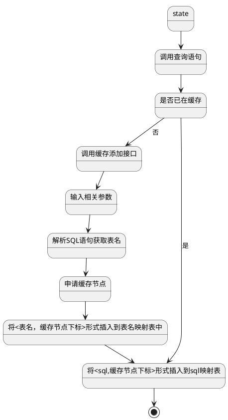
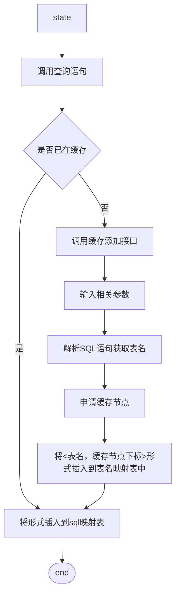

# 2_045 数据对档案

| 字段 | 值 |
|---|---|
| doc | 04数据统一访问服务软件需求规格说明-终稿 |
| section | 3.2.3.1 |
| image_caption | 图 33缓存添加流程图 |

## 原始图片


*图 33缓存添加流程图*

## 结构图

*来源: born-digital导出(flowchart, 8节点/10边)*
*类型经几何启发式精化(Master类型识别失败的图, 投影层推断, canonical锚点不变)*

*状态图以PlantUML渲染(UML母语): [*]=起止 | 圆角框=状态 | 箭头标签=迁移事件*



<details><summary>Mermaid兼容投影(通用md渲染器可显示)</summary>



</details>

<details><summary>DOT源码(完整语义, graphviz可渲染)</summary>

```dot
digraph G {
  rankdir=TB;
  node [fontname="Microsoft YaHei"];
  N465 [shape=box, label="调用查询语句"];
  N466 [shape=box, label="调用缓存添加接口"];
  N467 [shape=box, label="输入相关参数"];
  N463 [shape=ellipse, label="state"];
  N464 [shape=doublecircle, label="end"];
  N468 [shape=box, label="解析SQL语句获取表名"];
  N342 [shape=box, label="是否已在缓存"];
  N469 [shape=box, label="申请缓存节点"];
  N470 [shape=box, label="将<表名，缓存节点下标>形式插入到表名映射表中"];
  N471 [shape=box, label="将<sql,缓存节点下标>形式插入到sql映射表"];
  N342 -> N471, label="是";
  N471 -> N464;
  N342 -> N466, label="否";
  N465 -> N342;
  N463 -> N465;
  N466 -> N467;
  N469 -> N470;
  N468 -> N469;
  N467 -> N468;
  N470 -> N471;
}
```

</details>

### 锚点节点结构

| # | 文本 | 类型 |
|---|---|---|
| 1 | 调用查询语句 | process |
| 2 | 调用缓存添加接口 | process |
| 3 | 输入相关参数 | process |
| 4 |   | state |
| 5 |   | end |
| 6 | 解析SQL语句获取表名 | process |
| 7 | 是否已在缓存 | gateway |
| 8 | 申请缓存节点 | process |
| 9 | 将<表名，缓存节点下标>形式插入到表名映射表中 | process |
| 10 | 将<sql,缓存节点下标>形式插入到sql映射表 | process |

## 表格内容

| Use Case 名称：缓存添加 | Actors：应用软件 |   |
|---|---|---|
| Use Case 名称：缓存添加 | Actors：应用软件 |   |
| 概述：本用例是热点数据缓存的扩展用例，描 |   |   |
| 前置条件：数据库连接正常。 |   |   |
| 主事件流 |   |   |
| Actor的动作 | 系统的动作 | 动作约束 （性能、可靠性、容错等） |
| 1.没有查询到缓存并执行sql查询获取查 | 2．解析sql语句，获取对应的表名，申请 |   |
| 异常流E1：系统提示初始化，用例结束。 |   |   |
| 后置条件：无。 |   |   |

## 正文

缓存添加流程图如图 33所示：
