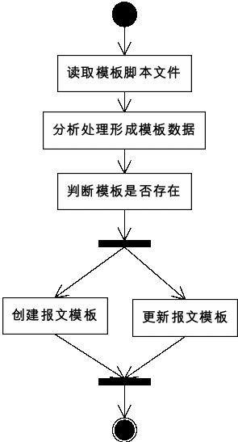
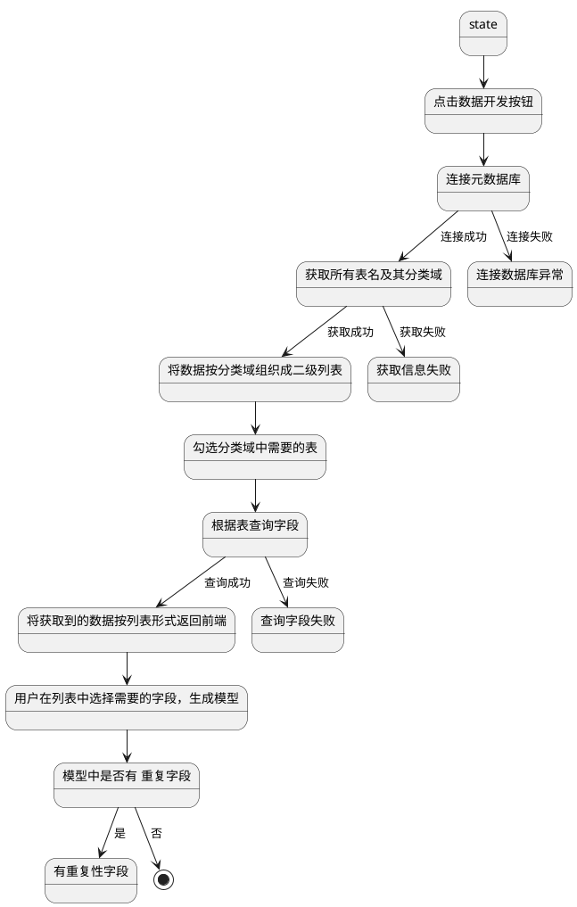
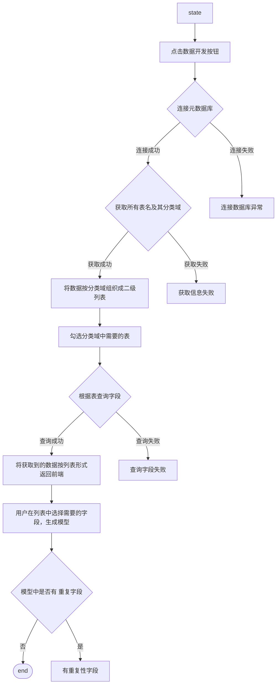

# 2_047 数据对档案

| 字段 | 值 |
|---|---|
| doc | 04数据统一访问服务软件需求规格说明-终稿 |
| section | 3.2.4.1 |
| image_caption | 图 36代码生成流程图 |
| table_caption | 表37 模型制作用例描述 |

## 原始图片


*图 36代码生成流程图*

## 结构图

*来源: born-digital导出(flowchart, 13节点/14边)*
*类型经几何启发式精化(Master类型识别失败的图, 投影层推断, canonical锚点不变)*

*状态图以PlantUML渲染(UML母语): [*]=起止 | 圆角框=状态 | 箭头标签=迁移事件*



<details><summary>Mermaid兼容投影(通用md渲染器可显示)</summary>



</details>

<details><summary>DOT源码(完整语义, graphviz可渲染)</summary>

```dot
digraph G {
  rankdir=TB;
  node [fontname="Microsoft YaHei"];
  N845 [shape=box, label="点击数据开发按钮"];
  N835 [shape=ellipse, label="state"];
  N843 [shape=box, label="勾选分类域中需要的表"];
  N844 [shape=box, label="将数据按分类域组织成二级列表"];
  N840 [shape=box, label="将获取到的数据按列表形式返回前端"];
  N841 [shape=box, label="用户在列表中选择需要的字段，生成模型"];
  N641 [shape=box, label="连接元数据库"];
  N671 [shape=box, label="根据表查询字段"];
  N686 [shape=box, label="获取所有表名及其分类域"];
  N701 [shape=box, label="模型中是否有 重复字段"];
  N836 [shape=doublecircle, label="end"];
  N839 [shape=box, label="获取信息失败"];
  N838 [shape=box, label="查询字段失败"];
  N837 [shape=box, label="有重复性字段"];
  N842 [shape=box, label="连接数据库异常"];
  N686 -> N844, label="获取成功";
  N844 -> N843;
  N843 -> N671;
  N671 -> N840, label="查询成功";
  N840 -> N841;
  N841 -> N701;
  N701 -> N836, label="否";
  N701 -> N837, label="是";
  N671 -> N838, label="查询失败";
  N686 -> N839, label="获取失败";
  N835 -> N845;
  N845 -> N641;
  N641 -> N686, label="连接成功";
  N641 -> N842, label="连接失败";
}
```

</details>

### 锚点节点结构

| # | 文本 | 类型 |
|---|---|---|
| 1 | 点击数据开发按钮 | process |
| 2 |   | state |
| 3 | 勾选分类域中需要的表 | process |
| 4 | 将数据按分类域组织成二级列表 | process |
| 5 | 将获取到的数据按列表形式返回前端 | process |
| 6 | 用户在列表中选择需要的字段，生成模型 | process |
| 7 | 连接元数据库 | gateway |
| 8 | 根据表查询字段 | gateway |
| 9 | 获取所有表名及其分类域 | gateway |
| 10 | 模型中是否有
重复字段 | gateway |
| 11 |   | end |
| 12 | 获取信息失败 | process |
| 13 | 查询字段失败 | process |
| 14 | 有重复性字段 | process |
| 15 | 连接数据库异常 | process |

## 表格内容

| Use Case 名称：模型制作 | Actors：用户 |   |
|---|---|---|
| Use Case 名称：模型制作 | Actors：用户 |   |
| 概述：本用例是代码生成的扩展用例，描述模 |   |   |
| 前置条件：数据库连接正常。 |   |   |
| 主事件流 |   |   |
| Actor的动作 | 系统的动作 | 动作约束 （性能、可靠性、容错等） |
| 1、用户打开集成开发工具，点击数据开发按 | 2、系统连接到元数据库，如果连接失败，执 | 如果无法连接到服务端，提示连接错误。 |
| 异常流E1：系统提示连接数据库异常，用例 |   |   |
| 后置条件：无。 |   |   |

## 正文

模型制作用例场景，见表37所示。
