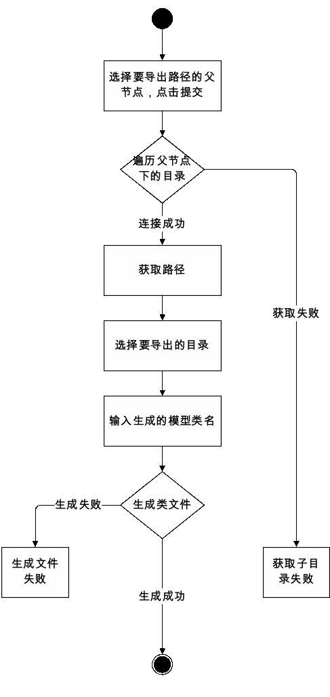
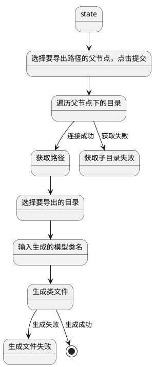
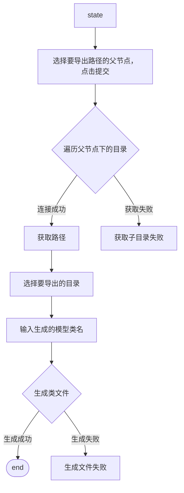

# 2_048 数据对档案

| 字段 | 值 |
|---|---|
| doc | 04数据统一访问服务软件需求规格说明-终稿 |
| section | 3.2.4.2 |
| image_caption | 图 37导出代码流程图 |

## 原始图片


*图 37导出代码流程图*

## 结构图

*来源: born-digital导出(flowchart, 8节点/9边)*
*类型经几何启发式精化(Master类型识别失败的图, 投影层推断, canonical锚点不变)*

*状态图以PlantUML渲染(UML母语): [*]=起止 | 圆角框=状态 | 箭头标签=迁移事件*



<details><summary>Mermaid兼容投影(通用md渲染器可显示)</summary>



</details>

<details><summary>DOT源码(完整语义, graphviz可渲染)</summary>

```dot
digraph G {
  rankdir=TB;
  node [fontname="Microsoft YaHei"];
  N884 [shape=box, label="选择要导出路径的父节点，点击提交"];
  N882 [shape=ellipse, label="state"];
  N887 [shape=box, label="输入生成的模型类名"];
  N885 [shape=box, label="获取路径"];
  N641 [shape=box, label="遍历父节点下的目录"];
  N671 [shape=box, label="生成类文件"];
  N883 [shape=doublecircle, label="end"];
  N888 [shape=box, label="生成文件失败"];
  N889 [shape=box, label="获取子目录失败"];
  N886 [shape=box, label="选择要导出的目录"];
  N886 -> N887;
  N885 -> N886;
  N887 -> N671;
  N671 -> N883, label="生成成功";
  N671 -> N888, label="生成失败";
  N882 -> N884;
  N884 -> N641;
  N641 -> N885, label="连接成功";
  N641 -> N889, label="获取失败";
}
```

</details>

### 锚点节点结构

| # | 文本 | 类型 |
|---|---|---|
| 1 | 选择要导出路径的父节点，点击提交 | process |
| 2 |   | state |
| 3 | 输入生成的模型类名 | process |
| 4 | 获取路径 | process |
| 5 | 遍历父节点下的目录 | gateway |
| 6 | 生成类文件 | gateway |
| 7 |   | end |
| 8 | 生成文件失败 | process |
| 9 | 获取子目录失败 | process |
| 10 | 选择要导出的目录 | process |

## 表格内容

| Use Case 名称：导出代码 | Actors：用户、文件 |   |
|---|---|---|
| Use Case 名称：导出代码 | Actors：用户、文件 |   |
| 概述：本用例是代码生成的扩展用例，描述导 |   |   |
| 前置条件：数据库连接正常。 |   |   |
| 主事件流 |   |   |
| Actor的动作 | 系统的动作 | 动作约束 （性能、可靠性、容错等） |
| 1. 用户点击提交按钮，选择要导出路径的 | 2、系统遍历父节点下的所有目录，如果获取 | 如果无法连接到服务端，提示连接错误。 |
| 异常流E1：系统提示获取子目录失败，用例 |   |   |
| 后置条件：无。 |   |   |

## 正文

导出代码流程图如图 37所示：
