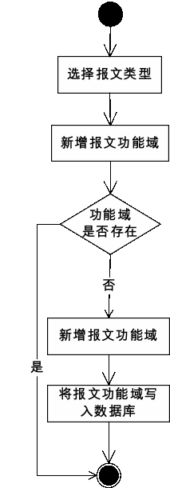
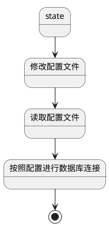
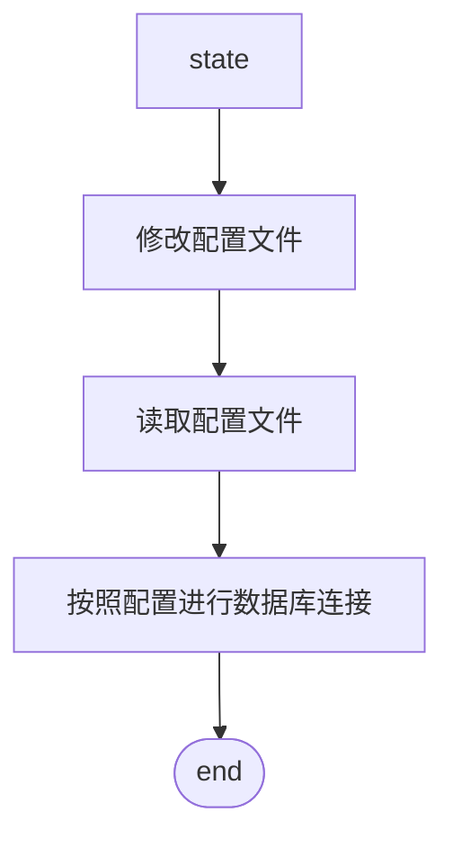
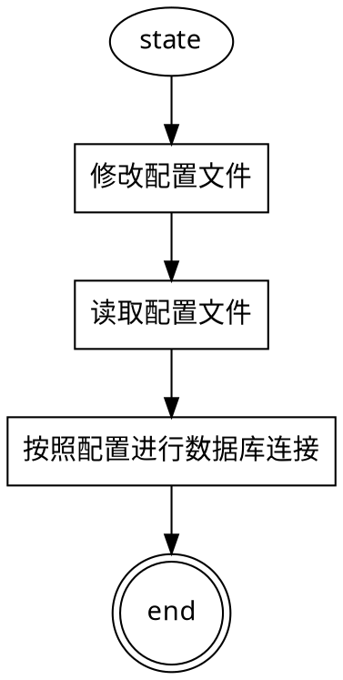

# 2_049 数据对档案

| 字段 | 值 |
|---|---|
| doc | 04数据统一访问服务软件需求规格说明-终稿 |
| section | 3.2.5.1 |
| image_caption | 图 39连接池配置流程图 |
| table_caption | 表40 连接池配置用例描述 |

## 原始图片

*图 39连接池配置流程图*

## 结构图

*来源: born-digital导出(flowchart, 3节点/4边)*
*类型经几何启发式精化(Master类型识别失败的图, 投影层推断, canonical锚点不变)*

*状态图以PlantUML渲染(UML母语): [*]=起止 | 圆角框=状态 | 箭头标签=迁移事件*

Mermaid兼容投影(通用md渲染器可显示)

DOT源码(完整语义, graphviz可渲染)

### 锚点节点结构

| # | 文本 | 类型 |
|---|---|---|
| 1 | 修改配置文件 | process |
| 2 |   | state |
| 3 |   | end |
| 4 | 读取配置文件 | process |
| 5 | 按照配置进行数据库连接 | process |

## 表格内容

| Use Case 名称：连接池配置 | Actors：用户、文件 |   |
|---|---|---|
| Use Case 名称：连接池配置 | Actors：用户、文件 |   |
| 概述：本用例是连接池管理的扩展用例，描述 |   |   |
| 前置条件：数据库连接正常。 |   |   |
| 主事件流 |   |   |
| Actor的动作 | 系统的动作 | 动作约束 （性能、可靠性、容错等） |
| 1.修改配置文件中的数据库IP、数据库密 | 2．读取配置文件中的数据库IP、数据库密 | 如果无法连接到服务端，提示连接错误。 |
| 异常流E1：系统提示初始化，用例结束。 |   |   |
| 后置条件：无。 |   |   |

## 正文

连接池配置用例场景，见表40所示。
