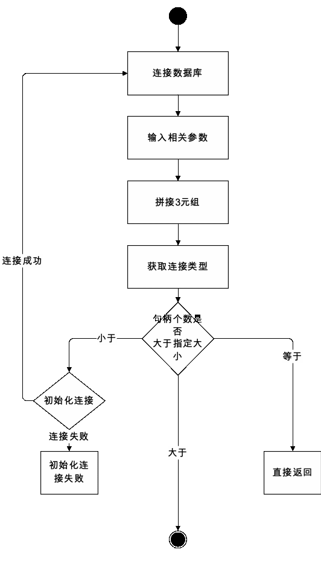
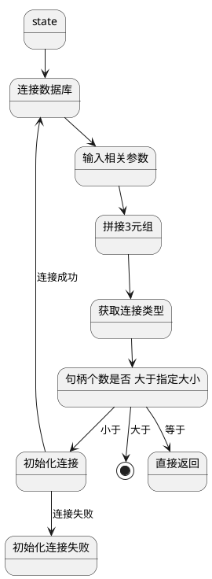
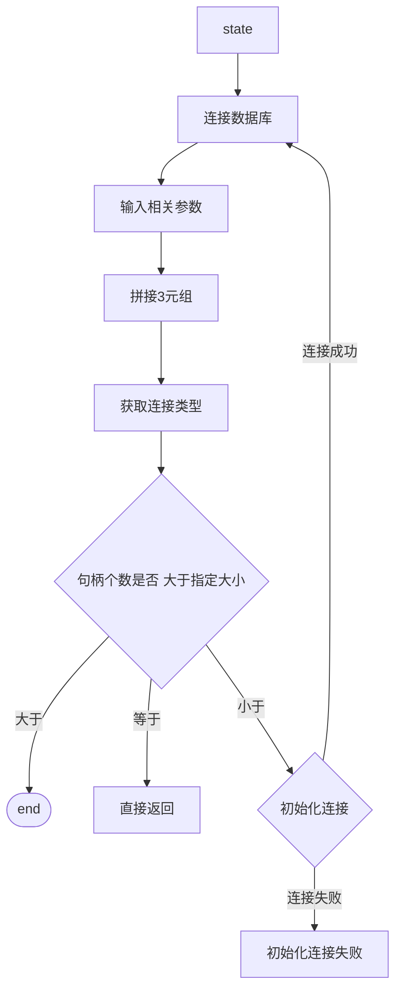

# 2_050 数据对档案

| 字段 | 值 |
|---|---|
| doc | 04数据统一访问服务软件需求规格说明-终稿 |
| section | 3.2.5.2 |
| image_caption | 图 40连接池初始化流程图 |
| table_caption | 表41 连接池初始化用例描述 |

## 原始图片


*图 40连接池初始化流程图*

## 结构图

*来源: born-digital导出(flowchart, 8节点/10边)*
*类型经几何启发式精化(Master类型识别失败的图, 投影层推断, canonical锚点不变)*

*状态图以PlantUML渲染(UML母语): [*]=起止 | 圆角框=状态 | 箭头标签=迁移事件*



<details><summary>Mermaid兼容投影(通用md渲染器可显示)</summary>



</details>

<details><summary>DOT源码(完整语义, graphviz可渲染)</summary>

```dot
digraph G {
  rankdir=TB;
  node [fontname="Microsoft YaHei"];
  N916 [shape=box, label="连接数据库"];
  N914 [shape=ellipse, label="state"];
  N919 [shape=box, label="获取连接类型"];
  N917 [shape=box, label="输入相关参数"];
  N671 [shape=box, label="句柄个数是否 大于指定大小"];
  N915 [shape=doublecircle, label="end"];
  N920 [shape=box, label="初始化连接失败"];
  N921 [shape=box, label="直接返回"];
  N918 [shape=box, label="拼接3元组"];
  N896 [shape=box, label="初始化连接"];
  N896 -> N916, label="连接成功";
  N896 -> N920, label="连接失败";
  N918 -> N919;
  N917 -> N918;
  N919 -> N671;
  N671 -> N915, label="大于";
  N914 -> N916;
  N916 -> N917;
  N671 -> N921, label="等于";
  N671 -> N896, label="小于";
}
```

</details>

### 锚点节点结构

| # | 文本 | 类型 |
|---|---|---|
| 1 | 连接数据库 | process |
| 2 |   | state |
| 3 | 获取连接类型 | process |
| 4 | 输入相关参数 | process |
| 5 | 句柄个数是否
大于指定大小 | gateway |
| 6 |   | end |
| 7 | 初始化连接失败 | process |
| 8 | 直接返回 | process |
| 9 | 拼接3元组 | process |
| 10 | 初始化连接 | gateway |

## 表格内容

| Use Case 名称：连接池初始化 | Actors：应用软件 |   |
|---|---|---|
| Use Case 名称：连接池初始化 | Actors：应用软件 |   |
| 概述：本用例是连接池管理的扩展用例，描述 |   |   |
| 前置条件：数据库连接正常。 |   |   |
| 主事件流 |   |   |
| Actor的动作 | 系统的动作 | 动作约束 （性能、可靠性、容错等） |
| 1.服务端连接数据库时，调用连接池初始化 | 2．拼接3元组，根据3元组获取连接类型， | 如果无法连接到服务端，提示连接错误。 |
| 异常流E1：系统提示初始化，用例结束。 |   |   |
| 后置条件：无。 |   |   |

## 正文

连接池初始化用例场景，见表41所示。
