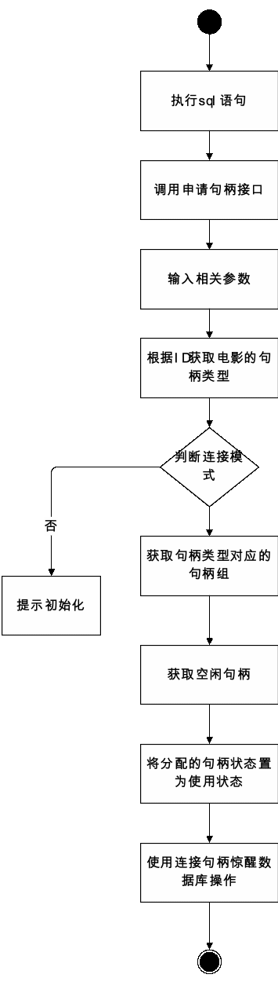
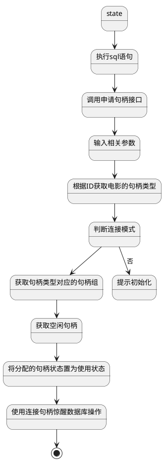
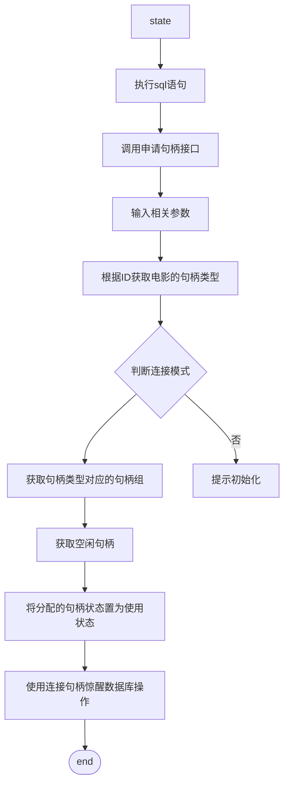

# 2_052 数据对档案

| 字段 | 值 |
|---|---|
| doc | 04数据统一访问服务软件需求规格说明-终稿 |
| section | 3.2.5.4 |
| image_caption | 图 42申请句柄流程图 |

## 原始图片


*图 42申请句柄流程图*

## 结构图

*来源: born-digital导出(flowchart, 10节点/11边)*
*类型经几何启发式精化(Master类型识别失败的图, 投影层推断, canonical锚点不变)*

*状态图以PlantUML渲染(UML母语): [*]=起止 | 圆角框=状态 | 箭头标签=迁移事件*



<details><summary>Mermaid兼容投影(通用md渲染器可显示)</summary>



</details>

<details><summary>DOT源码(完整语义, graphviz可渲染)</summary>

```dot
digraph G {
  rankdir=TB;
  node [fontname="Microsoft YaHei"];
  N1107 [shape=box, label="执行sql语句"];
  N1102 [shape=ellipse, label="state"];
  N1109 [shape=box, label="获取空闲句柄"];
  N1103 [shape=doublecircle, label="end"];
  N1108 [shape=box, label="获取句柄类型对应的句柄组"];
  N1111 [shape=box, label="将分配的句柄状态置为使用状态"];
  N956 [shape=box, label="判断连接模式"];
  N1104 [shape=box, label="根据ID获取电影的句柄类型"];
  N1105 [shape=box, label="输入相关参数"];
  N1106 [shape=box, label="调用申请句柄接口"];
  N1110 [shape=box, label="提示初始化"];
  N1112 [shape=box, label="使用连接句柄惊醒数据库操作"];
  N1112 -> N1103;
  N956 -> N1110, label="否";
  N1102 -> N1107;
  N1108 -> N1109;
  N956 -> N1108;
  N1104 -> N956;
  N1105 -> N1104;
  N1106 -> N1105;
  N1111 -> N1112;
  N1107 -> N1106;
  N1109 -> N1111;
}
```

</details>

### 锚点节点结构

| # | 文本 | 类型 |
|---|---|---|
| 1 | 执行sql语句 | process |
| 2 |   | state |
| 3 | 获取空闲句柄 | process |
| 4 |   | end |
| 5 | 获取句柄类型对应的句柄组 | process |
| 6 | 将分配的句柄状态置为使用状态 | process |
| 7 | 判断连接模式 | gateway |
| 8 | 根据ID获取电影的句柄类型 | process |
| 9 | 输入相关参数 | process |
| 10 | 调用申请句柄接口 | process |
| 11 | 提示初始化 | process |
| 12 | 使用连接句柄惊醒数据库操作 | process |

## 表格内容

| Use Case 名称：申请句柄 | Actors：应用软件 |   |
|---|---|---|
| Use Case 名称：申请句柄 | Actors：应用软件 |   |
| 概述：本用例是热点数据缓存的扩展用例，描 |   |   |
| 前置条件：数据库连接正常。 |   |   |
| 主事件流 |   |   |
| Actor的动作 | 系统的动作 | 动作约束 （性能、可靠性、容错等） |
| 1.执行sql语句时，调用申请句柄接口并 | 2．根据ID获取对应的句柄类型，如果句柄 | 如果无法连接到服务端，提示连接错误。 |
| 异常流E1：系统提示初始化，用例结束。 |   |   |
| 后置条件：无。 |   |   |

## 正文

申请句柄流程图如图 42所示：
